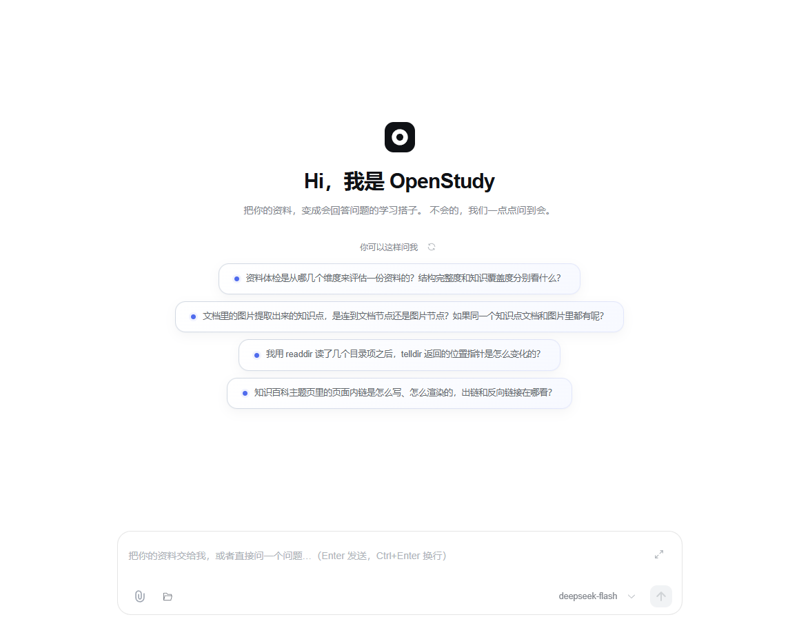
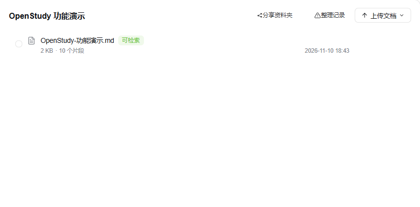
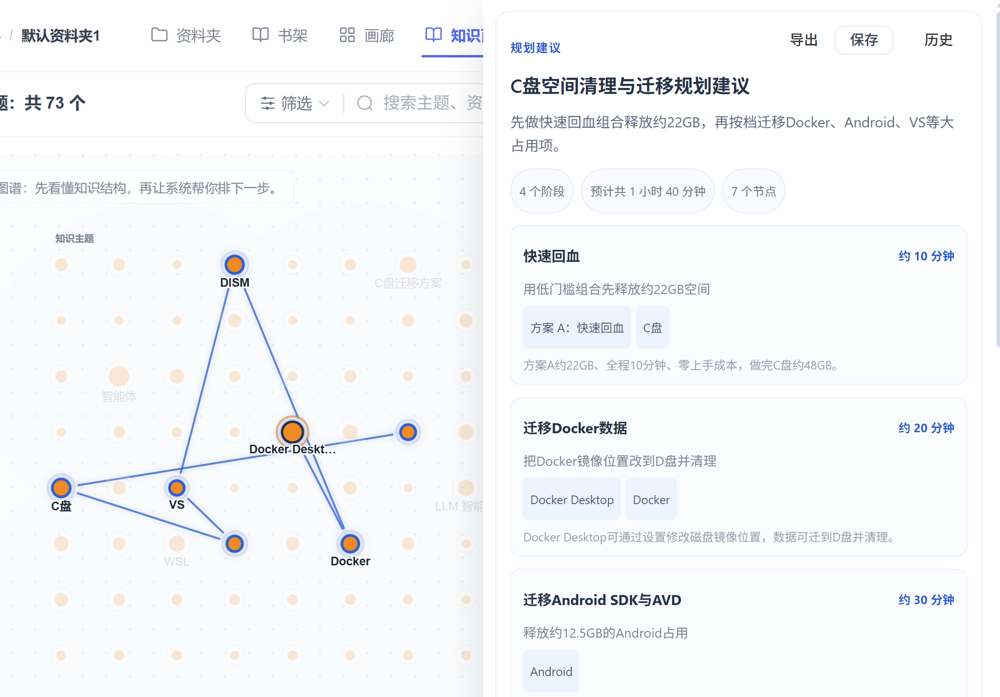
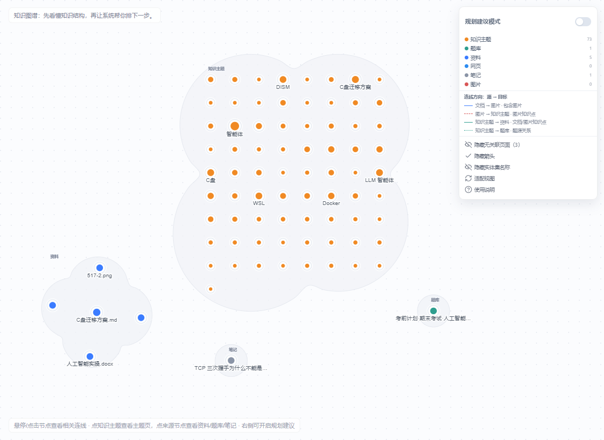

# OpenStudy · 把信息来源，编译成可用的知识资产

> 面向用户的信息来源处理系统：把网页、文档、图片、学习报告、比赛通知和事件记录，整理成可检查、可追溯、可继续使用、能被智能体调用的个人知识资产。

<p align="center">
  
</p>

<p align="center">
  <b>对话即入口</b> · <b>资料是资产</b> · <b>结果可追溯</b>
  <br><br>
  
  
  
  
  
</p>

---

## 这是什么

OpenStudy 不是普通的文件管理器，也不是一个只会聊天的问答框。

它把用户日常接触到的信息来源，串成一条真实的处理链路：

```text
网页 / 文档 / 图片 / 学习报告 / 比赛通知 / 事件记录
        │
        ▼
我的资料（资料夹、文档、图片资产）
        │
        ▼
解析 / 分块 / 章节识别 / 图片归属 / 向量索引
        │
        ▼
资料体检 → 智能报告 → 知识百科 → 实体关系图谱 → 规划建议
        │
        ▼
智能体通过工具继续检索、整理、出题、建库、写笔记、导出
```

OpenStudy 助手固定在侧边栏左上角品牌行，点击后打开右侧抽屉；没有悬浮球，也不会遮挡页面内容。用户可以直接在页面操作，也可以让智能体代为执行。

## 核心能力

### 01 · 智能对话与工具编排

- 对话入口与全站数据打通，不是孤立聊天窗口；
- 支持资料检索、题库与笔记管理、知识百科、图谱读取、网页搜索与导入、画廊取图等 29 个工具；
- 写操作先展示确认卡，支持操作记录与回滚；
- 回答保留真实来源，不把模型生成内容伪装成检索结果；
- 网页搜索返回真实标题、站点、日期和可点击链接。

### 02 · 我的资料：统一收纳与资产化

- 支持 Word / PDF / Markdown / TXT / 图片，以及网页导入；
- 文档解析保留章节、公式、表格和图片位置；
- 图片进入画廊资产，文档内图片用于提取图片级知识点，独立图片才作为图片实体节点；
- 资料夹支持新建、重命名、分享、屏蔽检索、删除；
- 文档支持版本记录、原文阅读、资料体检与智能整理；
- 题库和笔记可以通过逻辑关联进入同一资料夹，不复制原始内容。

<p align="center">
  
</p>

### 03 · 资料诊疗室：从体检到智能报告

- 四维体检：结构完整度、图文相关度、知识覆盖度、可学习化程度；
- 问题清单按优先级展示，每条都能回到原文证据；
- 章节覆盖热力图，快速定位内容过薄或缺少练习的章节；
- 智能报告给出更新目标、优势、改进项、下一步和风险；
- 整理手术台支持逐项接受/拒绝、版本对照和回滚；
- 原文阅读支持目录、搜索、选中原文提问、出题、引用到笔记。

> 资料诊疗室面向“用户的信息来源”，不强制排任务、不打卡、不要求跳转刷题。

### 04 · 知识百科：可读、可编辑、可追溯

- 将实体与关系整理成主题页：定义、核心要点、知识结构、易混淆和来源；
- 正文支持 `[[page:id|锚文本]]` 页面内链，显示出链和反向链接；
- 主题页支持手动编辑、历史版本与恢复；
- 构建按来源增量更新：文档、网页、图片、题库、笔记变化时只处理相关来源；
- 文档小节可以回到原始 chunk，知识百科回答保留来源；
- 知识百科与知识图谱是同一入口下的双视图，不再有孤立入口。

### 05 · 统一知识图谱：六类实体在一张图里

知识图谱把以下实体放在同一张图：

| 实体集 | 代表什么 |
|---|---|
| 知识主题 | 知识百科主题页 |
| 题库 | 用户题库，可按题源关系关联主题 |
| 资料 | 文档、网页、笔记等来源 |
| 网页 | 从网页导入的资料 |
| 笔记 | 用户笔记与资料夹关联笔记 |
| 图片 | 独立图片资产 |

关键规则：

- 文档内图片只进入画廊和知识点抽取，不单独作为图片节点；
- 独立图片才作为图片实体节点，并优先显示 LLM 生成的短名称；
- 图片详情保留完整描述，列表优先显示短名称；
- 节点间只画真实关系，不伪造连接；
- 首屏默认不渲染关系线，悬停或选中节点时才显示相邻关系，避免大资料夹卡顿；
- 图谱布局按容器尺寸动态计算，实体集之间保留硬间隔。

### 06 · 规划建议：从图谱关系出发

- 从主题、题库、资料、网页、笔记或图片节点选中起点；
- 系统先读取真实图谱关系，形成事实路径，再由模型解释建议；
- 规划建议可以反复调整、保存、查看历史、导出；
- 它是建议，不是任务清单：不强制打卡、不强制跳转、不把用户变成任务执行器。

<p align="center">
  
</p>

### 07 · 题库、练习、笔记与统计

- 题库支持手动创建、导入、AI 出题、分享、导出；
- 练习支持顺序、随机、错题和模拟考试；
- 题目可以保存原文依据，错题、收藏、斩题、笔记与统计形成闭环；
- 笔记支持富文本、题库关联、资料夹关联和知识图谱来源同步；
- 学习统计展示正确率、趋势、错因和薄弱点，为规划建议提供事实依据。

## 核心界面

### 知识图谱



### 资料空间


### 智能对话


## 技术栈

| 层 | 技术 |
|---|---|
| 前端 | Vue 3.4 · TypeScript · Vite · Element Plus · Pinia |
| 后端 | Python 3.11 · FastAPI · SQLAlchemy 2.0（异步）· asyncpg |
| 数据库 | PostgreSQL 16 + pgvector + pg_trgm |
| 缓存 | Redis 7 |
| AI | DeepSeek / 智谱 / 硅基流动多模型路由；本地 bge-m3 向量化 |
| 检索 | 向量检索 + 关键词检索 + RRF 融合 |
| 部署 | Docker Compose（PostgreSQL + Redis + FastAPI + Nginx） |

### 设计取舍

- **Agent 循环自己写**：路由优先使用规则，少一次模型调用就少一份不确定性；
- **检索用 RRF**：不拍脑袋定“向量分 0.8、关键词分 0.6”的权重；
- **来源优先**：主题页小节、题目依据和对话引用都回到真实数据；
- **建议不强迫**：规划建议输出判断和方向，不输出打卡任务。

## 快速开始

### Docker 部署

```bash
git clone https://gitee.com/wufeng1234567/openstudy-fastapi-ts.git
cd openstudy-fastapi-ts
docker compose up -d --build
```

浏览器打开 `http://localhost:3167`。

### 本地开发

```powershell
# 后端
cd openstudy-fastapi
.\.venv\Scripts\python.exe -m uvicorn app.main:app --host 0.0.0.0 --port 9101 --reload

# 前端
cd ..\openstudy-vue3-ts
npm run dev
```

### AI Key（可选）

复制 `openstudy-fastapi/.env.example` 为 `.env`，按需配置：

```dotenv
DEEPSEEK_API_KEY=      # 对话模型 / 网页搜索
SILICONFLOW_API_KEY=   # 云端向量化
ZHIPU_API_KEY=         # 备用模型
```

不配 Key 也可以使用资料管理、题库、笔记、统计等非 AI 功能。

## 项目结构

```text
openstudy-fastapi-ts/
├── openstudy-fastapi/          # FastAPI 后端
│   ├── app/
│   │   ├── api/v1/             # 路由层
│   │   ├── models/             # ORM 模型
│   │   ├── repositories/       # 数据访问
│   │   └── services/
│   │       ├── ai/             # Agent / 模型 / 工具 / 记忆
│   │       └── rag/            # 解析 / 分块 / 检索 / 知识百科 / 图谱
│   └── tests/
├── openstudy-vue3-ts/          # Vue 3 + TypeScript 前端
│   └── src/
├── doc/                        # 文档索引、架构、质量证据、方案与部署
├── deploy/db-init/             # 数据库初始化 SQL
└── docker-compose.yml
```

## 文档

| 文档 | 内容 |
|---|---|
| [CHANGELOG.md](CHANGELOG.md) | 版本记录与历史发布说明 |
| [文档总索引](doc/README.md) | 按“想确认什么”组织的全部文档入口 |
| [ARCHITECTURE.md](ARCHITECTURE.md) | 一页架构、分层边界、主链路与已知债务 |
| [OpenStudy 系统完整介绍](doc/功能迭代与代码质量/OpenStudy-系统完整介绍与功能架构梳理.md) | 产品定位、功能全景、边界与成熟度 |
| [知识图谱图片-文档-知识点关系方案](doc/planning/知识图谱图片-文档-知识点关系方案.md) | 图片、文档、知识点与图谱关系 |
| [知识图谱图片-文档-知识点关系实施记录](doc/planning/知识图谱图片-文档-知识点关系-实施记录.md) | 实施细节、验证指标与截图 |
| [知航活计划实施记录](doc/planning/知航活计划-统一学习闭环-实施记录.md) | 规划建议与学习计划统一闭环 |
| [部署说明](doc/deploy/SKILL.md) | Docker / Linux / Windows / 公网访问 |
| [常见问题](doc/deploy/TROUBLESHOOTING.md) | 部署排查 |
| [质量证据索引](doc/功能迭代与代码质量/README.md) | 质量文档、死代码、测试与复跑命令 |
| [质量验收报告](doc/功能迭代与代码质量/quality-report.md) | 可复核的 pytest/ruff/lint/build/type-check 结果与债务边界 |
| [技术实现质量 P0–P2 方案](doc/功能迭代与代码质量/OpenStudy-技术实现质量20%-P0-P2执行方案.md) | 比赛 20% 评分对应的整改路线与完整工程结构 |

## 质量与工程证据

> 复核日期：2026-11-12。只报真实结果；type-check 的存量错误不伪装成绿门禁。

```powershell
# 后端（openstudy-fastapi）
.\.venv\Scripts\python.exe -m pytest tests -q
.\.venv\Scripts\python.exe -m ruff check app --select E9,F63,F7,F82

# 前端（openstudy-vue3-ts）
npm run lint
npm run build:prod
npm run type-check   # 报告型：当前 1,808 条存量 error TS，exit 2
```

当前结果：后端 pytest exit 0（collect 109 tests）、ruff 语法门禁 All checks passed；前端 build exit 0、lint 0 errors/3,506 warnings；type-check 仍有 1,808 条存量错误，属于公开债务。详细证据见 [quality-report.md](doc/功能迭代与代码质量/quality-report.md)。

## 当前边界

- 扫描版 PDF 的文字层仍需要 OCR 能力补齐；
- 图片暂不参与向量检索，不能以图搜图；
- 图谱目前面向中等规模资料夹，超大知识库需要进一步物化图和分页；
- 资料体检的四维规则偏学习材料，通知、事件、报告类资料需要更细的模板；
- 规划建议依赖真实图谱关系，题源锚点和笔记来源仍需持续补充。

## License

[MIT](LICENSE)
