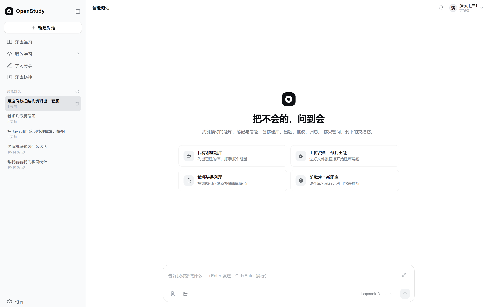
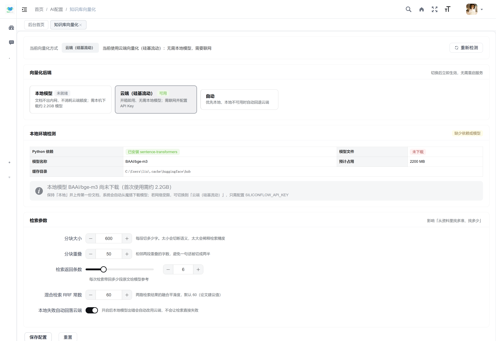
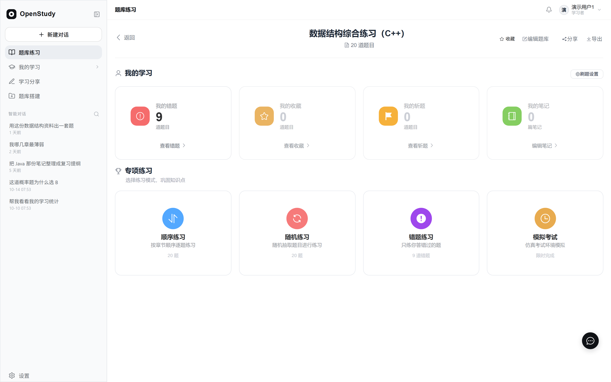
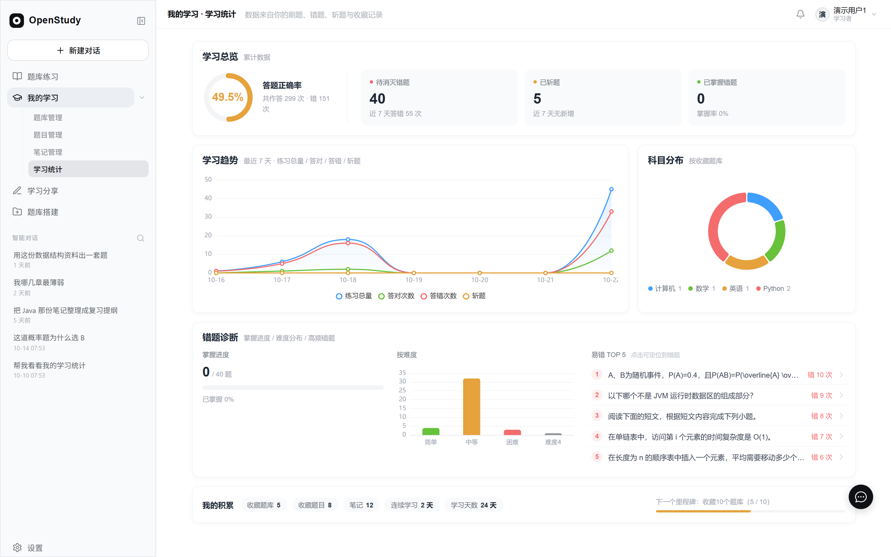
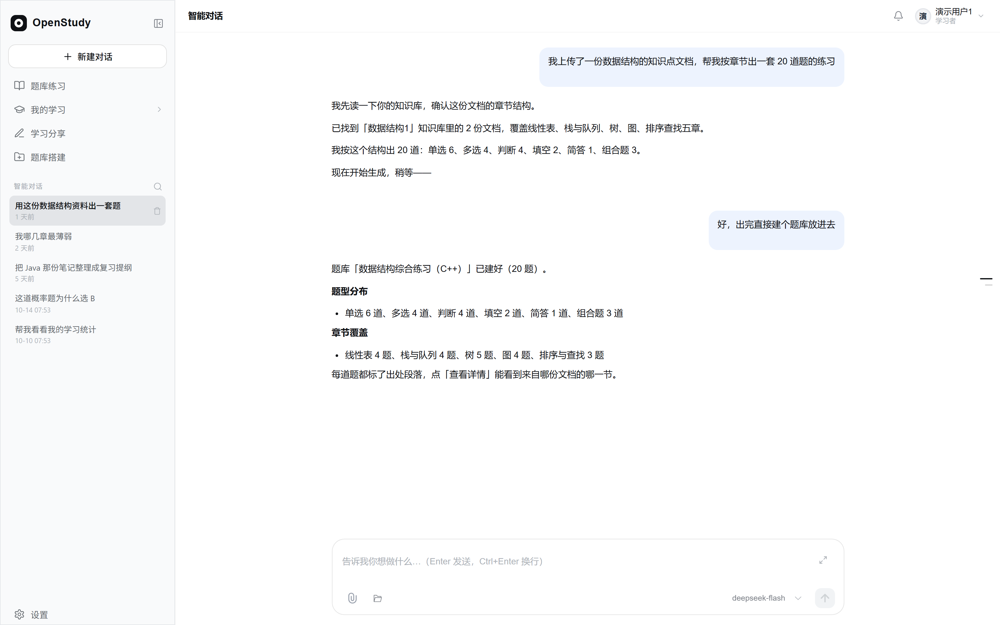

# OpenStudy · 把不会的，问到会

> 上传一份 Word / PDF / Markdown，它自己读、自己出题、自己组卷，你直接开刷。

<p align="center">
  
</p>

<p align="center">
  <b>对话即入口</b> · <b>资料即题库</b> · <b>练习即诊断</b>
  <br><br>
  
  
  
  
  
</p>

---

## 这是什么

**学生不缺题刷，缺的是「把资料变成题」这几步。**

老师的课件、历年真题、教材，大多是 Word / PDF / 扫描件。想变成能刷的题，得手动录入——
20 道题大约一小时，公式和图还会丢。刷完之后，错题散落在各处，没人告诉你下一步该练什么。

OpenStudy 把这条链路做通了：

```
上传资料  →  自动解析  →  导入系统  →  直接开刷
Word/PDF/MD    拆段落·认公式·抠图片    变成题库·标注出处    顺序/随机/错题/模拟考
```

**它不是一个聊天框。** 对话里的每个动作都调用真实工具、写真实数据表——
你说"用这份资料建个题库，出 10 道题"，它真的会建出来，你能点进去刷。

> 📖 四步各自做了什么、代码在哪 → **[doc/CORE-FLOW.md](doc/CORE-FLOW.md)**

### 从 Spring Boot 到 FastAPI

这个项目**最初是 Spring Boot 3 + Vue 3 实现的**（[Java 版仓库](https://github.com/wufeng1234567/open-study-backend)），
跑通之后重构到了 FastAPI。换技术栈不是赶潮流，是两个具体问题：

| 问题 | Spring Boot 版 | 重构后 |
|---|---|---|
| **流式输出** | SSE 要走 WebFlux，同步栈里接 Agent 的逐字流很别扭 | FastAPI 原生 `StreamingResponse`，纯 ASGI 透传即可逐字下发 |
| **AI 生态** | LangChain / sentence-transformers / bge-m3 的主力都在 Python | 直接 `pip install`，本地向量化同进程加载，不用再起一个 Python 服务 |

Java 那套的多模块分层（admin / common / framework / quartz / system）保留了思路，
Python 版按 `api / models / repositories / services` 重新组织，业务规则逐条对齐。

---

## 核心功能：一条从资料到成绩的闭环

### ① 上传资料 → 自动解析

支持 **Word（.doc / .docx）、PDF、Markdown、TXT**。

不只是抽文字。解析器会：

- **拆结构**：按标题/段落分块，保留章节层级
- **认公式**：Word 原生公式（OMML）和 LaTeX 都能识别，前端用 KaTeX 渲染
- **抠图片**：Word 内嵌图、PDF 里的图，按位置归属到对应段落，正文里留 `【图N】` 标记
- **转格式**：老版 `.doc` 自动调 Word 转 `.docx`，扩展名骗人的文件也能识别（改名的 docx/pdf 会被看穿）

> 传统方案在这一步就断了：扫描件抽不出正文、图片和文字对不上、公式变成乱码。
> 我们做的是**图文一起进**，所以后面出的题才带图、带公式。

### ② 导入系统 → 变成能检索的知识

解析完的文档进知识库，走完整流水线：

| 环节 | 做了什么 |
|---|---|
| 分块 | jieba 中文分词，按语义切，不是硬切字数 |
| 向量化 | bge-m3 模型，1024 维，存进 pgvector |
| 索引 | 两套索引并行：HNSW 向量索引 + GIN 全文索引 |
| 检索 | 两种方式同时找，再按排名合并（RRF），不拍脑袋定权重 |

**这套东西的价值是：AI 出题时能找到原文，并在每道题后面标注「出自哪一段」。**
不是凭空编题。

#### RAG 跑在哪：本地优先，云端可选

向量化（把文字变成可检索的数字）有两条路，**默认走本地**：

| 方式 | 说明 | 适用场景 |
|---|---|---|
| **本地（默认）** | 本机加载 `BAAI/bge-m3` 模型，文档**不出内网**、不消耗云端额度 | 有 GPU/大内存的服务器、注重数据隐私 |
| **云端（硅基流动）** | 调云端 embeddings 接口，**无需下载 2.2GB 模型** | 轻量服务器、本地装不下模型 |
| 自动 | 优先本地，本地不可用时自动回退云端 | 不想操心的默认选项 |

> **本项目实际部署采用本地向量化**——`openstudy-fastapi` 同机加载 bge-m3，
> 文档切片、向量、检索全部在本地 PostgreSQL + pgvector 内完成，不经过第三方。

后台「系统管理 → 知识库向量化」可视化配置：

<p align="center">
  
</p>

- **自动检测环境**：进了页面先告诉你「本地模型装了没、云端 Key 配了没」
- **没装本地模型会引导**：直接给出两种可选方案（装本地 / 切云端），不会让你卡在报错里
- **检索参数可调**：分块大小、重叠、返回条数、RRF 常数，改完即时生效、不用重启
- **换模型会提醒重建索引**：新旧向量不在同一空间，混用会让检索失真

### ③ 出题 → 变成你的题库

三种方式：

- **一句话出题**：「用这份资料出 10 道单选题，覆盖前三章」
- **按知识点出题**：指定知识点和数量，AI 从知识库里取材
- **整份文档直接入库**：上传即建库

出的题可以带图、带公式、带解析，题型覆盖单选/多选/判断/填空/简答，还能生成组合题（材料 + 若干小题）。

### ④ 开刷 → 练习与诊断

<p align="center">
  
</p>

| 模式 | 说明 |
|---|---|
| 顺序练习 | 按章节顺序逐题练 |
| 随机练习 | 随机抽题，一次抽定不刷新 |
| 错题练习 | 只练答错过的题 |
| 模拟考试 | 自定义组卷、限时、交卷判分、历史回看 |

刷完还有：**错题本、收藏、斩题、笔记（草稿自动保存）、学习统计（正确率/趋势/薄弱点 TOP5）。**

<p align="center">
  
</p>

---

## AI 智能体：会办事，不只是会聊

<p align="center">
  
</p>

- **多专家并行**：一句话要干两件事，两个专家同时开工；只有一件事就不打扰你
- **写操作先确认**：改数据之前弹确认卡，看清楚再点
- **改错能撤回**：题库、题目、分享、智能体四个域支持整树快照恢复；回退不了的会明确告诉你
- **跨会话记忆**：记住你做过的操作，下次接着聊
- **14 个工具**：题库管理、题目管理、笔记、知识库、检索、学情统计、记忆、导出…

---

## 快速开始

### 方式一：本地部署（Docker，推荐自建）

```bash
# GitHub
git clone https://github.com/wufeng1234567/openstudy-fastapi-ts.git

# GitCode（国内访问更快）
git clone https://gitcode.com/qi142410131/openstudy-fastapi-ts.git

cd openstudy-fastapi-ts
docker compose up -d --build
```

浏览器打开 **http://localhost:3167**。

**本地部署的演示账号**（数据库首次启动自动创建）：

| 账号 | 密码 | 说明 |
|---|---|---|
| `admin` | `123456` | 管理员，可进后台 |
| `user1` | `123456` | 演示用户，带题库 / 笔记 / 学习统计 |
| `user2` | `123456` | 分享接收方 |
| `guest` | 免密一键登录 | 只读游客 |

> ⚠️ 以上密码**仅适用于本地自建环境**，且仅用于快速体验。
> **正式对外部署前必须修改**：改 `deploy/db-init/05_change_password.sql` 里的初始密码，
> 并同步修改 `openstudy-fastapi/.env` 的 `JWT_SECRET`。

### 方式二：公网体验环境

公网演示环境**不提供任何账号密码**——请自行**注册**后登录体验。

> 出于安全考虑，线上环境不开放演示账号，也不对外公布任何凭据。
> 注册后你会得到一个独立账号，可以完整走通「上传资料 → 自动解析 → 建题库 → 刷题」全流程。

> 数据库首次启动会自动建表 + 导种子数据，无需手动操作。
> **不配 AI Key 也能跑**——除 AI 对话和知识库外，其余功能全部可用。
> 完整部署说明（含 Linux 手动部署、公网访问、Windows 本地）见 [`doc/deploy/SKILL.md`](doc/deploy/SKILL.md)。

### AI Key 配置（可选）

复制 `openstudy-fastapi/.env.example` 为 `.env`：

```dotenv
DEEPSEEK_API_KEY=      # 对话模型
SILICONFLOW_API_KEY=   # 向量化（BAAI/bge-m3）
ZHIPU_API_KEY=         # 备用模型
```

> 知识库向量化默认走本地模型（首次自动下载 bge-m3 约 2.2GB）。
> 小内存机器可设 `EMBEDDING_BACKEND=siliconflow` 走云端。

---

## 技术栈

| 层 | 技术 |
|---|---|
| 前端 | Vue 3.4 · TypeScript · Vite · Element Plus · Pinia |
| 后端 | Python 3.11 · FastAPI · SQLAlchemy 2.0（异步）· asyncpg |
| 数据库 | PostgreSQL 16 + pgvector（向量检索）+ pg_trgm（模糊匹配） |
| 缓存 | Redis 7（登录态 / 限流） |
| AI | LangChain · DeepSeek / 智谱 / 硅基流动 多模型动态路由 |
| 部署 | Docker Compose 一键起（PG + Redis + 后端 + Nginx） |

### 几个技术选择

**为什么自己写 Agent 循环，不用 LangGraph？**
因为要省 token、要可控。路由用关键词规则而不是再打一次模型——省下的钱不能被路由花回去。
按功能域把工具切成 5 类专家，每个只挂自己那组，工具越少选错越少。

**为什么检索用 RRF 不用加权分数？**
加权要先拍一个"向量分 0.8、关键词分 0.6"的系数，换个查询就反过来了。
RRF 只看排名不看分数，天然规避这个问题。

**为什么流式要自己写中间件？**
默认的 ASGI 中间件会把响应攒批，表现为"思考过程卡住几秒然后一次性刷出来"。
改成纯 ASGI 透传后才真正逐字下发。

---

## 项目结构

```
openstudy-fastapi-ts/
├── openstudy-fastapi/          # 后端（FastAPI）
│   ├── app/
│   │   ├── api/v1/             # 路由层（32 个模块）
│   │   ├── models/             # ORM 模型
│   │   ├── repositories/       # 数据访问
│   │   └── services/
│   │       ├── ai/             # 模型客户端 / Agent 循环 / 工具 / 记忆
│   │       │   └── agent/      # 编排 / 子代理 / 回退 / 确认
│   │       ├── rag/            # 分块 / 向量化 / 混合检索
│   │       └── file_parser.py  # 文档解析（Word / PDF / MD）
│   └── tests/                  # 45 个自动化探针
├── openstudy-vue3-ts/          # 前端（Vue3 + TS）
│   └── src/
├── deploy/db-init/             # 数据库初始化 SQL
├── doc/                        # 文档
│   ├── CORE-FLOW.md            # 核心链路（上传→解析→导入→刷题）
│   ├── ITERATION-PLAN.md       # 迭代计划
│   ├── deploy/                 # 部署说明
│   ├── dev-process/            # 开发过程记录（码道）
│   ├── screenshots/            # 产品截图
│   ├── testing/                # 接口测试用例
│   └── competition/            # 项目材料
└── docker-compose.yml          # 一键部署
```

---

## 开发方式：核心能力用华为云码道 CodeArts 开发

本项目的**智能体核心三块**——Agent 工具循环、工具链、RAG 检索——
是使用**华为云码道 CodeArts 代码智能体**完成优化与重构的，全过程留痕、可复核。

| 证据 | 位置 |
|---|---|
| 每日开发日志（5 天，10.9 MB） | [`doc/dev-process/logs/`](doc/dev-process/logs/) |
| 完整 AI 分析会话（6 份） | [`doc/dev-process/sessions/`](doc/dev-process/sessions/) |
| 决策与踩坑笔记（91 份） | [`doc/dev-process/memory/`](doc/dev-process/memory/) |
| 代码库索引记录 | [`doc/dev-process/codebase/index-report.md`](doc/dev-process/codebase/index-report.md) |
| 说明与复现方式 | [`doc/dev-process/README.md`](doc/dev-process/README.md) |

> 五天里码道执行了 **3,166 次工具调用**（1,658 次命令 / 629 次读文件 / 667 次改写文件），
> 产生 **50 次 Git 提交**。会话 ID、时间戳、工具调用记录、提交记录四者可交叉核对。

---

## 迭代方向

产品已经跑通「资料 → 题 → 练习 → 诊断」这一条闭环，接下来分三段推进：

### 30 天：补主链路的短板

| 事项 | 为什么优先 |
|---|---|
| **扫描版 PDF 接 OCR** | 高校最常见的资料形态。现在扫描件抽不出正文，等于这批资料白传 |
| Markdown 图片解析 | `` 外链图现在不进知识库 |
| 入库入口统一 | 「页面上传」和「对话入库」对图片处理不一致 |
| `/profile` 代理自检 | 线上配置漏了会让图片全 404 |

### 90 天：把「能用」做成「好用」

- **多模态向量**：现在图片不参与向量化，搜不到「那张电路图」。目标是以图搜图 / 文字搜图
- **移动端适配**：补响应式布局与软键盘适配
- **对象存储直传（OBS）**：摆脱对本地磁盘和 Nginx 静态代理的依赖
- **知识库增量更新**：教材改版只重传变更章节，不整份重来

### 更远：从工具到平台

- **校园版多租户**：一个学校一个租户，教师组卷、看班级学情
- **教师端**：按知识点 / 难度自动组卷，考后看班级薄弱点分布
- **开放 API**：题库、笔记、知识库对外开放，接入教务系统或题库供应商
- **更多华为云能力**：OCR、搜索加速

> 完整的边界分析、验收标准与优先级排序见 **[doc/ITERATION-PLAN.md](doc/ITERATION-PLAN.md)**。

---

## 文档

| 文档 | 内容 |
|---|---|
| [doc/deploy/SKILL.md](doc/deploy/SKILL.md) | 完整部署说明（Docker / Linux / Windows / 公网访问） |
| [doc/deploy/TROUBLESHOOTING.md](doc/deploy/TROUBLESHOOTING.md) | 常见问题排查 |
| [doc/deploy/DEPLOY-EXPERIENCE.md](doc/deploy/DEPLOY-EXPERIENCE.md) | 部署踩坑记录 |
| [ROADMAP.md](ROADMAP.md) | 已知边界与迭代方向 |
| [doc/testing/](doc/testing/) | 题库域接口功能测试用例表 |
| [doc/dev-process/](doc/dev-process/) | 开发过程原始记录 |

---

## 已知边界（如实说明）

- **扫描版 PDF** 目前抽不出正文（没有文字层），只能拿到目录骨架 → 已在 30 天计划里排 OCR
- 图片**不参与向量化**，只能随文字被检索到，不能"以图搜图"
- 公网演示环境依赖隧道，地址可能变化
- AI 限流：每用户每分钟 10 次、每日 50 次（评测期可通过环境变量放宽）

---

## License

[MIT](LICENSE)
