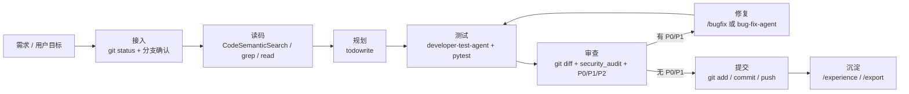

# 码道开发流程 · 图与要点

> 配套架构图：[codearts-flow.png](codearts-flow.png)（源文件 `codearts-flow.drawio`、`render_diagram.py`）
> 说明：以下 A/B/C 由本次流程试跑整理，B/C 补全了原输出被截断的列。

## A. 流程图

## B. 十节项目说明（面向非技术读者，每节 ≤60 字）

| # | 标题 | 三个要点 |
|---|---|---|
| 1 | 产品定位 | 资料变题库；学生少刷无用题；对话即入口。 |
| 2 | 核心闭环 | 上传资料；自动解析；直接刷题。 |
| 3 | 资料解析 | 支持 Word/PDF/MD；保留公式图片；标注出处。 |
| 4 | 题库组卷 | 自动出题；顺序/随机/错题练习；模拟考。 |
| 5 | 智能对话 | 自然语言下指令；调用真实工具；写入真实数据。 |
| 6 | 学习诊断 | 收集错题；定位薄弱点；推荐下一步。 |
| 7 | 技术架构 | FastAPI 后端；Vue3 前端；PostgreSQL 向量库。 |
| 8 | 内容安全 | 清洗 HTML；拦截恶意协议；保护笔记内容。 |
| 9 | 开发流程 | 八步流程；技能可复用；提交前审查。 |
| 10 | 交付运维 | Docker 编排；启停脚本；数据备份。 |

## C. 2 分钟流程走查脚本

| 时间 | 画面 | 说明 | 操作 |
|---|---|---|---|
| 0:00–0:10 | 技能面板 / SKILL.md 开头 | 先讲"我们有一套固定流程" | 打开 `/skills` 或 SKILL.md |
| 0:10–0:25 | 终端 `git status -sb` / `git log` | 分支干净、与远端同步 | 执行两条命令 |
| 0:25–0:40 | 编辑器 `html_sanitize.py:79-95` | 先读代码，定位正则与降级路径 | 打开文件高亮 79–95 |
| 0:40–0:50 | `todowrite` 待办面板 | 任务被拆成可勾选步骤 | 展示 8 项清单 |
| 0:50–1:10 | 终端 `58 passed` | 子代理写测试、跑测试 | 运行 pytest |
| 1:10–1:30 | `git diff` 与审查结论 | 分支差异 + P0/P1/P2 | 展示 diff 与结论 |
| 1:30–1:40 | `git status` 无变更 | 无必修项，回归通过 | 展示状态 |
| 1:40–1:50 | `git log -3` 与远程状态 | 已同步，无需重复提交 | 展示 log |
| 1:50–2:00 | 经验配置 / 导出目录 | 沉淀：经验、会话导出 | 展示目录 |

## 说明（如实记录）

- `CodeSemanticSearch` 本次因项目未建索引未解析，已按流程降级为 `grep/read`；读码结论不受影响。
- `/codebase-knowledge/init` 因 Codebase-CLI 缺失、内网域名不可解析而跳过，未生成知识文档。
- 审查发现 **1 个既有 P1**（非本次改动）：`html_sanitize.py:79-82` 降级正则未覆盖未加引号属性值 / HTML 实体编码绕过，建议单独立项修复。
- 现有会话导出为上一轮产物，本轮复跑记录如需导出，需再执行一次 `/export`。
