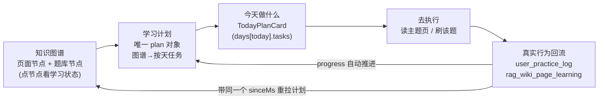

# 学习计划统一 · 方案

> 日期：2026-11-08
> 性质：**只读方案 / 设计契约 / 实施清单**。本轮不修改任何业务代码、不建表、不跑迁移；唯一写入为本文件。
> 工作区根：`D:\OpenStudy\apps\fastapi-v2`；下文路径均相对此目录。
> 事实基线：`doc/planning/学习计划融合-探索报告.md`（下称「探索报告」）是**唯一事实基线**。凡带 `文件:行号` 的判断均来自该报告本次实际读取的代码；本方案**不照抄旧规划稿、不发明不存在的数据**。报告 0.2 已声明「文档与代码不一致处以代码为准」，本方案遵循之。
> 硬约束（探索报告 G 章）：**不造数据 / 不新增计划表 / 不破坏旧导出·旧历史·旧题库 / 不破坏知识百科（wiki）入口 / 不引入 Neo4j 或新图库**。
> 交付口径：本方案本身在本轮一次交付；实施按 G 章分阶段推进，但文件清单、接口契约、测试用例在本文一次给全。

---

## Lead 复审后的最终执行范围（2026-11-08）

审查代理结论为「打回原全量方案」，Lead 复审后按“简化优先”收敛如下，实际实施以本节为准：

- **保留**：唯一计划对象 `build_study_plan`；学习统计页默认「学习计划」tab；统计页内嵌知识页+题库图谱；`bank-page` 边仅来自真实 `QuestionSource`；无锚点题 `pageId=0`；`weak_questions` 同源；`study_graph` 只读工具；`study_plan` 支持 `bank_ids`/无 KB；`GLOBAL_TOOLS`；提示词去掉“自动建私有题库/今日处方”；旧数据、旧题库、旧导出不动。
- **砍掉/合并**：`GET /rag/study-context`（前端直接用知识库列表 + 图谱）；`PlanTaskList.vue`；`study_plan` 的 `include_graph/explain`；`graphId/axis` 的额外契约；`LegacyExamPlanPanel` 独立主流程（只保留一个隐藏的旧版只读入口，不占导航）；`study_graph` 的 `page/bank` 不作为独立必测 action（由 overview/search 覆盖即可，实际实现保留兼容）。
- **唯一入口**：学习统计页 `plan` tab；`TodayPlanCard` 不挂载（今日任务只在 `StudyPlanPanel` 内）；workspace 不再挂载完整计划抽屉，只保留路径预览和「查看完整学习计划」跳转；旧 `?tab=exam` 仅落到只读历史归档。
- **LLM 可见入口**：`StudyPlanPanel` 顶部「问 AI」通过 `openstudy:ask-assistant` 预填上下文，助手用 `study_graph` 查图谱/题库、用 `study_plan` 读同一份计划。
- **本轮验收最小集**：`/rag/study-graph`、`/rag/study-plan?kbId=0&bankIds=...`、`study_graph` 工具、统计页计划 tab、`npm run build:prod`、pytest（图谱/计划/路由/知识页）。其余大而全的接口、组件、测试和 CDP 清单不阻塞本轮。

---

## 0. 一页总览与关键决策

### 0.1 现状一句话

同一用户同一天最多能遇到 **5～7 处互相独立或半独立的「今天该做什么」**（探索报告 B.1）：`bank` tab 的活计划今日任务、`exam` tab 的考前计划当天任务、周报建议、诊断最该练、workspace 抽屉/右侧卡、资料诊疗室「学习处方」。知识图谱只在 workspace 里被「看」，不产生任何计划动作（C.1、E.3）；`question` 类任务在图谱抽屉里点了没反应（P1-1）。名词「知航 · 活计划 / 今日处方」用户看不懂（要求 2）。

### 0.2 目标态一句话

**全站只有一个「学习计划」对象（`build_study_plan` 的返回）与一个「学习计划」入口（学习统计页的「学习计划」tab，默认 tab）**；该 tab 内画一张「页面节点 + 题库节点」统一的图谱，点节点看学习状态、点节点上的任务就去做，做完由真实行为回流、进度自动推进；LLM 通过 `study_graph` / `study_plan` 两个只读工具查询与解释同一份数据。旧考前计划 UI 退出主流程但数据与题库原样保留。

### 0.3 关键决策速览（对应 7 条要求）

| # | 决策 | 对应要求 |
| --- | --- | --- |
| D1 | 用户可见名称全部收敛为「学习计划」；禁用「知航 / 活计划 / 今日处方」；**代码标识、API 路径、localStorage 键一律不改**（兼容） | 2、7、F |
| D2 | 学习统计页 tab 收敛为 `plan(学习计划,默认) / bank / english / weekly`；`exam` 移出导航，仅旧 URL `?tab=exam` 可达「历史计划归档」 | 1、3、4、A |
| D3 | 唯一计划对象 = `build_study_plan`；统计页、workspace 抽屉、Agent 全部读它，**共用一份 `studyPlanState` 重建态（含 `sinceMs`）** | 1、3、5、7、C、E |
| D4 | 新增 `GET /rag/study-graph`：同一张图返回 page 节点 / bank 节点 / page-page 边 / bank-page 边 / bank 统计 / weakQuestions / degraded | 4、6、B |
| D5 | `bank-page` 边**仅在真实 `QuestionSource` 锚点反查成功时**产生，带 `via:'questionSource'`、`anchorCount`、`anchoredQuestionIds`；无锚点不画、不猜 | 6、B、H |
| D6 | `GET /rag/study-plan`：`kbId` 由「必填 gt=0」放宽为「可空/0」，新增 `bankIds`；无 KB / 无页面时走 `bank-only` 计划，仅靠题库也能排 | 3、6、B、C |
| D7 | `build_study_plan` 补「题库轴任务」，**绝不调用 `exam_plan_service._create_plan_bank`、不复制题库** | 3、C、F |
| D8 | 新增 `study_graph` Agent 工具（overview/page/bank/question_map/weak）+ 扩展 `study_plan`（`bank_ids`、无 KB、`explain`）；加入 `GLOBAL_TOOLS` | 5、D |
| D9 | 系统提示词重写：删除「考前倒计时自动建私有题库」承诺、删「今日处方」、加「只查询/解释/调用，不编造完成态与锚点」 | 2、5、D |
| D10 | 新增 `StudyPlanPanel.vue / StudyMapGraph.vue / TodayPlanCard.vue / PlanTaskList.vue`；workspace 三件套**保留并复用同一计划**，修 `questionId` 跳转死点 | 4、5、E |
| D11 | 旧 `os_exam_plan_v1_*`、`practiceBank.id`、`考前计划·` 题库、全部导出、`/rag/wiki/graph`、`/rag/wiki/route`、wiki 入口**原样保留** | 3、F、G.3 |
| D12 | 完成判定只认 `sinceMs` + `user_practice_log` / `rag_wiki_page_learning`；前端勾选不算完成 | 1、C、H |

### 0.4 闭环图（用户一眼看懂）



页面顶部放一条 4 步 stepper：`① 知识图谱 → ② 学习计划 → ③ 今天做什么 → ④ 做完自动回流`。四步都落在**同一个 tab、同一份计划**上，用户不需要换页、不需要看第二份清单（直接消灭探索报告 B.1 的「5～7 处行动清单」）。

### 0.5 名词统一表（要求 2、7）

| 旧（用户可见，禁用） | 新（用户可见，统一） | 出现位置（证据） |
| --- | --- | --- |
| 知航 · 活计划 | **学习计划** | `study_plan_service.py:1`、`rag.py:1210`、`workspace.ts:269`、`StudyPlanTool.description:78`、`prompts.py:639,645`、`index.vue:343` 副标题、各卡片标题 |
| 今日处方 | **今日任务**（学习计划的一部分） | `index.vue:61` 模板注释「今日处方」、`WeeklyReportPanel.vue:145`「回到今日处方」、`prompts.py:616`、`user_stats.py:597` docstring |
| 考前计划（作为主流程 tab） | **学习计划**；旧视图称「历史计划（旧版）」 | `index.vue:328` tabList、`:343` 副标题、`ExamPlanPanel.vue` |
| 学习处方（资料诊疗室第 3 tab，第三套 LLM 计划） | **学习计划（本文档）**，降级为同一计划的 `doc_id` 视图 | `prompts.py:871-876`、`rag.py:936`；探索报告 A.4 |
| 学习航线 / 知识体检图 / 错题歼灭战 | 并入「学习计划」「学习概览」 | `LearningLoopPanel.vue:23,62` |

> **保持不变（不是用户可见文案，属兼容契约，不改）**：`study_plan` 工具名、`StudyPlanTool` 类名、`build_study_plan` 函数名、`/rag/study-plan`、`/userStats/study-plan-today`、`os_exam_plan_v1_<userId>`、`openstudy.workspace.studyPlanState`、`practiceBank.id`、`考前计划·` 题库命名规则、`/rag/wiki/route` 与 `getLearningRoute(...)` 签名。理由见 F.1、探索报告 G.3。

---

## A. 产品信息架构（要求 1、3、4、7）

### A.1 学习统计页最终 tab 结构

`index.vue:310,312,324-329` 现状：`StatsTab = 'bank'|'english'|'weekly'|'exam'`，默认 `'bank'`。改为：

| key | 标签 | 默认 | 内容 | 相对现状 |
| --- | --- | --- | --- | --- |
| `plan` | **学习计划** | ✅ **默认 tab** | `StudyPlanPanel.vue`：闭环 stepper + `TodayPlanCard` + `StudyMapGraph` + 计划设置条 + 完整按天任务 | **NEW**，全站唯一「学习计划」入口 |
| `bank` | 题库练习 | | 学习总览 / 趋势 / 科目分布 / 错题诊断 / 学情诊断 / 我的积累 / 里程碑；`LearningLoopPanel` 降级为纯统计 | 保留，剥离「今天做什么」 |
| `english` | 英语练习 | | `EnglishStatistics` 不变（独立数据源 `/words/practice/stats`） | 不变（E.4、G.3 旧链接重定向保留） |
| `weekly` | 学习周报 | | 周报 + PNG 导出不变 | 不变，仅改「回到今日处方」文案 |

- `exam` **从 `tabList` 移除**（退出主流程，要求 3）；但 `applyTabFromQuery`（`index.vue:408-444`）**仍接受 `?tab=exam`**，渲染 `LegacyExamPlanPanel`（`ExamPlanPanel.vue` 的只读归档包装，见 A.3/F.1）。
- `tabSeen`（`:315`）新增 `plan: true`（默认挂载），`english/weekly` 仍懒挂载。`onActivated`（`:895-899`）的刷新列表增加 `plan`。
- `syncTopbarSubtitle` 的 `subtitleMap`（`:339-344`）重写：`plan` → 「知识图谱、学习计划与今天要做的题，都在这里」；删除 `exam` 的「输入考试日期…倒排」；`bank` 保留；`weekly` 保留。
- `?tab=` URL 同步（`:348-361`）、`/front/english/statistics` 重定向、keep-alive 复用**全部保留**（探索报告 G.3）。

### A.2 「学习计划」tab 布局（自上而下，`StudyPlanPanel.vue`）

```
┌─ ① 闭环 stepper：知识图谱 → 学习计划 → 今天做什么 → 做完自动回流 ─────┐
├─ ② 计划设置条（PlanSettingsBar）                                      │
│    资料夹[下拉：全部/具体KB/「不按资料夹(仅题库)」] · 考试日期[date]     │
│    每日分钟[40] · 休息日[多选] · 题库范围[多选 bankIds] · 目标[补弱…]   │
│    [重新生成]  ← 写回单一 studyPlanState + 刷新 sinceMs                 │
├─ ③ TodayPlanCard：今天 0/3 · 进度条 · 任务列表 · [开始今日任务]         │
├─ ④ StudyMapGraph：页面节点(圆) + 题库节点(方) + 实线/虚线边            │
│    点节点 → 右侧「节点详情」抽屉：学习状态 + 该节点的计划任务 + 去执行   │
├─ ⑤ 完整计划：按天折叠（复用 PlanTaskList.vue）                         │
└─ ⑥ degraded 提示条（空态/降级，见 E.5）                                │
```

- 设置条数据源 `GET /rag/study-context`（B.3）；计划数据源 `GET /rag/study-plan`（B.2）；图谱数据源 `GET /rag/study-graph`（B.1）。三者**用同一组 `kbId / bankIds / goal / examDate / dailyMinutes / restDays / sinceMs` 参数**，天然同源（要求 7「相互呼应」）。
- 点图谱节点 → 从**同一份 `plan.days[].tasks[]`** 里按 `sourceNodeId`（C.5）过滤出该节点任务 → 点任务用 `target.jumpUrl` 跳刷题/读页 → 真实行为回流 → 带同 `sinceMs` 重拉 → 进度自动推进。这就是「知识图谱不再只能看」。

### A.3 旧 UI 下线 / 保留 / 降级矩阵

| 对象 | 结论 | 处理 | 证据 |
| --- | --- | --- | --- |
| `exam` tab 导航项 | **下线**（退出主流程） | 从 `tabList` 删；`?tab=exam` 仅可达「历史计划归档」 | 要求 3；`index.vue:328` |
| `ExamPlanPanel.vue` | **降级为只读归档** | 包一层 `LegacyExamPlanPanel.vue`：加「这是旧版考前计划，仅查看历史；新的学习计划在『学习计划』tab」横幅；保留 localStorage 恢复与 `practiceBank.id` 跳转；**不生成新计划、不新建题库** | 探索报告 E.4/G.3/P0-3；`ExamPlanPanel.vue:444-479,573-579` |
| `LearningLoopPanel.vue` | **降级**（保留数据，剥离第二份「今天做什么」） | 删除「今日学习任务 · 活计划」列表与 fallback（`:23-24,221-236`）；「知识体检图」保留但改名「学习概览·按科目」并注明不是图谱；「回到今日处方」删。保留一张「去看学习计划 →」卡片跳 `plan` tab | 探索报告 B.1#1、P2-1、P2-2 |
| `WeeklyReportPanel.vue` | **保留** | 「回到今日处方」→「去看学习计划」；PNG 导出（`:202-223`）不动 | 探索报告 E.4/P2-3 |
| `DiagnosisPanel.vue` | **保留** | 逐题诊断 + 复习卷导出不动；「最该练 8 题」与计划薄弱题同源但**不另成计划** | 探索报告 B.1#4、G.3 |
| `KnowledgeWikiPanel.vue` / `KnowledgeRoutePanel.vue` / `StudyPlanDrawer.vue` | **保留 + 复用同一计划** | workspace 作为第二「视图」而非第二「计划」；读同一 `studyPlanState` + `/rag/study-plan`；修 `question` 任务无跳转死点（P1-1）；标题改「学习计划」；关闭抽屉重算沿用 `:1743-1757` | 探索报告 A.1、P1-1、G.3「不破坏 wiki 入口」 |
| `KnowledgeGraphSvgPanel.vue`（实体图谱） | **保留但明确不在本闭环** | 无学习态/题库/计划字段（C.1），统计页接的是 `/rag/study-graph`（页面+题库图谱），**不接实体图谱**；仅改文案避免指代歧义 | 探索报告 C.1、P2-5 |
| 资料诊疗室「学习处方」tab | **降级为同一计划的文档视图** | `StudyPrescriptionPanel` 入口/导出保留；内容改为 `study_plan(doc_id=...)` 的文档范围视图，不再由 LLM 另排一份按天计划 | 探索报告 A.4、G.3、`prompts.py:871-876` |
| `is-route-mode` 类名残留 | 可删（无害） | 探索报告 P2-4 | `KnowledgeWikiPanel.vue:71` |
| 四张重复 KPI 卡 | **展示层合并，接口不动** | 「学习总览」小指标与「学情诊断」KPI 字段重叠但聚合口径不同，只合并视觉不互替接口 | 探索报告 E.4、P2-1 |

### A.4 「今天做什么」唯一化

目标态「今天该做什么」只有 **1 处来源**：`plan.days[today].tasks`（`TodayPlanCard`）。探索报告 B.1 的各处收敛：

- #1 `bank` tab 活计划今日任务 → **移入 `plan` tab**。
- #2 `exam` tab 当天任务 → **退出主流程**（仅归档）。
- #3 周报 `nextWeek[]` / #4 诊断最该练 + 复习卷 → 保留为「建议/导出物」，**不再自称今日任务**。
- #5/#6 workspace 右侧卡与抽屉 → 同一份 `plan` 的视图，不是第二套。
- #7 资料诊疗室学习处方 → 同一份 `plan` 的 `doc_id` 视图。
- 旧「无任务时用 `days[0]` 冒充今日」（P1-3，`user_stats.py:569-570,580-581`、`LearningLoopPanel.vue:224`、`study_plan.py:200-201`、`StudyPlanDrawer.vue:141-147`）→ **改为如实返回空态**（见 E.5/C.4）。

---

## B. 数据契约（要求 3、4、5、6）

### B.0 接口清单

| 状态 | 接口 | 作用 | 依据 |
| --- | --- | --- | --- |
| **NEW** | `GET /rag/study-graph` | 统一图谱：page/bank 节点 + 两类边 + bank 统计 + weakQuestions + degraded | 要求 4、6 |
| **MOD** | `GET /rag/study-plan` | `kbId` 放宽 + `bankIds`；无 KB 走 bank-only；返回加题库轴 | 要求 3、6、`rag.py:1194-1252` |
| **NEW** | `GET /rag/study-context` | 计划设置条的 KB/题库/默认值/能力位 | 要求 E「统计页如何选 KB」 |
| **MOD** | `GET /userStats/study-plan-today` | 降级为兼容薄封装，去掉 N-KB 逐份重算（P1-7） | 探索报告 F/P1-7 |
| **KEPT** | `GET /rag/wiki/graph`、`/rag/wiki/route`、`/rag/wiki/pages/{id}/view` | 旧契约不动，供 `study-graph` 复用 | 探索报告 G.3 |
| **KEPT** | `GET /userStats/exam-plan`、`/exam-banks`、`/practice-progress` | 旧考前计划链路，**只读兼容**，主流程不再调用 | 探索报告 G.3、要求 3 |
| **KEPT** | 全部 `/userStats/*` 聚合与导出、`/rag/knowledge-graph` | 不动 | 探索报告 G.3 |

> 命名理由：`/rag/study-graph` 与 `/rag/study-plan` 同属 study 域、成对呼应；与 `/rag/wiki/graph`（仅页面节点，`get_wiki_graph()`）、`/rag/knowledge-graph`（仅实体关系、无学习态）明确区分，直接消除探索报告 P2-5 的「指代歧义」。

### B.1 NEW `GET /rag/study-graph`

#### 参数表

| 参数 | 类型 | 必填 | 默认 | 说明 |
| --- | --- | --- | --- | --- |
| `kbId` | int | 否 | `0` | **0/空 = 不加载页面图谱，仅题库图**（对应 `bank-only`）；>0 时取该 KB 下 `status in [ready,stale]` 的页面（复用 `get_wiki_graph`，`wiki_service.py:2244-2253`） |
| `bankIds` | str | 否 | `''` | 逗号分隔；空 = 全部「真正练过的题库」（复用 `/userStats/exam-banks` 口径，`user_stats.py:632-701`） |
| `goal` | str | 否 | `weakness` | 与 study-plan 一致，影响 weakQuestions 排序 |
| `focusPageId` | int | 否 | `None` | 高亮节点 |
| `limitWeak` | int | 否 | `20` | weakQuestions 上限 |
| `includeWeak` | bool | 否 | `true` | 是否附薄弱题 |

#### 返回字段表（`data`）

顶层：`graphId`（参数哈希，供 LLM/前端引用）、`generatedAt`、`kbId`、`hasKb`、`nodes[]`、`edges[]`、`bankStats[]`、`weakQuestions[]`、`stats{}`、`degraded{}`、`sources[]`。

**(1) `nodes[]` — page 节点（`nodeType='page'`，复用 `get_wiki_graph`）**

| 字段 | 类型 | 说明 / 来源 |
| --- | --- | --- |
| `id` | str | `"p:{pageId}"`，稳定 |
| `nodeType` | str | `"page"` |
| `pageId` `title` `pageType` `summary` `degree` `status` | — | `wiki_service.py:2244-2255` 既有 `nodes[]` 字段 |
| `learning` | obj | `{ viewCount, lastViewTime, level, masteryScore, accuracy, practiceCount }`，**复用 `build_learning_snapshot()` / `_wiki_learning_map()` 实时算，不另算、不落库**（G.1） |
| `weakCount` | int | 命中该页且有真实锚点的薄弱题数（来自 `_load_diagnosis_page_signals` 同构反查，`learning_route_service.py:613-692`） |
| `planTaskIds` | str[] | 关联该页的计划任务 id（前端按 `sourceNodeId` 与 plan 联表得出，服务只回空数组占位或由调用方 join） |

**(2) `nodes[]` — bank 节点（`nodeType='bank'`，要求 6「题库节点/题库统计」）**

| 字段 | 类型 | 说明 / 来源 |
| --- | --- | --- |
| `id` | str | `"b:{bankId}"` |
| `nodeType` | str | `"bank"` |
| `bankId` `bankName` `subject` | — | `QuestionBank` + `/userStats/exam-banks` 口径（`user_stats.py:686-699`） |
| `stats` | obj | `{ questionCount, attemptCount, errorCount, weakCount, lastPracticeTime }`，来自 exam-banks 查询 + `diagnose()`；**只读，不复制题** |
| `anchoredQuestionCount` | int | 该库中带 `QuestionSource` 锚点的题数 |
| `linkedPageIds` | int[] | 由 `bank-page` 边反推，仅真实锚点；无则 `[]` |
| `isLegacyExamBank` | bool | `bank_name` 以 `考前计划·` 开头（F.1，旧题库可视化标记，**不改命名、不删**） |

**(3) `edges[]` — page-page 边（`edgeType='page-page'`，仅真实链接）**

| 字段 | 说明 |
| --- | --- |
| `id` `source` `target` | 两端为 `"p:{pageId}"` |
| `edgeType` | `"page-page"` |
| `linkType` | `related / prerequisite / contrast / part_of / mention`（`wiki.py:151-152`），**如实返回，不强行过滤成 prerequisite** |
| `linkSource` `weight` | `graph/mention`、1-10（`wiki.py:153-154`） |
| `directionAssumed` | `true`——前置方向是约定、绝不改写已落库关系（`learning_route_service.py:873`） |

**(4) `edges[]` — bank-page 边（`edgeType='bank-page'`，要求 6「真实映射，仅有 QuestionSource 时」）**

| 字段 | 说明 |
| --- | --- |
| `source` `target` | `"b:{bankId}"` → `"p:{pageId}"` |
| `edgeType` | `"bank-page"` |
| `via` | **固定 `"questionSource"`**，作为「真实锚点」的凭据 |
| `anchorCount` | 反查成功的题数（>0 才产生本边） |
| `anchoredQuestionIds` | int[]，真实题 id |
| `semantic` | `"practice-source"`（**练习来源关联，不是先学/后学前置**） |
| `directionAssumed` | 不适用；**不声称方向** |

> **生成规则（不可绕过）**：对每个 `QuestionSource`（`question.py:106-124`，一题一锚点、老题无锚点）取 `doc_id / chunk_id` → 按 `RagWikiPage.source_doc_ids / source_chunk_ids` 反查页面（与 `wiki_service.py:1128-1169`、`learning_route_service.py:652-690` 同构算法，chunk 优先、否则回退 doc）。**至少一个题命中才画边**；同 doc 命中多页时全部计入并如实给多个 target（`wiki_service.py:1167-1169`），不细化到「知识点」；无锚点题**直接跳过、不画、不猜**（`learning_route_service.py:620,669-670`）。

**(5) `bankStats[]`**：与 bank 节点 `stats` 同源的数组视图，另含 `anchoredQuestionCount / unanchoredQuestionCount / legacyExamBank`；便于 LLM 直接读，不必遍历节点。

**(6) `weakQuestions[]`**（要求 6「题库薄弱题进入同一图谱/计划」）

| 字段 | 说明 |
| --- | --- |
| `questionId` `bankId` `bankName` | 真实题与库 |
| `pageId` | int，**无锚点 = 0**（诚实，沿用 `study_plan_service.py:566-590` 的 `pageId=0` 伪站点口径） |
| `pageTitle` | `pageId=0` 时为 `""` |
| `anchored` | bool |
| `anchor` | `{ docId, chunkId, quote } \| null`，来自 `get_question_source`（`question_write_service.py:358-412`），仅 `anchored=true` 时有值 |
| `level` `levelText` `advice` `recommendedIntervalDays` `accuracy` `streak` | 逐题诊断 `diagnose()` 字段（`learning_stats.py:325-383`、`userStats.ts:95-181`），**数字是算出来的，不重新分档** |
| `sourceNodeId` | 锚定→`"p:{pageId}"`，未锚定→`"b:{bankId}"`（**绝不伪造 `p:{pageId}`**） |

**(7) `stats{}`**：`pageCount / bankCount / pagePageEdgeCount / bankPageEdgeCount / anchoredQuestionCount / unanchoredQuestionCount / weakCount / readyPageCount`。

**(8) `degraded{}`**（要求 6、探索报告 C.3/G.1 的「如实下发」）：

| 字段 | 含义 |
| --- | --- |
| `pagesEmpty` | 该 KB 无 `ready/stale` 页面 |
| `noKb` | `kbId=0` 或用户无资料夹 |
| `noBanks` | 无「真正练过的题库」 |
| `noQuestionSource` | 全库无锚点题（老题/非资料生成题占多数） |
| `noBankPageEdges` | **一条 bank-page 边都没能反查出来**（无锚点时必须为 true，前端据此提示） |
| `noPrerequisiteEdges` | 无真实前置边 |
| `noPracticeData` | 无作答流水 |
| `allMastered` | 诊断无薄弱题 |

**(9) `sources[]`**：逐项声明事实源，新增 `bankStats` / `questionSource` / `diagnosis`，并保留 `generated: "request-time recompute; no plan table"`（与 `study_plan_service.py:654-663` 的 `_sources()` 同口径）。

### B.2 MOD `GET /rag/study-plan`（`rag.py:1194-1252`）

#### 参数表（**加粗为改动**）

| 参数 | 类型 | 现状 | 改为 | 说明 |
| --- | --- | --- | --- | --- |
| `kbId` | int | `Query(..., gt=0)` 必填 | **`Query(0, ge=0)` 可空/0** | 0 = 无 KB，仅靠题库排计划（要求 3、6）；>0 时行为完全不变，保旧调用 |
| `bankIds` | str | 无 | **NEW，逗号分隔，默认 `''`** | 空 = 全部练过的题库；与 `study-graph` 同参 |
| `goal` `examDate` `horizonDays` `dailyMinutes` `restDays` `focusPageId` `docId` `sectionIndexes` `mode` `sinceMs` | — | 不变 | 不变 | 兼容点全部保留（探索报告 G.3/P2-7） |

`build_study_plan` 同步新增 `bank_ids: Optional[Sequence[int]] = None`（`study_plan_service.py:429-445`），`kb_id` 允许 `0`。

#### 两种产计划模式（要求 3、6）

| 模式 | 触发 | 行为 |
| --- | --- | --- |
| `graph`（默认） | `kbId>0` 且有 `ready/stale` 页面 | 沿用现有 `build_learning_route(max_stops=8)`（`:481-488`）生成页面轴任务，**并合并题库轴任务**（C.1），装进**同一份** `days[]` |
| `bank-only` | `kbId=0`，或 `kbId>0` 但 `pagesEmpty=true`，且存在题库 | **不调 `build_learning_route`**（它要求真实 KB，`rag.py:1169`）；`route.mode='bank-only'`、`route.stops=[]`；`days[]` 全部来自题库轴任务（薄弱题/复测/复习/模拟）；`degraded.noKb/pagesEmpty/bankOnlyPlan=true` |
| `empty` | 既无页面又无题库 | `days=[]`、`degraded.noBankSelected=true`，前端显示「先去题库练习或导入题目」引导（不造假任务） |

> 关键：`kbId` 从 `gt=0` 放宽是「无 KB 仅靠题库」能成立的**前置修改**——否则 `build_learning_route` 一定会因无页面返回空，计划就排不出来。

#### 返回增量字段（**加性扩展，不破坏 `StudyPlanDrawer` / `KnowledgeRoutePanel` / `index.vue onOpenPlanTask` 既有消费**）

| 字段 | 说明 |
| --- | --- |
| `bankIds` `graphId` | 回显本次范围，便于前端/LLM 与图谱对齐 |
| `route.mode` | 新增 `'bank-only'`；保留 `'graph' / 'fallback' / 'empty'` |
| `axisSummary` | `{ pageTasks, bankTasks, questionTasks }`，用于进度条与图谱徽标 |
| `days[].tasks[].axis` | `'page' \| 'bank'` |
| `days[].tasks[].sourceNodeId` | `"p:{pageId}"` / `"b:{bankId}"` / 未锚定薄弱题用 `"b:{bankId}"`，**把任务与图谱节点连起来（呼应）** |
| `days[].tasks[].target.bankId` / `target.jumpUrl` | 新增；保留既有 `target.pageId` / `target.questionId` / `kind` / `title` / `minutes` / `status` |
| `degraded` | 新增 `noKb / bankOnlyPlan / noBankSelected / noAnchoredMapping`（沿用 `:500-508,614-625` 结构） |

### B.3 NEW `GET /rag/study-context`

供 A.2 设置条一次拉齐：

| 返回字段 | 说明 / 来源 |
| --- | --- |
| `knowledgeBases[]` | `{ kbId, name, isDefault, docCount, pageCount }`，复用 `rws.list_knowledge_bases`（`user_stats.py:547`）+ `get_wiki_graph` 计数；含显式「不按资料夹（仅题库）」选项由前端拼 `kbId=0` |
| `defaultKbId` | 按 `isDefault + docCount` 排序首个（与 `user_stats.py:550-554` 同口径，避免 P1-4 的 KB 漂移） |
| `banks[]` | 复用 `/userStats/exam-banks` 字段 + `isLegacyExamBank` |
| `defaults` | `{ goal:'weakness', examDate:'', horizonDays:7, dailyMinutes:40, restDays:[], bankIds:[], mode:'balanced' }` |
| `capabilities` | `{ hasKb, hasPages, hasBanks, hasQuestionSource }` |
| `degraded` | 同 B.1 子集 |

> 该端点只读现有表，**不新增任何表、不缓存计划**。

### B.4 MOD `GET /userStats/study-plan-today`（`user_stats.py:525-589`）

| 项 | 现状 | 改为 | 理由 |
| --- | --- | --- | --- |
| 主流程地位 | `bank` tab 今日任务来源 | **降级为兼容薄封装**；新 `plan` tab 直接调 `/rag/study-plan` | 统一单一计划入口 |
| `kbId` 缺失时 | 遍历**所有** KB 逐个 `build_study_plan`（`:558-565`），N 次完整排程 | 改为**一次** `build_study_plan(kbId=defaultKbId 或 0, bank_ids=..., goal='today')` | 修 P1-7 性能/一致性缺口 |
| `sinceMs` | 未传（`:560-562`），退化今天 00:00 | 接收并透传 `sinceMs`，与主计划同锚点 | G.2、C.4 |
| 返回 | `{...plan, hasPlan, todayTasks}` | **形状保持不变**（兼容旧 `LearningLoopPanel` fallback） | 探索报告 G.3 |
| 「无任务用 `days[0]` 冒充今日」 | `:569-570,580-581` | 改为 `todayTasks=[]` + `reason` 如实说明 | P1-3、A.4 |

### B.5 统一 `StudyPlan` 对象字段表（加性）

| 顶层字段 | 现状 | 本方案 |
| --- | --- | --- |
| `planId` `planVersion` `generatedAt` `intent` `window` `route` `days` `progress` `sources` `degraded` | 已有（`study_plan_service.py:630-651`） | 全部保留 |
| `bankIds` `graphId` `axisSummary` | — | NEW |
| `route.mode` | `graph/fallback/empty` | +`bank-only` |
| `days[].tasks[]` | `kind/title/minutes/target/status` | +`axis` +`sourceNodeId` +`target.bankId/jumpUrl` |
| `degraded` | 8 项（`:500-508,614-625`） | +`noKb/bankOnlyPlan/noBankSelected/noAnchoredMapping` |

`planId` 仍为 `sha1(用户+资料夹+意图+窗口+版本)`（`:391-403`），**建议把 `bankIds` 纳入哈希输入**，使题库范围变化时 `planId` 改变、前端可识别需刷新；不新增计划表。

### B.6 共享 provider：`weak_questions()`（保证「同一份」，要求 6、7）

新增 `app/services/study_graph_service.py` 内的单一函数 `weak_questions(db, user_id, bank_ids, kb_id, limit)`：

```
diagnose() 逐题 items  ──→ join QuestionSource(question_id) ──→ doc/chunk→page 反查
        │                                                          │
        └── 未锚定题 pageId=0 / anchored=false                     └── 锚定题 pageId>0
                     ▼
        weakQuestions[]（B.1(6) 字段）
                     ▼
   ┌─────────────────┴─────────────────┐
   ▼                                   ▼
/rag/study-graph 的 weakQuestions   build_study_plan 的题库轴任务
（节点 weakCount / bank-page 边）   （question/retest/review/mock）
```

图谱与计划**调用同一个函数**，杜绝「图谱显示 5 道薄弱题、计划里却是另外 5 道」的孤岛（要求 7）。该函数只读 `diagnose` + `question_source` + `question_main`（过滤已删题，修 P1-6）+ `user_practice_log`，不写库。

---

## C. 统一计划对象（要求 3、6、7）

### C.1 `build_study_plan` 补「题库轴任务」（`study_plan_service.py:429-651`）

在现有三段（航线 → `_task_for_stop` 生成页面轴任务 `:138-255` → `_pack_days` 装箱 `:258-301` → `_apply_progress` `:329-388`）之间，**插入题库轴**，步骤描述（不写代码）：

1. 调 B.6 的 `weak_questions(db, user_id, bank_ids, kb_id)` 得到共享薄弱题集。
2. 由真实数据生成任务，**沿用现有 `TASK_MINUTES` / `TASK_LABELS`（`:35-53`）与「不造假」规则（`:9-10,144,165-199`）**：
   - 锚定薄弱题（`pageId>0`）→ `question` 任务，`target={kind:'question', questionId, bankId, pageId}`，`sourceNodeId="p:{pageId}"`。
   - 未锚定薄弱题（`pageId=0`）→ `question` 任务，`target={kind:'question', questionId, bankId}`，`sourceNodeId="b:{bankId}"`，**明示「无页面锚点，不伪造图谱归属」**（沿用 `:566-590` 已有考前薄弱题伪站点做法，扩展到非考试场景）。
   - 有同源题库（`_wiki_practice_bank`，`wiki_service.py:1198-1261`）→ `practice` 任务带真实 `bankId/questionIds`。
   - 临考（`exam_date` 非空）→ `retest` / `mock`（`:236-254`），范围受 `bankIds` 约束。
   - **没有真实 `questionId/bankId/pageId` 的任务一律不排**；阅读只在 `viewCount==0`、练习只在有 `bankId && questionIds` 时排（`:165-199`）。
3. 页面轴任务 + 题库轴任务**合并进同一个 `all_tasks`**，交给同一个 `_pack_days`（`:591`）装箱、同一个 `_apply_progress`（`:600-606`）算完成态 → 仍是**一份 `days[]`、一份 `progress`**，不是第二套计划（直接规避 H 坑 #5）。
4. `axisSummary` 按 `axis` 计数；`degraded.noAnchoredMapping` 在「有题库但全库无锚点」时置 true。

### C.2 如何避免旧考前计划复制题库（要求 3、P0-3）

| 约束 | 落地 |
| --- | --- |
| 统一计划路径**绝不写库** | `build_study_plan` / `study_graph_service` / `study_plan` 工具**不 import、不调用** `exam_plan_service._create_plan_bank`（`exam_plan_service.py:98-199,164-195`）；题库轴任务的 `questionId` 一律用**原始题 id**，不改写、不复制 |
| `_create_plan_bank` 仅存活于旧端点 | 保留在 `/userStats/exam-plan`（`user_stats.py:704-767`）内部，供「历史计划归档」只读查看；主流程不触发它，杜绝 G.3.1 的「`考前计划·` 题库累积污染」继续增长 |
| `study_plan` 工具 `write_operation=False` | `study_plan.py:150` 已声明只读，新增 `study_graph` 工具同样 `False`；工具描述明写「不建表、不写完成态、不复制题目」（`study_plan.py:7-8`） |
| `sources.generated` | 保持 `"request-time recompute; no plan table"`（`study_plan_service.py:662`） |

### C.3 保留 `os_exam_plan_v1_*` 与旧 `practiceBank.id` 兼容（F/要求 3）

| 资产 | 处理 | 证据 |
| --- | --- | --- |
| `os_exam_plan_v1_<userId>`（`form/plan/createdAt/manualDone/visibleDays`） | **不改名、不删除、不被新流程写入**；`LegacyExamPlanPanel` 仍用 `loadPlanState` 恢复（含过期日期可见兜底） | `ExamPlanPanel.vue:274-278,365-379,444-479,589-594` |
| `practiceBank.id` 跳转 | 保留「开始刷题」跳该 id；旧专属题库名 `考前计划·{exam}·{bank}` 与「按名去重复用」规则**原样不动** | `exam_plan_service.py:116-131,515-518`；`ExamPlanPanel.vue:151-153,189-191,573-579` |
| `考前计划·` 题库 | 不删、不合并、不改命名；`study-graph` 仅用 `isLegacyExamBank` 标记，供用户在设置条里主动排除 | 探索报告 G.3.1、P0-3 |
| `/userStats/exam-banks` 的 `subject` 单值兼容 `subjects` | 保留 | `user_stats.py:710-711,737-739`、探索报告 G.3/P2-7 |
| `/userStats/practice-progress` 的 `manualDone` 口径 | 保留（仅归档面板用），主计划不采用 | `user_stats.py:770-823,779-781` |

### C.4 复用 `sinceMs` 完成判定（要求 1、探索报告 B.2/G.2）

| 任务类型 | 事实源 | 判定 | 前端勾选 |
| --- | --- | --- | --- |
| 题目轴（`question/practice/retest/mock`，含题库轴） | `user_practice_log.create_time >= since` | `_apply_progress`（`study_plan_service.py:304-326,406-426`） | **不算** |
| 页面轴（`read/section/review`） | `rag_wiki_page_learning.last_view_time / last_activity_time` | 同上（`:318-326`） | **不算** |
| 旧考前计划非题任务 | `manualDone` | 仅 `LegacyExamPlanPanel` 使用，与主计划隔离 | 仅旧面板 |

- `sinceMs` 语义不变：「计划生成后发生过」，**不按日期切分**（`:448-450`）；缺省今天 00:00（`:478`）。
- 唯一客户端状态 `openstudy.workspace.studyPlanState` 扩展为 `{ kbId, bankIds, examDate, dailyMinutes, restDays, goal, mode, sinceMs, planId }`（**新增字段，键名不变**，探索报告 G.3）；用户点「重新生成」或改设置 → 写 `sinceMs=Date.now()` → 统计页与 workspace 两个视图读**同一份**状态重拉 `/rag/study-plan`，进度按真实行为自动推进。
- workspace 前端按 `viewCount` 本地推断 `done/current/next`（`KnowledgeWikiPanel.vue:1759-1809`）→ **改为直接消费服务端 `_apply_progress` 的 `status`**，消除第三套完成口径（探索报告 B.2-3）。

### C.5 `degraded` 扩展与「不造假」

在 `study_plan_service.py:500-508,614-625` 的 8 项上加 4 项：`noKb / bankOnlyPlan / noBankSelected / noAnchoredMapping`。所有降级标志如实下发并被 `StudyPlanPanel` / `StudyMapGraph` 消费（E.5），与 G.1「`degraded` 必须如实下发并可见」一致。

---

## D. LLM 工具与系统提示词（要求 5、7）

### D.1 NEW `study_graph` 工具（`app/services/ai/agent/tools/study_graph.py`）

`name="study_graph"`，`label="学习图谱"`，`write_operation=False`，内部调 `study_graph_service`（与 B.1 同源）。

| action | 参数 | 返回 | 回答用户的问题 |
| --- | --- | --- | --- |
| `overview` | `kb_id?`, `bank_ids?` | 精简 `nodes/edges/stats/degraded` + `message` | 「我的知识图谱长什么样 / 哪个节点最弱」 |
| `page` | `page_id` | 该页 `learning` + `linkType` 边 + `linkedBanks` + `weakQuestions` + 关联 `planTaskIds` | 「这页的前置是什么 / 这页学得怎样」 |
| `bank` | `bank_id` | bank 节点 `stats` + `bank-page` 边（`via/anchorCount/anchoredQuestionIds`）+ `weakQuestions` | 「我这个题库哪页最弱 / 和知识页怎么对应」 |
| `question_map` | `question_id` 或 `question_ids[]` | `{ questionId, bankId, anchored, anchor, pageId, pageTitle }`；**无锚点 `pageId=0, anchored=false`** | 「这道题落在哪一页」 |
| `weak` | `bank_id?`, `limit?` | `weakQuestions[]`（B.1(6)）+ `degraded` | 「我哪些题最该练」 |

**返回统一带**：`degraded{}`、`sources[]`、`message`（引导 LLM 只描述/查询/调用）、可选 `jumpUrl=/front/myQuestion/myStats?tab=plan&...`。

**不编造硬约束（写进工具 description 与 execute）**：
- `bank-page` 边只在 `anchorCount>0` 时返回；无锚点不返回边、不按题干猜知识点（`question.py:45-69,96-103`、探索报告 D.2/G.1）。
- `question_map` 无锚点如实回 `pageId=0`，**不猜测**。
- 所有数字来自 `diagnose/exam-banks/get_wiki_graph`，**不重新分档、不发明正确率**（`prompts.py:797-805`）。

### D.2 MOD `study_plan` 工具（`tools/study_plan.py`）

| 改动 | 说明 |
| --- | --- |
| 参数 +`bank_ids`（array<int>） | 透传 `build_study_plan(bank_ids=...)` |
| 参数 +`include_graph`（bool） | 为 `explain` 附一份 `study_graph.overview` 精简上下文，便于解释 |
| `kb_id` 可省 / 允许 `0` | 改 `_resolve_kb_id`（`:39-56`）：当用户无资料夹 / 多资料夹未指定**但传了 `bank_ids`** 时，返回 `0`（bank-only）而非 `fail`；「仅有一个 KB」仍自动选用；纯多 KB 且无 bank_ids 才要求用户指定 |
| action 枚举 +`explain` | `plan`(生成/查看) / `today`(今日) / `adjust`(按新参数重算，含 bank_ids) / `reassess`(按最新真实数据重算) / `explain`(完整计划 + graph 上下文，供 LLM 解释同一份计划) |
| `jumpUrl` | 由 `/front/workspace?view=wiki&kbId={kb}&plan=1`（`:218`）改为 **`/front/myQuestion/myStats?tab=plan&kbId={kb}&plan=1`**（指向唯一入口，要求 3/7） |
| 文案 | `description` / `description_zh` / `message`（`:204-208`）里的「知航 · 活计划」→「学习计划」 |
| 不编造 | `message` 保留「完成后重新调用 reassess 即可看到进度自动推进」；**删除任何「已完成 N 项」的断言**，完成态只由 `progress` + 真实回流决定（`:203-208`、`prompts.py:732,640`） |

`_public_plan`（`:59-71`）继续把 `days` 截到 14 天，新增 `bankIds/graphId/axisSummary` 透出。

### D.3 注册与 `GLOBAL_TOOLS`（文件级）

| 文件 | 改动 | 证据 |
| --- | --- | --- |
| `tools/__init__.py` | 加 `from ...study_graph import StudyGraphTool`（`:39` 附近）、`registry.register(StudyGraphTool())`（`:71` 附近）、`__all__` 加 `"StudyGraphTool"`（`:144-172`） | 探索报告 D.4；`:1-13` 说明「新增工具=加一行注册」 |
| `roles.py` | `GLOBAL_TOOLS`（`:57-71`）加 `"study_graph"`；`general` 角色全工具无需改 | 探索报告 D.4-4（专家白名单收窄，靠 GLOBAL_TOOLS 兜底） |
| `prompts.py` | 见 D.4；`{{TOOLS}}`（`:854-855`）由 registry 自动注入，**不需手工维护工具清单** | `tools/__init__.py:11-12` |

> 新工具必须进 `GLOBAL_TOOLS`：否则 bank/kb/stats 三个专家角色白名单里没有它（探索报告 D.4-4），用户问「我题库和图谱怎么对应」时 Agent 拿不到工具。

### D.4 系统提示词改动（`app/services/ai/prompts.py`，逐处）

| 位置 | 现状 | 改为 |
| --- | --- | --- |
| `:616-619` | 「today's study prescription … exam countdown plans … automatically create a private practice bank」 | 删除「今日处方」与「自动建私有题库」承诺；改为：**「学习计划（唯一）」= `study_plan`；考试日期只是它的一个参数；不自动复制题库；旧考前计划仅作历史归档** |
| `:638-640` | 「Use `study_plan` … same 知航 · 活计划 … do not invent a separate schedule」 | 改名「学习计划」；补「图谱/题库/题→页/薄弱题用 `study_graph`；`study_plan` 与 `study_graph` 返回的是同一份数据；不得编造计划、完成态或统计数字」 |
| `:645-646` | 「ask for a 知航 · 活计划」 | 「ask for a 学习计划」 |
| 新增规则（插入 `AGENT_WORKFLOW_RULES`，`:730-739` 之后 / 学情规则 `:786-809` 附近） | — | **学习计划四条铁律**：① 生成/调整/解释一律通过 `study_plan`，查询一律通过 `study_graph`；② 两者只读，返回的数字/状态/锚点是算出来的，不得改写；③ **不得声称任务已完成**（完成态由 `progress` + 真实行为回写决定）；④ **不得编造题→页锚点、不得按题干猜知识点**（无锚点即 `pageId=0`）；⑤ 无 KB 时用 `bank_ids` 走题库-only 计划 |
| `:730-739` 既有「Never fabricate execution results」 | 保留 | 与新增铁律互相印证（探索报告 G.1） |
| `:786-809` 既有「diagnose FIRST / 数字是算出来的」 | 保留 | LLM 只表达不生成 |
| `:871-876` `AGENT_MATERIAL_CLINIC_RULES` 第 3 tab | 「学习处方」LLM 另排按天计划 | 改为「**学习计划（本文档）** = 同一份 `study_plan` 的 `doc_id` 视图，LLM 负责解释不另排计划」；保留「Never fabricate」 |

### D.5 保证 LLM「只解释 / 查询 / 调用，不编造完成状态」

| 机制 | 落地 |
| --- | --- |
| 工具层 | 两个工具 `write_operation=False`；`study_plan` 不写完成态、不复制题；`study_graph` 只读反查 |
| 数据层 | 完成态只由 `_apply_progress`（`study_plan_service.py:329-388`）基于 `sinceMs + user_practice_log + rag_wiki_page_learning` 算；工具返回的 `progress` 是**算出来的快照** |
| 提示层 | D.4 铁律 ③ + 既有 `:732`/`:640`「do not … claim a task is completed」 |
| 反例防护 | 用户说「我做完第 2 题了」→ LLM 只能答「完成状态以真实作答为准，可调用 `study_plan` action=reassess 查看」，**不得自行把 `status` 改成 done** |

---

## E. 前端组件（要求 4、5、7）

### E.1 新增组件表

| 组件 | 职责 | 数据源 | 关键交互 |
| --- | --- | --- | --- |
| `StudyPlanPanel.vue` | `plan` tab 容器；**唯一计划状态持有者**；设置条 + stepper + 三块编排 | `getStudyContext` / `getStudyPlan` / `getStudyGraph` | 改设置 → 写 `studyPlanState.sinceMs` → 一次重拉三接口 |
| `StudyMapGraph.vue` | 画 `nodes[]`（page 圆 / bank 方）+ `edges[]`（page-page 实线 / bank-page 虚线）；节点着色按 `learning.level` 与 `stats.errorCount`；节点上叠 `planTaskIds` 徽标 | `getStudyGraph` + 父传同一份 `plan` | 点节点 → emit `select-node`；点徽标任务 → emit `open-task`；空态/降级条 |
| `TodayPlanCard.vue` | 渲染 `plan.days[today].tasks`（**同一份计划**），进度 `progress.todayDone/todayTotal`，`[开始今日任务]` | 父传 `plan` | 点任务 → `target.jumpUrl`；无任务显示如实空态（不用 `days[0]` 冒充） |
| `PlanTaskList.vue` | 纯展示组件：`days[].tasks[]` 列表 + `status` 徽标 + `jumpUrl` | 父传 `tasks` | **统计页 `StudyPlanPanel` 与 workspace `StudyPlanDrawer` 共用**，保证两处渲染/完成语义一致（探索报告 B.2 三套口径 → 收敛为一套） |
| `LegacyExamPlanPanel.vue` | `ExamPlanPanel.vue` 只读归档包装 + 历史横幅 | 旧 localStorage / 旧接口 | 仅 `?tab=exam` 可达 |

目录：`openstudy-vue3-ts/src/views/front/myQuestion/myStats/components/`（与现有 `ExamPlanPanel.vue` 等同级），`PlanTaskList.vue` 可放 `src/components/` 供 workspace 复用。

### E.2 与既有组件的复用 / 下线关系

| 组件 | 关系 | 具体动作 |
| --- | --- | --- |
| `KnowledgeWikiPanel.vue` | **保留 + 复用同一计划** | ① 修 P1-1：`onPlanTask`（`:1001-1016`）补 `target.questionId` 分支，跳错题本/该题（对齐 `index.vue:817-837` 已有分支）；② 标题「知航 · 活计划」→「学习计划」（`:170-177` 挂载处）；③ 删除 `is-route-mode` 残留（`:71`，P2-4）；④ 关闭抽屉重算沿用 `:1743-1757`；⑤ 前端按 `viewCount` 本地推断状态（`:1759-1809`）改为消费服务端 `status`（C.4） |
| `KnowledgeRoutePanel.vue` | **保留 + 改名** | 「今日任务 0/3」标题改「学习计划 · 今日」；`statusText` 按服务端 `status` 翻译，去掉 `learning.level` 本地三套语义叠加（`:110-118`、探索报告 B.2-3） |
| `StudyPlanDrawer.vue` | **保留 + 换渲染内核** | 按天列表改用 `PlanTaskList.vue`；`primaryTask` 不再把 `blocked`/未来任务当今日（`:141-147`、P1-3）；刷新按钮补上（探索报告 B.4-5）；读同一 `studyPlanState` |
| `LearningLoopPanel.vue` | **降级** | 剥离今日任务列表 / fallback（`:221-236`）；「知识体检图」改名「学习概览·按科目」并注明非图谱；加「去看学习计划 →」跳 `plan` tab；保留错题歼灭战等统计 |
| `WeeklyReportPanel.vue` | **保留** | 「回到今日处方」→「去看学习计划」（`:145`）；PNG 导出不动 |
| `DiagnosisPanel.vue` | **保留** | 不动；其逐题 `items` 与 `weakQuestions` 同源但不再自称计划 |
| `KnowledgeGraphSvgPanel.vue` | **保留但隔离** | 实体图谱无学习态/题库（C.1、P2-5），统计页**不接它**；仅调整说明文案 |
| `index.vue` | **MOD** | tabList / 默认 tab / subtitle / import / `onActivated` / `applyTabFromQuery`（保留 `?tab=exam`）/ `onOpenPlanTask`（`:817-837` 已有 `questionId` 分支，保留并复用） |

### E.3 统计页如何选 KB、调整考试日期 / 每日分钟 / 题库范围

- `StudyPlanPanel` 挂载时调 `getStudyContext()` 拉 `knowledgeBases[] / defaultKbId / banks[] / defaults / capabilities`。
- **资料夹下拉**：默认 `defaultKbId`（与 `user_stats.py:550-554` 同口径，解决 P1-4「统计页与 workspace 指向不同 KB」）；提供「不按资料夹（仅题库）」→ `kbId=0`；用户选择写入 `studyPlanState.kbId`。
- **题库范围多选**：来自 `banks[]`，标出 `isLegacyExamBank`（旧 `考前计划·` 库，默认不勾选但可勾）；写入 `studyPlanState.bankIds`。
- **考试日期 / 每日分钟 / 休息日 / 目标 / 强度**：表单写入 `studyPlanState`，作为 `/rag/study-plan` 的 `examDate / dailyMinutes / restDays / goal / mode`。
- 任一变更 → `sinceMs=Date.now()` → 用同一组参数**同时**重拉 `study-plan` / `study-graph` / `study-context`（可选），保证图谱、计划、今日卡同源。
- 空 `capabilities.hasBanks=false` 时给出「去题库练习 / 导入题目」引导，不排空计划。

### E.4 单一 plan 状态，杜绝「第二套 plan 状态」（要求 7、H 坑 #5）

| 规则 | 落地 |
| --- | --- |
| 唯一客户端键 | `openstudy.workspace.studyPlanState`（键名不变，探索报告 G.3），字段扩展为 C.4 的 9 项；**不新建 `studyPlanStatsState` 之类第二键** |
| 不存整份计划 | 该键只存「可重建参数 + `sinceMs` + `planId`」；`plan` 对象永远由 `/rag/study-plan` 请求期重算（G.2「零计划表」） |
| 两个视图共享 | `StudyPlanPanel`（统计页）与 `StudyPlanDrawer`（workspace）**读写同一键**；任一方改参数，另一方 `onActivated` 时按 `planId/sinceMs` 重拉，看到同一份计划 |
| 完成态不落前端 | `status` 只来自 `_apply_progress`；前端勾选不写完成态（C.4） |

### E.5 图表空态 / 降级展示（`degraded` → UI）

| `degraded` | `StudyMapGraph` 展示 | `StudyPlanPanel` 展示 |
| --- | --- | --- |
| `noKb` / `pagesEmpty` | 只画 bank 节点，顶部「当前仅按题库学习，没有可规划的知识页」 | 设置条默认「不按资料夹」，`route.mode='bank-only'` 标签 |
| `noBanks` / `noBankSelected` | 无 bank 节点，空态「还没有练过的题库」 | 「去题库练习 / 导入题目」引导，`days=[]` |
| `noQuestionSource` / `noBankPageEdges` | **不画任何 bank-page 虚线**；提示「这些题没有原文锚点，无法对应到知识页（不会猜测）」 | 薄弱题仍以 `pageId=0` 进入任务，标「无页面锚点」 |
| `noPrerequisiteEdges` | page-page 边如实按 `linkType` 显示，不包装成「先学顺序」 | 沿用 `KnowledgeRoutePanel.vue:101-108` 的 mode 文案 |
| `noPracticeData` / `allMastered` | 学习态圆环显示「暂无数据」 | 「先读一页 / 做一道题，计划会自己长出来」（沿用 `study_plan_service.py:628`） |
| 完全空（无页面 + 无题库） | 骨架空态 + 引导按钮 | 不渲染进度条，不显示 0/0 假进度 |

> 探索报告 G.1 要求「`degraded` 显式降级标志必须如实下发并可见」；`StudyPlanDrawer.vue:105-108`、`KnowledgeRoutePanel.vue:101-108` 已消费部分字段，本方案把覆盖面扩到统计页图谱与今日卡。

### E.6 API 封装改动（函数级）

| 文件 | 改动 |
| --- | --- |
| `workspace.ts` | 新增 `getStudyGraph({kbId?, bankIds?, goal?, focusPageId?, limitWeak?})` → `/rag/study-graph`；新增 `getStudyContext()` → `/rag/study-context`；`getStudyPlan`（`:270-303`）options 加 `bankIds?: number[]`，`kbId` 允许 `0`，注释「知航 · 活计划」→「学习计划」；`getWikiGraph` / `getLearningRoute`（`:247-267`）**签名不变**（兼容 G.3） |
| `userStats.ts` | `getStudyPlanToday`（`:265-272`）保留；注释「知航 · 活计划」→「学习计划」；`getExamPlan` / `getExamBanks`（`:477-497`）**不动**（归档面板用） |

---

## F. 兼容与迁移（要求 3、探索报告 G.3）

### F.1 兼容矩阵

| 旧资产 / 入口 | 处理 | 证据 |
| --- | --- | --- |
| `?tab=exam` URL | **保留可达**：不进 `tabList`，`applyTabFromQuery` 仍认，渲染 `LegacyExamPlanPanel`（只读归档 + 横幅）；`?tab=bank/english/weekly` 不变 | `index.vue:348-361,408-444` |
| `os_exam_plan_v1_<userId>` | 键名 + `form/plan/createdAt/manualDone/visibleDays` 结构**原样保留**，新流程不写 | `ExamPlanPanel.vue:274-278,444-479` |
| `practiceBank.id` / `考前计划·` 题库 | **不删、不合并、不改命名**；`_create_plan_bank` 仅旧端点内部；`study-graph` 用 `isLegacyExamBank` 标记 | `exam_plan_service.py:116-131,515-518`；G.3.1 |
| 旧专属题库导出 / 复习卷 docx / 周报 PNG / 诊断 PDF / 题库·处方·文档导出 | **全部不动** | `user_stats.py:952-1003`、`WeeklyReportPanel.vue:202-223`、`learning_stats.py:404-480`、`rag.py:1532`、`tools/__init__.py:17,36,98,124` |
| `GET /userStats/exam-plan` `subject` 单值兼容 `subjects` | 保留 | `user_stats.py:710-711,737-739` |
| `GET /userStats/study-plan-today` | **保留但降级**（B.4）：形状不变，去掉 N-KB 重算、透传 `sinceMs` | `user_stats.py:525-589` |
| `GET /rag/wiki/graph` / `get_wiki_graph()` `nodes/edges/stats` 契约 | **不动**，被 `study-graph` 复用 | `rag.py:1152-1164`、`wiki_service.py:2244-2255` |
| `GET /rag/wiki/route` + `getLearningRoute(kbId,maxStops,strategy,focusPageId)` 签名 | **不动**（新端点失败时的 legacy 回退） | `rag.py:1167-1191`、`workspace.ts:256-267`、`KnowledgeWikiPanel.vue:971-983` |
| `openstudy.workspace.studyPlanState` / `routeQuery` / `wikiView` / `wikiLearnMode` / `routeGuideSeen` / `activeKbId` | 键名全部保留；`studyPlanState` **加性扩展** | `KnowledgeWikiPanel.vue:486-490,915-944`；`LearningLoopPanel.vue:272` |
| `/front/english/statistics` 重定向 + keep-alive | 不动 | `index.vue:408-409` |
| 知识百科（wiki）入口 `/front/workspace?view=wiki` | **不破坏**，workspace 三件套保留 | 探索报告 G.3、要求 F |
| 6 个基线文件 `rag.py / wiki.py / wiki_service.py / test_wiki_service.py / workspace.ts / KnowledgeWikiPanel.vue` | **不覆盖、不回滚**，仅加性修改 | 探索报告 G.3 |
| 0.8.0 边界「只保留知识百科一个入口、不引入 Neo4j」 | 遵守：`study-graph` 是 REST 只读聚合，不建图库、不建表 | 探索报告 G.3 |

### F.2 不新增计划表（声明）

- 新增 `study_graph_service.py` 是**纯读取聚合服务**；`study-graph` / `study-context` / `study-plan`（含题库轴）全部 `request-time recompute`。
- 唯一「状态」在浏览器 `studyPlanState`（可重建参数 + `sinceMs`），不是数据库表；`planId` 仍是参数哈希（`study_plan_service.py:391-403`）。
- 无 Alembic 迁移、无 DDL、无 `CREATE TABLE`。

### F.3 迁移步骤（零 DB 迁移）

1. 发布后端新接口（加性），旧接口零改动并存。
2. 发布前端；`studyPlanState` 读取时**兼容旧结构**（缺 `bankIds/examDate/...` 时用 `defaults` 补齐，不清空旧 `sinceMs/kbId`）。
3. 旧 `os_exam_plan_v1_*` 永不触碰；用户首次进 `plan` tab 时若 `studyPlanState` 为空，用 `study-context.defaults` 初始化。
4. 文案改名只改用户可见字符串与注释，**不改任何 localStorage / URL / API 键名**，因此旧书签、旧快照、旧题库全部继续可用。

### F.4 命名迁移清单（要求 2）

需清理「知航 / 活计划 / 今日处方」用户可见文案的文件（**只改字符串，不改标识**）：`study_plan_service.py:1`、`rag.py:1176,1210`、`workspace.ts:255,269`、`StudyPlanTool` 的 `description/description_zh/label/message`（`study_plan.py:1,78,90-94,204`）、`prompts.py:616,639,645,871`、`user_stats.py:531,597`、`index.vue:61,343`、`LearningLoopPanel.vue:23`、`KnowledgeRoutePanel.vue:53`、`StudyPlanDrawer.vue`、`WeeklyReportPanel.vue:145`、`KnowledgeWikiPanel.vue:170-177`。验收用 grep 全仓用户可见文案命中数 = 0（代码标识 `study_plan` / `StudyPlan` 不算）。

---

## G. 实施顺序（分阶段 · 文件清单 · 测试清单）

> 本方案本轮一次交付；以下为落地阶段划分，每阶段有明确门禁，可顺序一次做完。

### G.0 阶段总览

| Phase | 主题 | 主要产物 | 门禁 |
| --- | --- | --- | --- |
| 0 | 契约与命名基线 | 文案统一、接口契约冻结 | 前端 build 通过、grep 违禁词=0 |
| 1 | 后端数据层 | `study_graph_service` + 3 个接口 + `build_study_plan` 题库轴 | 后端 pytest 全绿 |
| 2 | LLM 工具 | `study_graph` 工具 + `study_plan` 扩展 + 注册 + 提示词 | 工具单测全绿 |
| 3 | 前端 | 4 新组件 + index.vue 改造 + 降级/修复 | `npm run build:prod` 通过 |
| 4 | 端到端验证 | CDP 验证点 + 验收清单 | 验收标准全勾 |

### G.1 Phase 0 · 命名与契约冻结

**文件清单（仅文案/注释，不改逻辑）**：`study_plan_service.py`、`rag.py`、`user_stats.py`、`workspace.ts`、`userStats.ts`、`study_plan.py`(tool)、`prompts.py`、`index.vue`、`LearningLoopPanel.vue`、`KnowledgeRoutePanel.vue`、`StudyPlanDrawer.vue`、`KnowledgeWikiPanel.vue`、`WeeklyReportPanel.vue`、`ExamPlanPanel.vue`(归档包装文案)。
**测试**：`npm run build:prod`；`grep -R "知航\|活计划\|今日处方" <用户可见文件>` = 0；旧 URL/localStorage 冒烟不回归。

### G.2 Phase 1 · 后端数据层

**新增文件**：
- `openstudy-fastapi/app/services/study_graph_service.py`（B.6 `weak_questions()` + `build_study_graph()` + `build_study_context()`）
- `openstudy-fastapi/app/api/v1/rag.py`（**MOD**：`/study-graph` `/study-context` 两路由；`/study-plan` 改 `kbId` 放宽 + `bankIds`）
- `openstudy-fastapi/app/services/study_plan_service.py`（**MOD**：`bank_ids` 参数、`kb_id=0` 分支、题库轴、`axisSummary/sourceNodeId`、新 `degraded`、`planId` 纳入 `bankIds`）
- `openstudy-fastapi/app/api/v1/user_stats.py`（**MOD**：`study-plan-today` 降级薄封装，P1-7）
- `openstudy-fastapi/app/services/ai/agent/tools/study_plan.py`（Phase 2 一并改，见 G.3）

**测试清单（pytest）**：
- `tests/test_study_graph_service.py`（NEW）：无锚点不产生 `bank-page` 边；`anchorCount` 正确；同 doc 多页如实多 target；`pageId=0` 未锚定题；`degraded.noBankPageEdges`；老题无锚点被跳过；已删题被过滤（P1-6）。
- `tests/test_study_plan_bank_axis.py`（NEW）：`kbId=0 + bankIds` 产出 `bank-only` 计划；无页面无题库 → `days=[]`；题库轴任务 `questionId` 为**原始 id**、未调用 `_create_plan_bank`；`sinceMs` 完成判定；`axisSummary` 计数；`planId` 随 `bankIds` 变化。
- `tests/test_rag_study_graph_api.py`（NEW）：参数校验、`kbId>0` 旧行为不变、`kbId=0` 可用。
- `tests/test_study_plan_today.py`（NEW/MOD）：单次 build（非 N 次）、`sinceMs` 透传、返回形状不变、无任务不冒充今日。
- 回归：`tests/test_wiki_service.py`（基线文件，**不回滚、只增不改旧断言**）、既有 `study_plan` 相关测试。

### G.3 Phase 2 · LLM 工具

**文件清单**：
- `openstudy-fastapi/app/services/ai/agent/tools/study_graph.py`（**NEW**）
- `openstudy-fastapi/app/services/ai/agent/tools/study_plan.py`（**MOD**：`bank_ids/include_graph/explain/jumpUrl/文案`）
- `openstudy-fastapi/app/services/ai/agent/tools/__init__.py`（**MOD**：import/register/`__all__`）
- `openstudy-fastapi/app/services/ai/agent/roles.py`（**MOD**：`GLOBAL_TOOLS` 加 `study_graph`）
- `openstudy-fastapi/app/services/ai/prompts.py`（**MOD**：D.4 六处）

**测试清单（pytest）**：
- `tests/test_study_graph_tool.py`（NEW）：5 个 action；`question_map` 无锚点回 `pageId=0`；`bank` action 在无锚点时 `bank-page` 边为空；`write_operation=False`；返回带 `degraded/sources`。
- `tests/test_study_plan_tool.py`（NEW/MOD）：`bank_ids` 透传；多 KB 未指定但有 `bank_ids` → `kb_id=0`；`explain` 附 graph；`jumpUrl` 指向 `?tab=plan`；`message` 不含「已完成」断言；`_public_plan` 截断 14 天。
- `tests/test_agent_roles.py`（MOD）：`study_graph` 在 `GLOBAL_TOOLS`，三专家角色可用。
- 提示词快照测试（可选）：确保 `{{TOOLS}}` 注入后含两个工具描述。

### G.4 Phase 3 · 前端

**文件清单**：
- **NEW**：`myStats/components/StudyPlanPanel.vue`、`StudyMapGraph.vue`、`TodayPlanCard.vue`、`LegacyExamPlanPanel.vue`；`src/components/PlanTaskList.vue`（共享）。
- **MOD**：`myStats/index.vue`（tab/默认/subtitle/import/onActivated/applyTabFromQuery 保留 `?tab=exam`/onOpenPlanTask 复用）、`LearningLoopPanel.vue`（降级）、`WeeklyReportPanel.vue`（文案）、`KnowledgeWikiPanel.vue`（修 P1-1 `questionId` 分支 / 改名 / 删残留 / 状态改服务端）、`KnowledgeRoutePanel.vue`（改名/状态）、`StudyPlanDrawer.vue`（换 `PlanTaskList` / 补刷新 / 去 `days[0]` 冒充）、`api/ai/workspace.ts`（`getStudyGraph/getStudyContext/getStudyPlan+bankIds`）、`api/userStats/userStats.ts`（注释）。
- **KEPT**：`DiagnosisPanel.vue`、`EnglishStatistics`、`KnowledgeGraphSvgPanel.vue`、`getWikiGraph/getLearningRoute/getExamPlan/getExamBanks/getStudyPlanToday` 签名。

**测试清单**：`npm run build:prod`（或 `npm run build`）通过；`vue-tsc`/类型检查通过；`getStudyPlan(kbId=0, {bankIds})` 请求参数快照；`studyPlanState` 旧结构读取不报错；workspace 抽屉 `question` 任务可跳。

### G.5 Phase 4 · CDP 验证点（浏览器端）

| # | 验证点 | 期望 |
| --- | --- | --- |
| C1 | 进 `/front/myQuestion/myStats` | 默认落在「学习计划」tab；顶部 4 步 stepper 可见 |
| C2 | 有 KB + 有题库用户 | `StudyMapGraph` 同时出现 page 圆节点与 bank 方节点；`bank-page` 虚线只连有锚点的库 |
| C3 | 全老题（无 `QuestionSource`）用户 | **无** `bank-page` 边；降级条「这些题没有原文锚点」；薄弱题仍进任务且标 `pageId=0` |
| C4 | 点 page 节点 | 右侧显示 `learning` 学习状态 + 该节点计划任务；点任务 `jumpUrl` 跳读页 |
| C5 | 点 bank 节点 | 显示 `stats`（题数/错题/薄弱）+ `linkedPageIds`；点 `question` 任务跳该题 |
| C6 | 完成一题后重拉 | `progress.todayDone` +1，节点 `learning` 更新；**前端勾选不生效** |
| C7 | 「不按资料夹（仅题库）」 | `kbId=0`，`route.mode='bank-only'`，仍能产出按天任务 |
| C8 | 改考试日期/每日分钟/题库范围 | 一次重拉三接口，图谱/今日卡/完整计划同步变化；`sinceMs` 更新 |
| C9 | `?tab=exam` | 渲染「历史计划（旧版）」归档，横幅可见；旧 `os_exam_plan_v1_*` 快照恢复、`practiceBank.id` 跳转仍可用 |
| C10 | `?tab=weekly` / `?tab=english` / `/front/english/statistics` | 旧链接、PNG 导出、英语统计不回归 |
| C11 | workspace `/front/workspace?view=wiki` | wiki 入口可用；抽屉 `question` 任务点击可跳；标题为「学习计划」 |
| C12 | Agent 对话 | 问「我题库哪页最弱 / 这题落在哪一页 / 帮我调整学习计划」分别命中 `study_graph`/`study_plan`；回答不编造完成态 |
| C13 | 空用户（无 KB 无题库） | 显示引导，不出现 0/0 假进度、不排空任务 |

### G.6 一次交付检查表

- [ ] 本方案文件 `doc/planning/学习计划统一-方案.md` 已写入
- [ ] A–H 八章齐全、接口/字段表齐全、文件级任务清单齐全、验收标准齐全
- [ ] 未修改任何业务代码、未建表、未跑迁移
- [ ] 所有 `文件:行号` 引用均来自探索报告，未照抄旧规划稿、未发明数据
- [ ] 7 条用户要求逐条有对应章节（见 0.3 映射表）
- [ ] H 章反例 ≥ 5 条

---

## H. 风险与反例（「看起来能做，实际不能做」）

| # | 坑（看起来能做） | 为什么不能做（证据） | 本方案如何规避 |
| --- | --- | --- | --- |
| H1 | 按题干 / 关键词 / 难度猜「这题考哪个知识点」，把每道题挂到图谱节点 | `QuestionMain` 无知识点 / page_id 字段（`question.py:45-69`）；`QuestionSource` 只有 `doc/chunk` 且一题一锚点（`:106-124`）；老题无锚点（`:96-103`）；探索报告 C.3、G.1、P0-4 明令「不按题干猜页面」 | 只经 `QuestionSource` 的 `doc/chunk → page` 反查；无锚点 `pageId=0`、不画边；`weakQuestions.anchored=false` |
| H2 | 把每个 bank 节点硬连到「最像」的 page 节点，让图谱好看 | 没有锚点就是没有事实；硬连 = 伪造映射（探索报告 D.2/G.1） | `bank-page` 边仅 `via='questionSource' && anchorCount>0`；否则 `degraded.noBankPageEdges=true` 且不画 |
| H3 | 把前端勾选 / 手动完成当「已完成」，直接改 `status` | 活计划完成只认 `user_practice_log.create_time >= sinceMs` 与 `rag_wiki_page_learning`（`study_plan_service.py:11-12,304-326`）；`manualDone` 只属旧考前计划（P0-2、`user_stats.py:779-781`） | 统一计划不读 `manualDone`；`status` 只由 `_apply_progress`；workspace 本地推断状态改服务端口径 |
| H4 | 把旧 `exam` tab / `os_exam_plan_v1_*` / `考前计划·` 题库直接删掉或改命名，彻底「统一」 | `practiceBank.id` 存在旧快照里，删/改名即失效（P0-3、G.3、G.3.1）；`manualDone` 是旧计划唯一非题完成机制（E.4） | `exam` 仅退出导航；旧键、旧题库、旧端点原样保留；`LegacyExamPlanPanel` 只读归档 |
| H5 | 为统计页新建第二套 plan 状态（或第二张计划表） | 会重现 B.1「两套今天做什么」；硬约束「不新增计划表」（G.2） | 唯一 `build_study_plan` + 唯一 `studyPlanState`（加性扩展）；统计页与 workspace 读写同一键；`planId` 参数哈希、请求期重算 |
| H6 | 「今天没任务」时用 `days[0]` / `blocked` 未来任务冒充今日 | 现状三处这么干（`user_stats.py:569-570,580-581`、`LearningLoopPanel.vue:224`、`study_plan.py:200-201`、`StudyPlanDrawer.vue:141-147`），但 `sinceMs` 按「生成后发生过」判定，不会纠正日期（P1-3） | 如实返回 `todayTasks=[]` + `reason`；`TodayPlanCard` 显示空态 |
| H7 | 保留 `/rag/study-plan` 的 `kbId` 必填 `gt=0`，却宣称「无 KB/无页面仅靠题库也能排计划」 | `build_learning_route` 要求真实 KB（`rag.py:1169`），无页面必返回空（P1-4、探索报告 G.4）；不放宽就排不出 | `kbId` 改 `Query(0, ge=0)`；`kb_id=0` 或 `pagesEmpty` 时跳过航线、走 `bank-only` 题库轴 |
| H8 | 让 LLM 自己「生成一份学习计划」或替用户把任务标成完成 / 编造正确率 | 两个计划服务确定性不调模型（A.1）；`prompts.py:732` 禁编造执行结果、`:786-809` 数字是算出来的、`:640` 不许另编日程、不许声称完成 | 工具只读；D.4 铁律 ②③④；LLM 只解释/查询/调用 `study_plan`/`study_graph` |
| H9 | 把 `KnowledgeGraphSvgPanel.vue`（实体图谱）当作统计页要接的「知识图谱」 | 实体图谱无 `learning/practice/plan/题库` 字段（C.1、P2-5），接了也看不到学习状态、执行不了任务 | 统计页接 `/rag/study-graph`（页面图谱 + 题库节点，有学习态）；实体图谱保留但隔离 |
| H10 | 把 `bank-page` 边当「先学 A 再练 B」的前置顺序，或把 `related/mention` 边包装成前置 | 前置方向本来就是约定 `directionAssumed`（`learning_route_service.py:873`）；航线边允许反向且不限 `link_type`（P1-8）；bank-page 是「练习来源」不是前置 | `bank-page.semantic='practice-source'` 不声称方向；`page-page` 如实回 `linkType`，不伪装成先学顺序 |
| H11 | 直接照搬 `_wiki_practice_bank` / `_wiki_learning_map` 现状口径 | `_wiki_practice_bank` 可见性判断与注释相反、可能选错库（P1-5，`wiki_service.py:1242-1244`）；`_wiki_learning_map` 未 JOIN `QuestionMain` 过滤已删题，含幽灵练习（P1-6） | `study_graph_service` 统一实现里复核可见性、JOIN 过滤已删题；与 `exam_plan_service.py:377-380`、`DiagnosisPanel.vue:275-279` 对齐 |
| H12 | 让统一计划调用 `_create_plan_bank` 复用「专属刷题题库」能力 | 会继续复制题目、累积 `考前计划·` 题库（P0-3、G.3.1），且与「零新表」冲突 | 统一计划只用原始 `questionId`；`_create_plan_bank` 仅存活于旧端点；C.2 明令不 import |

---

## 附录 1 · 接口 / 字段速查

| 类型 | 名称 | 关键字段 |
| --- | --- | --- |
| NEW GET | `/rag/study-graph` | `nodes[](page/bank)` `edges[](page-page/bank-page)` `bankStats[]` `weakQuestions[]` `stats` `degraded` `sources` `graphId` |
| MOD GET | `/rag/study-plan` | `kbId`(可0) `bankIds` → `planId/route/days/progress/sources/degraded` + `bankIds/graphId/axisSummary`，`days[].tasks[].axis/sourceNodeId/target.bankId/jumpUrl` |
| NEW GET | `/rag/study-context` | `knowledgeBases[]` `defaultKbId` `banks[]` `defaults` `capabilities` `degraded` |
| MOD GET | `/userStats/study-plan-today` | `{...plan, hasPlan, todayTasks}` 形状不变，单次 build + `sinceMs` |
| KEPT | `/rag/wiki/graph` `/rag/wiki/route` `/userStats/exam-*` | 旧契约不动 |
| NEW 工具 | `study_graph` | `overview/page/bank/question_map/weak` |
| MOD 工具 | `study_plan` | `+bank_ids` `+include_graph` `+explain` `kb_id` 可省 `jumpUrl=?tab=plan` |
| 状态键 | `openstudy.workspace.studyPlanState` | `kbId/bankIds/examDate/dailyMinutes/restDays/goal/mode/sinceMs/planId` |

## 附录 2 · 文件级任务总表（一次交付用）

| 文件 | Phase | 动作 |
| --- | --- | --- |
| `openstudy-fastapi/app/services/study_graph_service.py` | 1 | NEW |
| `openstudy-fastapi/app/api/v1/rag.py` | 0/1 | MOD（文案 + 2 新路由 + study-plan 放宽） |
| `openstudy-fastapi/app/services/study_plan_service.py` | 0/1 | MOD（文案 + 题库轴 + kb_id=0 + 字段） |
| `openstudy-fastapi/app/api/v1/user_stats.py` | 0/1 | MOD（文案 + study-plan-today 降级） |
| `openstudy-fastapi/app/services/ai/agent/tools/study_graph.py` | 2 | NEW |
| `openstudy-fastapi/app/services/ai/agent/tools/study_plan.py` | 0/2 | MOD（文案 + 扩展） |
| `openstudy-fastapi/app/services/ai/agent/tools/__init__.py` | 2 | MOD（注册） |
| `openstudy-fastapi/app/services/ai/agent/roles.py` | 2 | MOD（GLOBAL_TOOLS） |
| `openstudy-fastapi/app/services/ai/prompts.py` | 0/2 | MOD（六处文案 + 铁律） |
| `openstudy-fastapi/app/services/rag/wiki_service.py` | 1 | 只读复用，**不改旧断言**（G.3 基线文件） |
| `openstudy-fastapi/app/models/*` | — | **不动** |
| `openstudy-vue3-ts/src/api/ai/workspace.ts` | 0/3 | MOD（+2 函数 + getStudyPlan 扩展 + 文案） |
| `openstudy-vue3-ts/src/api/userStats/userStats.ts` | 0 | MOD（文案） |
| `myStats/components/StudyPlanPanel.vue` | 3 | NEW |
| `myStats/components/StudyMapGraph.vue` | 3 | NEW |
| `myStats/components/TodayPlanCard.vue` | 3 | NEW |
| `myStats/components/LegacyExamPlanPanel.vue` | 3 | NEW（包装） |
| `src/components/PlanTaskList.vue` | 3 | NEW（共享） |
| `myStats/index.vue` | 0/3 | MOD（tab/默认/subtitle/import/兼容 `?tab=exam`） |
| `myStats/components/LearningLoopPanel.vue` | 0/3 | MOD（降级 + 文案） |
| `myStats/components/WeeklyReportPanel.vue` | 0 | MOD（文案） |
| `myStats/components/DiagnosisPanel.vue` / `EnglishStatistics` | — | KEPT |
| `workspace/components/KnowledgeWikiPanel.vue` | 0/3 | MOD（修 P1-1 / 改名 / 删残留 / 状态口径） |
| `workspace/components/KnowledgeRoutePanel.vue` | 0/3 | MOD（改名 / 状态口径） |
| `workspace/components/StudyPlanDrawer.vue` | 0/3 | MOD（换内核 / 补刷新 / 去冒充） |
| `workspace/components/KnowledgeGraphSvgPanel.vue` | 0 | 仅文案，KEPT 隔离 |
| `myStats/components/ExamPlanPanel.vue` | 3 | KEPT（被包装，不删） |
| `doc/planning/学习计划统一-方案.md` | 本轮 | **NEW（本文件）** |

## 附录 3 · 验收标准（可勾选）

1. [ ] 全站用户可见文案 grep `知航|活计划|今日处方` = 0；代码标识/URL/localStorage 键零改动。
2. [ ] 学习统计页默认 tab = 「学习计划」；tab 为 `plan/bank/english/weekly`；`?tab=bank|english|weekly|exam` 全部可达且行为符合 A.1/F.1。
3. [ ] 「学习计划」是唯一计划入口；全站「今天做什么」只有 `plan.days[today].tasks` 一处来源。
4. [ ] `StudyMapGraph` 在统计页内渲染（非跳转链接）：能看图谱、点节点、看 `learning` 学习状态、点节点任务 `jumpUrl` 去执行。
5. [ ] `/rag/study-graph` 同时返回 page 节点、bank 节点、page-page 边、bank-page 边、bank 统计、weakQuestions、degraded；`bank-page` 边仅 `via='questionSource' && anchorCount>0`。
6. [ ] 无锚点题：`pageId=0`、`anchored=false`、**不产生 bank-page 边**、不按题干猜页面；`degraded.noBankPageEdges` 如实可见。
7. [ ] 题库薄弱题经同一 `weak_questions()` provider 同时进入图谱（`weakCount`）与计划（题库轴任务）。
8. [ ] `/rag/study-plan` 接受 `bankIds`；`kbId=0` 或无页面时产出 `bank-only` 计划；`kbId>0` 旧行为不回归。
9. [ ] 统一计划不复制题库、不调用 `_create_plan_bank`；`os_exam_plan_v1_*` / `practiceBank.id` / `考前计划·` 题库 / 全部导出 / wiki 入口零回归。
10. [ ] 完成判定只用 `sinceMs + user_practice_log + rag_wiki_page_learning`；前端勾选不改状态；workspace 与统计页共用一份 `studyPlanState`。
11. [ ] `study_graph` 工具 5 action 可用、`study_plan` 支持 `bank_ids/explain/无KB`；两者在 `GLOBAL_TOOLS`；`jumpUrl` 指向 `?tab=plan`。
12. [ ] 系统提示词已删「自动建私有题库 / 今日处方」，含「不编造计划/完成态/锚点」铁律；LLM 回答不声称任务已完成。
13. [ ] 无 DB 迁移、无新表；`sources.generated='request-time recompute; no plan table'`。
14. [ ] 后端 pytest（G.2/G.3 清单）全绿；`npm run build:prod` 通过；6 个基线文件未回滚。
15. [ ] CDP 验证点 C1–C13 全部通过（G.5）。

## 附录 4 · 事实基线引用映射

| 本方案章节 | 探索报告依据 |
| --- | --- |
| A（IA/tab/降级） | E.1–E.4、B.1、P0-1、G.3 |
| B（数据契约） | A.3、C.2–C.3、D.1–D.3、G.1–G.4、附录 1 |
| C（统一计划对象） | A.1/A.3、B.2、C.4、G.2、P0-3、P1-3 |
| D（LLM 工具） | A.1、D.4、G.1、P0-5、prompts 相关行 |
| E（前端） | E.1–E.3、B.4、P1-1/P1-4、P2-1/2/3/4/5 |
| F（兼容迁移） | G.3、G.3.1、P2-7、E.4、附录 1/2 |
| G（实施/测试） | 0.1 已核对文件表、G 全章、附录 2 时效对照 |
| H（风险反例） | C.3、D.2、P0-1…P2-7、G.1、G.4 |

---

*本方案为设计与契约文档，未修改任何业务代码、未运行测试或构建、未连接数据库；唯一写入为本文件。所有 `文件:行号` 证据来自 `doc/planning/学习计划融合-探索报告.md`。*
