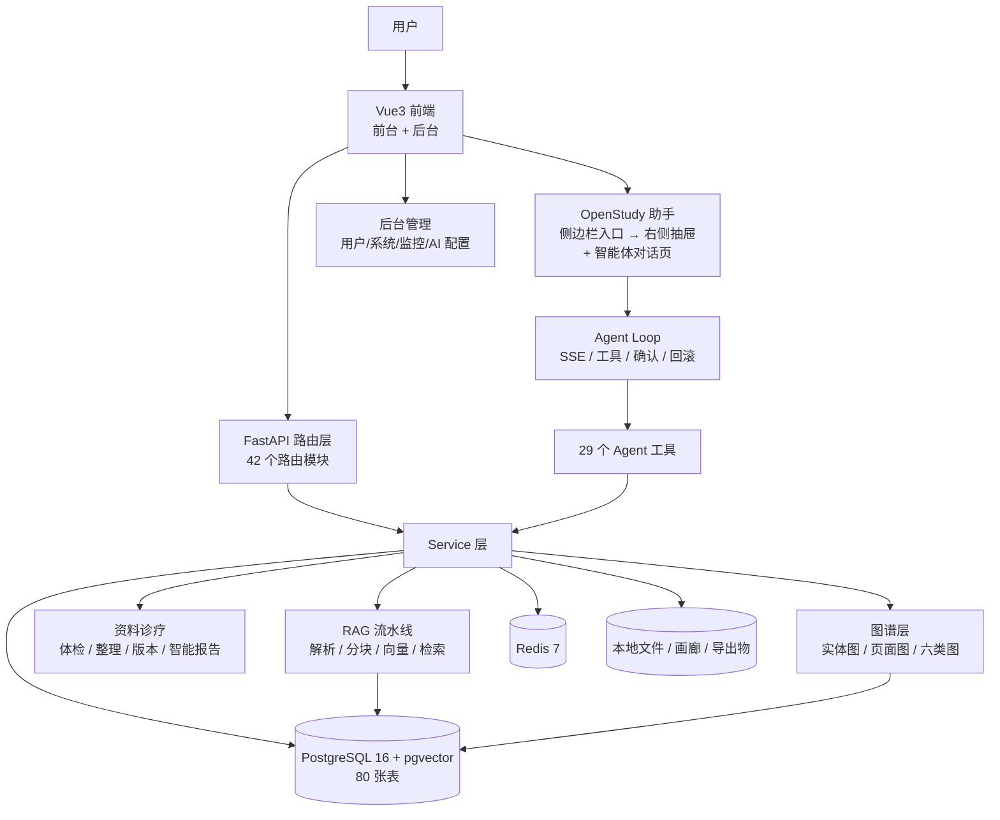
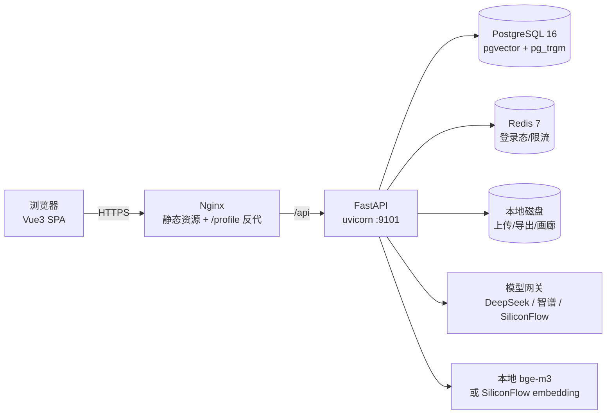

# OpenStudy 系统完整介绍与功能架构梳理

> 文档版本：v2.0（2026-11-09 修订）
> 代码基线：`main @ 58f12c7`（2026-11-09 14:59 +08:00）
> 修订重点：把产品口径从「AI 学习平台」校正为「面向用户的信息来源处理系统」；纠正「全局悬浮助手」的错误描述；补充资料诊疗室、智能报告、智能图谱的真实能力与边界；补充「一切皆对话」的分模块成熟度评估。
> 证据口径：所有结论来自代码、配置、git 历史、数据库只读查询与本地实测；无法确认的内容标为「待验证」，不写成既成事实。

---

## 0. 文档导航与结论摘要

### 0.1 这份文档回答什么

1. OpenStudy 现在是什么、面向谁、解决什么问题；
2. 当前迭代到底做了什么（不只是 README 写的 0.8.0）；
3. 每个功能模块的职责、入口、代码位置与相互依赖；
4. 用户手上的网页、图片、文档、事件记录等信息，进入系统后如何被检查、评价、生成报告与建议；
5. 智能图谱到底是什么水平：垃圾、能用还是好用；
6. 哪些模块之间已经形成闭环，哪些还是功能孤岛；
7. 「一切皆对话 / 以智能体为基石」落地到什么程度、下一步怎么补；
8. 代码质量现状与无用代码（摘要，完整清单见同目录另一份文档）。

### 0.2 一页结论

**OpenStudy 是一个面向「用户」的信息来源处理与学习资产化系统，而不是只服务学生/老师的刷题网站。** 用户每天接触的网页、图片、文档、比赛通知、学习报告、事件记录等，最终会变成手上的一个个实体文件；这些文件往往不全面、混乱。OpenStudy 以智能体为基石，把「信息来源 → 实体文件 → 解析 → 检查 → 多维评价 → 智能报告 → 实体/关系图谱 → 规划建议」串成一条可追溯的链路，学习只是其中最重要的一个场景。

本次审计的判断：

| 维度 | 评分（主观） | 依据 |
|---|---:|---|
| 产品定位与完整度 | 8.0 / 10 | 资料、RAG、题库、练习、笔记、统计、规划建议、英语、导出均有真实链路 |
| 信息来源处理闭环 | 7.5 / 10 | 上传→解析→体检→智能报告链路已存在但需手动串联；体检规则仍偏学习材料，比赛/事件类模板缺失 |
| 核心业务闭环 | 8.0 / 10 | 资料→题→练→错→诊断→建议成立；题库/笔记/资料域可双向对话 |
| 智能体主链路质量 | 9.0 / 10 | SSE、工具注册、参数守卫、确认卡、回滚、记忆、子代理齐全且工程化 |
| 模块智能体覆盖率 | 6.0 / 10 | 29 个工具覆盖核心学习域；资料诊疗室、智能报告、题库关联、知识库分享等仍无工具 |
| 智能图谱可用性 | 6.0 / 10 | 真实数据、真实边、百毫秒级响应；但前端画布没渲染六类统一图、题源锚点极少、笔记来源为空、边 ID 跨请求不稳定 |
| 代码可读性/可维护性 | 5.5 / 10 | 注释与类型基础好，但超大文件、超长函数、死代码、重复样板明显 |
| 工程质量门禁 | 6.0 / 10 | P0 已加 ruff/ESLint/Prettier/pytest/CI step；type-check 工具修复，P1 第一批后仍有 2,325 条存量错误 |
| 文档与版本一致性 | 5.0 / 10 | 文档数量多但版本双轨、README 落后于代码、子 README 仍是 Spring Boot 叙事 |

**一句话：功能是「能做」，智能体是「能办事」，信息来源处理已经有骨架；但工程质量还是「手工坊」，智能图谱是「能用但不算好用」，笔记导入资料夹还没做。当前最值得做的不是继续堆功能，而是把质量门禁接电、把无用代码清掉、把智能体覆盖到资料诊疗室与图谱。**

### 0.3 关键数字

| 指标 | 数值 |
|---|---:|
| 后端 `app/` Python 文件 | 247 个 |
| 后端 `app/` 物理行数 | 96,111 行 |
| 后端测试目录 | 28 个 `test_*.py` + 59 个 `_probe_*` + 12 个 `e2e_*`；pytest 99 passed |
| 前端 `src/` 文件 | 437 个（276 `.vue` + 161 `.ts`） |
| 前端 `src/` 物理行数 | 179,276 行 |
| 已挂载后端路由模块 | 42 个（`api/v1` 下 43 个 `.py`，含 `__init__.py`） |
| ORM 表 | 80 张 |
| Agent 注册工具 | 29 个 |
| 0.8.0 之后提交 | 48 个提交，114 个文件，+15,604 / −864 行 |
| 图谱服务 / 图谱端点 | 4 个服务 / 5 个 GET 端点（详见 2.4、3.7） |
| 本地验证库知识百科 | 109 页 / 241 条页面链接 / 704 实体 / 745 关系 |

> 本地验证库指 `openstudy_v2_pgsql` 中的测试数据（user 105/106），用于证明「有真实数据、真实边、能跑」，不代表生产环境规模。

---

## 1. 产品定位：用户的信息来源处理系统

### 1.1 一句话定位

> **把用户手上混乱、不全面的信息来源，编译成可检查、可评价、可追溯、能被智能体继续使用的个人知识资产。**

OpenStudy 的核心不是「让 AI 回答问题」，也不是只做「题库 + 刷题」，而是处理用户日常接触的信息：

- 一段网页、一份 PDF/Word、一张书页照片；
- 一份比赛通知、一份学习报告、一份课程讲义；
- 一份会议/活动记录、一份项目复盘、一份研究资料。

这些内容最终会变成用户手上的一个个实体文件。但原始文件往往缺章节、缺图片说明、格式混乱、信息不完整，甚至彼此矛盾。OpenStudy 要做的，是先用规则和模型把文件「看懂」，再用多维度指标告诉用户「这份资料哪里有问题」，最后用智能报告和图谱建议告诉用户「下一步可以补什么、怎么补」。

### 1.2 用户真正面临的问题

| 用户痛点 | OpenStudy 的处理方式 |
|---|---|
| 网页、图片、文档散落各处，找不全 | 我的资料（资料夹）+ 网页导入 + 图片资产 + 对话附件统一收纳 |
| 文件内容残缺、结构混乱、图文错位 | 解析、分块、章节识别、图片归属、资料体检逐项指出问题 |
| 不知道一份资料「好不好、缺什么」 | 结构完整度、图文相关度、知识覆盖度、可学习化程度四维评分 + P1/P2 问题清单 |
| 看完报告还是不知道下一步做什么 | 智能报告给出更新目标、优势、改进项、下一步与风险；不排任务、不强制跳转 |
| 资料之间没有关系，知识是孤岛 | 实体/关系抽取、知识百科主题页、页面级图谱、六类节点统一图 |
| 题库/笔记与资料脱节 | 题库可逻辑关联到资料夹并抽取知识点；笔记导入资料夹后端表/服务/API 已补，前端入口与 Agent 工具待接（见 3.9/4.4） |
| AI 只会聊天，不能办事 | 29 个 Agent 工具直接读写题库、笔记、资料、图谱、统计、导出 |

### 1.3 目标用户：写「用户」，不写「学生/老师」

OpenStudy 的面向对象是**用户**。学生、教师、内容创作者、知识工作者都只是用户的一种身份，不是产品边界。

| 用户类型 | 典型信息来源 | 想解决的问题 |
|---|---|---|
| 备考/自学者 | 教材、课件、真题、错题、学习报告 | 把资料变成可练习、可复习、可追踪的学习资产 |
| 知识工作者 | 网页、行业报告、会议纪要、项目文档 | 快速检查资料完整性，形成结构化知识与行动建议 |
| 内容创作者 | 讲义、素材图、旧文档、题库 | 把混乱素材整理成可复用、可分享的内容包 |
| 活动/竞赛参与者 | 比赛通知、报名文件、赛制说明、事件记录 | 从通知中抽出资格、截止时间、赛制、评审标准等关键实体，形成准备建议 |
| 培训/内容输出用户 | 课程资料、试题、学员反馈 | 生成讲义、复习卷、微课与可分享题库 |

> 前端全量检索「学生/老师/教师」共 20 处字面命中，其中真正把产品对象写成「在校学生」的只有旧首页 `views/index.vue:32`（该页未被路由引用），另有出题 prompt `QuestionBuilder.vue:3285` 的「学生做题时看不到它」应改成「用户/做题者」；其余是课程字段（授课教师/最大学生数）、试卷术语（学生卷）、智能体人设示例（数学老师），不应机械替换。本文件以「用户」为准。

### 1.4 信息来源处理模型（本系统的核心心智模型）

```text
信息来源层          实体文件层              结构层                  诊断层                    建议层
网页 / 图片 / 文档 → 我的资料（资料夹） → 解析 / 分块 / 章节 /    → 资料体检（四维）      → 智能报告（更新目标/
比赛通知 / 学习报告   文档 / 图片资产        图片 / 实体 / 关系        问题清单 / 热力图       优势/改进项/下一步）
事件记录 / 会议纪要                         知识百科主题页            版本对比                 实体关系图谱 + LLM 规划建议
        │                    │                    │                       │                         │
        └────────────────────┴────────── 智能体（对话 / 工具 / 确认 / 回滚 / 记忆） ─────────────┘
```

四层含义：

1. **信息来源层**：用户接触到的原始信息，可以是 URL、图片、Word/PDF/Markdown、粘贴文本；
2. **实体文件层**：进入「我的资料」后变成可管理的文档、图片资产、资料夹；
3. **结构层**：解析出章节、公式、图片位置、实体与关系，并生成知识百科主题页；
4. **诊断与建议层**：体检打分、问题清单、智能报告、图谱建议——只给判断与方向，不把用户变成任务执行器。

### 1.5 五条产品设计原则

1. **一切皆对话，但不强推对话**：对话是默认首页与跨模块工具层；OpenStudy 助手入口固定在侧边栏左上角品牌行，点击打开右侧抽屉。没有悬浮球、没有遮挡内容的全屏悬浮按钮。用户可以在页面里操作，也可以在对话里让智能体代做。
2. **资料资产化**：对话附件、页面上传、网页导入统一进入「我的资料/知识库」；图片不是附件，是有 `assetKey`、来源、描述的资产。
3. **真实来源、不伪造**：RAG 问答在无命中时不调用模型；知识百科的文档小节必须落回真实 chunk；图谱边来自真实表。注意：「无来源不生成」不是全产品保证，智能报告在无事实时仍可能给模板建议（见 3.5）。
4. **建议不强迫**：规划建议是「可反复调整的建议」，不是任务清单、不是打卡、不是「生成后跳转到某处学习/刷题」。智能报告也明确「不排任务、不要求打卡」。
5. **可执行、可追溯、可回滚**：写操作走确认卡、回滚账本、版本记录；学习建议说明依据与来源。

### 1.6 核心概念表

| 概念 | 含义 | 主要代码 |
|---|---|---|
| 资料空间 / 我的资料 | 每个用户一个默认知识库（资料夹）+ 多资料夹 | `rag/workspace_service.py`、`workspace/index.vue` |
| 知识库 | 文档集合，含解析、分块、向量、检索 | `rag/rag_write_service.py`、`rag/document_pipeline.py` |
| 资料体检 | 四维评分 + P1/P2 问题清单 + 章节热力图，纯规则、可复现 | `document_health_service.py` |
| 智能报告 | 基于体检事实的更新目标/优势/改进项/下一步，不排任务 | `document_smart_report_service.py`、`document_clinic.py` |
| 知识百科 | 由实体/关系生成的用户可读主题页，支持页面内链 | `rag/wiki_service.py`、`rag/wiki_link_service.py` |
| 实体图谱 | LLM 从资料正文抽取实体与有向关系，落 `rag_graph_entity/relation` | `rag/knowledge_graph_service.py` |
| 学习图谱 | 页面级/题库级关系图；六类节点统一图用于规划建议 | `rag/study_graph_service.py`、`rag/study_map_service.py` |
| 题库 | 题目集合，支持建库、导入、AI 出题、分享、导出 | `question_write_service.py`、`questions.py` |
| 资料夹↔题库 | 逻辑引用 `question_bank_kb_link`，不复制题目 | `question_bank_link_service.py` |
| 规划建议 | 图谱 trace + 事实锁定 + LLM 解释，不是任务清单 | `study_advice_service.py`、`study_plan.py` |
| Agent 工具 | 智能体可调用的业务能力，统一注册、确认、回滚 | `ai/agent/tools/__init__.py`、`ai/agent/registry.py` |

---

## 2. 当前迭代版本

### 2.1 版本谱系

| 版本 | 主题 | 主要能力 |
|---|---|---|
| 0.4.1 | 资料知识网络 | 画廊、引用、版本对照、资料知识图谱 |
| 0.5.0 | 知识百科 | 实体图 → 主题页、页面级图谱、Wiki RAG |
| 0.6.0 / 0.6.1 | 知识百科可编辑 | 手动编辑、版本历史、对话 CRUD |
| 0.7.0 | 智能资料阅读器 | 目录清洗、章节导航、原文阅读、选中即操作 |
| 0.7.1 | 图片描述任务持久化 | 后台任务、3 路并发、任务恢复 |
| 0.7.2 | 智能体画廊取图 | `gallery_manage` 工具 |
| 0.8.0 | 知识图谱与页面内链 | `[[page:id]]`、出链/反链、知识百科内融合图谱、首次抽取增强 |
| 0.8.0 之后（未升版本号） | 规划建议 × 统一图谱 × 题库知识化 × 资料智能报告 | 2026-11-08～09 共 48 个提交 |

### 2.2 0.8.0 发布说明中的四件事

依据 `doc/planning/OpenStudy-0.8.0-发布说明.md`：

1. **页面内链**：`[[page:<id>|<锚文本>]]`，正文渲染绿色下划线；主题页显示「本页链接到 / 反向链接」，支持手动添加/移除/刷新；删除页面时清理死链。
2. **知识百科内融合图谱**：只保留知识百科一个入口，主题页/知识图谱双视图；一个百科页面对应一个节点；节点大小按连接度、选中脉冲、拖拽缩放、WeKnora 式力导动画。
3. **首次抽取增强**：实体抽取从单次前 12 个 chunk 扩展为全文均匀采样最多 60 个、按每批 8 个分块多次抽取；实体类型扩展、别名、提及次数、12 类关系；主题页生成上限提高到 30。
4. **智能对话引用**：知识库检索同时保留文档原文与知识百科来源；回答按段落显示文档/百科 chip；引用只来自本次 `knowledge_search` 真实命中。

### 2.3 0.8.0 之后的 48 个提交（当前真正的最新迭代）

`git log --oneline c8a6d28..HEAD` = 48 个提交；`git diff --shortstat` = 114 files changed, 15,604 insertions(+), 864 deletions(-)。主线可归为六组：

| 组 | 代表提交 | 内容 |
|---|---|---|
| 规划建议/历史 | `58f12c7`、`0b49644`、`5c433c9`、`5ec41dd` | 按节点筛选建议历史、固定高度建议预览、建议时长、移除 wiki 抽屉学习状态块 |
| 知识图谱分组/性能 | `7b8ba49`、`f086637`、`d65e7ba`、`f270f78`、`8331212`、`bc73265` | 按来源实体集分组、实体集标签、分组布局、大图跳过力导、排除文档内图片独立实体集 |
| 增量更新 | `c09556a`、`a3bb8ef`、`bfc6d70`、`835d2a4`、`00b5419` | 来源级增量、并发处理来源组、限制构建量、同步引用笔记、来源图谱持久化 |
| 学习计划/工作台 | `dd9fd50`、`99394b2`、`9b7bfe9`、`b311c10`、`726a0b5` | 计划建议工作台、资料智能报告、建议移入知识图谱、移除学习雷达、移除旧学习路线入口 |
| 题库关联/知识化 | `a606bac`、`8e6b1ba`、`712f79e`、`75604c5`、`93d0d5e`、`492f683`、`63a0a3a`、`77b4a8c` | 资料夹↔题库、题库知识点抽取/筛选、题目跳转、错题实时同步 |
| 稳定性/网页引用 | `08072e8`、`31b6288`、`6f76453`、`0500da7` | 恢复中断图片描述/wiki 任务、网页结果折叠、参考来源胶囊、灰色上标引用 |

**本轮新增的后端模块：**

- 路由：`api/v1/study_plan.py`（373 行）、`wiki_update.py`（264 行）、`question_bank_link.py`（150 行）、`document_clinic.py`（62 行）。
- 服务：`study_advice_service.py`（678 行）、`rag/study_map_service.py`（662 行）、`rag/study_graph_service.py`（737 行）、`rag/source_graph_service.py`（281 行）、`source_entity_service.py`（265 行）、`source_graph_state_service.py`（272 行）、`study_plan_history_service.py`（252 行）、`study_advice_export_service.py`（154 行）、`question_bank_link_service.py`（154 行）、`document_smart_report_service.py`（263 行）、`ai_job_recovery.py`（49 行）、`ai/agent/tools/study_graph.py`（307 行）。
- 新表：`study_plan_snapshot`、`question_bank_kb_link`、`source_graph_state`。

**需要特别说明：**

- `knowledge_graph_service.py` 本轮没有修改；本轮实体入图走新增的 `source_graph_service.py`，复用原有的 `rag_graph_entity` / `rag_graph_relation` 表。
- 页面内链 `[[page:id]]` 本轮没有修改，属于 0.8.0 已有能力；本轮改的是 `wiki_service.py` 的 `doc_ids` 参数、图谱节点 `sourceType/sourceId/sourceName`、以及两处统计口径修复。

### 2.4 图谱不是「双轨」，实际是「四套服务、五个入口」

这是旧文档漏掉的关键事实。当前代码里同时存在四套「图」：

| 服务 | 数据来源 | 对外端点 | 真实用途 | 前端是否有活入口 |
|---|---|---|---|---|
| `knowledge_map_service.py` | 文档 → 章节 → 题组/图组 | `GET /rag/knowledge-map` | 旧版页面层级地图，语义弱 | ❌ 仅被零引用组件 `KnowledgeMapPanel.vue` 调用 |
| `knowledge_graph_service.py` | 文档 chunk → LLM 实体/关系 | `GET /rag/knowledge-graph`、`POST /build`、`GET /entity/{id}` | 真知识图谱底座；**文档上传后自动构建**，供知识百科生成使用 | ❌ 仅被零引用组件 `KnowledgeGraphSvgPanel.vue` 调用（API 存在但无活页面） |
| `study_graph_service.py` | 知识页 + 题库 + `QuestionSource` 桥 | `GET /rag/study-graph` | 旧版学习图；Agent `study_graph` 工具直接调用 | ⚠️ API 函数存在，主页面未直接使用 |
| `study_map_service.py` | topic/bank/document/web/note/image 六类节点 | `GET /rag/study-map` | 规划建议 workbench 的统一图；`study_advice_service.prepare_trace` 调用 | ⚠️ 仅用于「按来源更新」下拉选择，不作为主图谱视图 |

用户真正看到的「知识图谱」是 `GET /rag/wiki/graph` 返回的**主题页级页面图**（`wiki_service.get_wiki_graph`），不是实体关系图，也不是六类节点图。

> 结论：图谱能力不弱，但**入口碎片化、实体图无前台入口、四套服务重复维护**，这是「能用但不算好用」的最重要原因之一。

### 2.5 版本与文档一致性（当前硬伤）

| 位置 | 版本/表述 | 结论 |
|---|---|---|
| `VERSION:1` | 0.7.1 | 落后 |
| `openstudy-fastapi/pyproject.toml:3` | 0.7.1 | 落后 |
| `README.md:7` | 0.8.0 | 对外版本 |
| `openstudy-vue3-ts/package.json:3` | 0.8.0 | 前端版本 |
| `openstudy-fastapi/app/main.py:201,325` | 0.8.0 | 运行版本 |

其他文档/代码不一致：

- `README.md:432` 写「`api/v1/` 路由层（32 个模块）」，实际 `api/v1/` 有 43 个 `.py`、42 个已挂载路由模块。
- `README.md:336` 写「20+ 个工具」，实际注册 29 个。
- `README.md` 的 0.8.0 段落仍是「知识图谱与页面内链」，未覆盖 2026-11-08～09 的「规划建议工作台 / 资料智能报告 / 实体集分组 / 资料夹题库关联」。
- `openstudy-vue3-ts/README.md:22` 仍写「与 Spring Boot 3 后端配合」，实际后端为 FastAPI。
- `openstudy-vue3-ts/package.json:19-22` 的 `repository` 仍指向 `https://gitee.com/y_project/RuoYi-Vue.git`。
- `openstudy-vue3-ts/type-errors.txt` 是提交进仓库的 npm `EPERM` 错误日志；`ts_errors.txt` 为空文件。
- `doc/代码质量提升实施方案.md` 是 2026-10-21 的历史方案，其中「156 个文件 / 无 pytest」等基线已过时，且方案本身未真正落地。

**建议：版本号以 0.8.0 为准，但下一轮应统一升到 0.9.0 或 0.8.1，并建立单一版本源（构建时注入或读取 `VERSION`）。**

---

## 3. 功能全景

### 3.1 模块总览图



### 3.2 功能模块总表

| # | 功能域 | 主要用户入口 | 核心后端 | 核心数据 | Agent 覆盖 | 状态 |
|---|---|---|---|---|---|---|
| 1 | 智能对话 / Agent | `/front/agent/chat` + 侧边栏左上角 OpenStudy 助手入口（右侧抽屉） | `ai.py`、`agent/loop.py`、`agent/tools/*` | `ai_chat_*`、`ai_agent_*` | 自身 + 29 工具 | 核心 |
| 2 | 我的资料空间 | `/front/workspace` | `rag.py`、`workspace_service.py` | `rag_knowledge_base`、`rag_document` | `knowledge_*`、`workspace_search`、`gallery_manage` | 核心 |
| 3 | 资料解析 / RAG | 上传、知识库、检索 | `file_parser.py`、`document_pipeline.py`、`hybrid_search.py` | `rag_document_chunk` | `knowledge_search`、`knowledge_ingest` | 核心 |
| 4 | 资料诊疗室 | 资料详情 → 体检/原文阅读/智能报告/整理/版本 | `document_health_service.py`、`material_organizer.py`、`document_smart_report_service.py` | `material_organize_*`、`rag_document_section` | **无专属工具（断点 B1）** | 核心页面、Agent 缺口 |
| 5 | 知识百科 / 智能图谱 | `/front/workspace` 的百科/图谱视图 | `wiki_service.py`、`wiki_link_service.py`、`knowledge_graph_service.py`、`study_map_service.py` | `rag_wiki_page*`、`rag_graph_*` | `wiki_manage`、`study_graph`、`study_plan` | 核心 / 部分可用 |
| 6 | 题库 / 题目 | `/front/studio`、`/front/myQuestion` | `questions.py`、`question_write_service.py` | `question_bank`、`question_main`、`question_source` | `bank_manage`、`question_manage` | 核心 |
| 7 | 练习 / 考试 / 判分 | `/front/questionPractice` | `practice.py`、`question_grading_service.py` | `user_practice_session`、`user_practice_log` | 间接（`bank_manage` jumpUrl） | 核心 |
| 8 | 错题 / 收藏 / 斩题 | `/front/myQuestion/questions` | `questions.py`、`question_record_service.py` | `user_question_error/favorite/marked` | `question_flag_manage` | 核心 |
| 9 | 笔记 / 学习分享 | `/front/notes`、`/front/myQuestion/noteManage` | `notes.py`、`note_write_service.py` | `note*`、`note_question*` | `note_manage` | 核心；**笔记导入资料夹未实现** |
| 10 | 学习统计 / 学情诊断 / 规划建议 | `/front/myQuestion/myStats`、知识图谱 | `user_stats.py`、`study_diagnosis_service.py`、`study_advice_service.py` | `user_practice_log`、`study_plan_snapshot` | `learning_stats`、`study_plan`、`study_graph` | 核心 |
| 11 | 文档编排 / 导出 / 微课 | `/front/tools/docCompose`、`/front/microCourse` | `doc_compose_*`、`bank_export_service.py`、`micro_course_*` | `rag_micro_course` | `document_compose`、`bank_export`、`micro_course_generate`、`review_sheet`、`mind_map` | 核心/边缘 |
| 12 | 英语学习 | `/front/english/*` | `words.py`、`english_practice.py`、`ocr.py` | `word_books`、`words`、`english_practice_log` | `english_wordbook`、`english_practice` | 核心 |
| 13 | 分享 / 消息 / 通知 | `/front/share/*`、`/front/messages` | `bankShare.py`、`kbShare.py`、`notification.py` | `bank_share*`、`kb_share*`、`user_notification` | `bank_share_manage`；知识库分享无工具 | 核心/缺口 |
| 14 | 后台管理 / 系统支撑 | `/index`、`/system/*`、`/monitor/*` | `system.py`、`monitor*.py`、`ai_config.py` | `sys_*`、`sys_ai_config` | 无（设计上可做运营智能体） | 仅后台 |
| 15 | 实用工具 | `/front/tools/*` | `document.py`、`doc_compose.py` | — | 部分（文档编排） | 边缘（侧栏入口已注释） |

### 3.3 智能对话 / Agent（系统的基石）

**产品入口（已按当前代码校正）：**

- 默认首页 `/front/agent/chat`（`router/index.ts:61-65`）。
- **没有全局悬浮助手，也没有悬浮球。** OpenStudy 助手的入口在**侧边栏左上角品牌行的 `assistant-entry` 按钮**（`components/FrontSidebar/index.vue:48-51`，`title="OpenStudy 助手"`），点击后通过 `window.dispatchEvent(new CustomEvent('openstudy:open-assistant'))` 唤起右侧抽屉；抽屉组件是 `components/AiAssistant/index.vue`，`el-drawer direction="rtl"`。
- 侧边栏收起态只保留「展开侧边栏」按钮，助手入口不显示（`FrontSidebar:66-79`）；移动端通过侧边栏抽屉进入。
- `layout/front.vue:169` 仍挂载 `<AiAssistant v-if="isLogin && !isGuest && !isAgentPage && !isMockExamPage" />`，模拟考试页刻意隐藏，防止「考场随时问 AI」的作弊通道。
- **历史残留**：`front.vue:152` 的注释仍写「全局悬浮 AI 助手」；`AiAssistant/index.vue:511-580` 仍保留整套悬浮按钮拖拽逻辑，`1402-1431` 保留 `.float-btn { position: fixed; ... }` 样式。UI 已不渲染悬浮按钮，但这些是约 100 行无用代码，应清理（见代码质量文档）。

**技术链路：**

1. 前端 `useAgentChat.ts` 接收/解析 SSE 事件；
2. `/ai/agent/stream`（`ai.py:635`）→ `run_agent_stream`（`agent/loop.py:1160`）；
3. 注册表 `registry.py` 把 29 个工具转成 OpenAI Function Calling 定义或提示词清单；
4. `orchestrator.resolve_role` 决定本轮角色：显式指定 → 关键词 → `general`，不调用额外 LLM；
5. `_execute_tool` 统一执行工具：写操作 SAVEPOINT、`rollback_service.record_op`、`memory_hook`；
6. 确认：SSE 主链路用 `asyncio.Event` 服务端挂起等待用户确认；非流式链路用 HMAC `confirm_ticket`；
7. 结果通过 `tool_result` 事件回到前端，`AgentToolResult` 按输出契约渲染卡片。

**五类官方角色 + 通用：**

| 角色 | 负责域 | 主要工具 |
|---|---|---|
| `bank` 题库专家 | 题库、题目、错题/收藏/斩题、导出、资料出题 | `bank_manage`、`question_manage`、`question_flag_manage`、`bank_export`、`knowledge_search`、`workspace_search` |
| `note` 笔记专家 | 笔记、草稿、笔记关联 | `note_manage` 等 |
| `kb` 资料专家 | 资料/知识库、入库、检索、微课 | `knowledge_base_manage`、`knowledge_ingest`、`knowledge_search`、`workspace_search`、`micro_course_generate`；**资料体检/智能报告/整理/题库关联只会指路** |
| `stats` 学习统计专家 | 学习统计、学习建议、错题/收藏 | `learning_stats`、`question_flag_manage`、`bank_share_manage` |
| `agent_builder` 智能体专家 | 用户自定义智能体 | `agent_manage` |
| `general` 通用助手 | 兜底，全部工具（含未挂角色的 7 个工具） | 全部 |

**边界：** 具体工具矩阵与断点见第 4 章。

### 3.4 我的资料空间（资料资产层）

- 每个用户一个默认知识库/资料夹（`workspace_service.get_or_create_workspace`，`rag_knowledge_base.is_workspace=1`）。
- 入口：页面上传、整页拖拽、对话附件、网页导入、从网页搜索导入。
- 资料夹：重命名、分享、屏蔽检索、删除；分享领取方得到独立副本（`kb_copy_service.py`）。
- 资产账本：`material_asset_usage`、`content_reference` 记录图片被哪些题/笔记/主题页使用。
- 画廊：`rag_image_asset` 统一索引文档图与聊天图，支持描述/OCR/来源章节搜索；`gallery_manage` 工具可让 Agent 主动取图。
- 资料诊疗室：四维体检、原文阅读、智能报告、整理手术台、版本对照（详见 3.5）。
- 资料类型识别：`material_organizer.analyze` 用规则识别「试卷/习题/讲义/笔记/教材」，其余落到「资料」；当前本地库 45 份文档中 30 份是「资料」，且出现 GitHub README 被判为「试卷/英语」的误分类。**面向比赛通知、事件记录、行业报告等非学习材料时，类型体系明显不够**（见 3.5）。

### 3.5 资料诊疗室（资料质量层）——「上传→检查→评价→报告」的主承载

| 子能力 | 作用 | 接口/服务 | 真实状态 |
|---|---|---|---|
| 资料体检 | 结构完整度、图文相关度、知识覆盖度、可学习化程度四维评分；问题清单；章节热力图 | `document_health_service.py`、`GET /rag/workspace/documents/{doc_id}/health`（`rag.py:1602`） | **真实、纯规则、可复现**；权重 30/20/25/25；问题实际只产 P1/P2，P0 只是排序枚举占位 |
| 原文阅读 | 按章节阅读、搜索、选中即操作、图片资产、全屏 | `DocumentAnatomyPanel.vue`、`workspace/index.vue` | 真实 |
| 整理手术台 | 变更对比、逐项接受/拒绝、回滚、复检 | `material_organizer.py`、`material_structure.py`、`/workspace/organize/*` | 真实；LLM 多模态整理失败不阻断确定性整理 |
| 版本对照 | 时间线、左右 diff、分数变化、恢复生成新版本 | `doc_compare_service.py`、`/document/versions/*` | 真实；只展示真实正文与规则体检，不做 AI 评价 |
| 智能报告（本轮新增） | 输出更新目标、优势、改进项、下一步、风险；不排任务、不要求打卡 | `document_smart_report_service.py`、`POST /rag/workspace/documents/{doc_id}/smart-report/generate`（`document_clinic.py:29`） | 真实但**不写库、无历史**；LLM 失败回退模板并标记 `degraded.llmFallback` |

**体检四维的准确定义（可直接对外说明）：**

1. **结构完整度（30%）**：标题数量、章节区块数量、最长连续正文长度；没有标题直接 30 分。
2. **图文相关度（20%）**：没有图片不扣分；有图时按「找不到归属」「位置可疑」「正文无标记」扣分。
3. **知识覆盖度（25%）**：章节中有完整讲解的比例。
4. **可学习化程度（25%）**：带例题/练习的章节比例 + 按章节字数估算的可出题点。

**必须如实说明的边界：**

- 体检规则是**学习材料导向**：`可学习化程度` 会把「没有例题/练习」当作扣分项。对比赛通知、事件记录、行业报告这类不以练习为目的的资料，这个评分会天然偏低，甚至误判。要做「用户信息来源处理」，必须增加**文档类型感知的评分模板**（例如：通知类看「时间/资格/流程/联系方式」是否齐全；事件记录看「时间/地点/人物/决议/待办」；报告类看「结论/数据/来源/风险」）。
- 当前 `material_type` 规则只有五类（试卷/习题/讲义/笔记/教材），比赛通知、活动记录、研究报告都会落到「资料」；本地库已出现 GitHub README 被判为「试卷/英语」的误分类。**分类体系需要扩展，否则智能报告的「针对性」会打折。**
- 智能报告不是「无来源不生成」：体检无问题时，模板仍会给一条「资料结构基本可用」的默认改进项。它只保证「尽量依据体检事实」，不保证「没有事实就拒绝输出」。
- 智能报告每次现算、即时返回，**不写数据库、没有历史版本、刷新会重新生成**。这是当前一个明确的产品缺口（见 B20）。

> **Agent 缺口：** 资料诊疗室的体检 / 整理手术台 / 版本 diff / 智能报告 / 题库关联**都没有专属 Agent 工具**。`knowledge_base_manage` 只覆盖文档版本列表/恢复的一部分；`kb` 角色的人设明确只会「指引用户去资料诊疗室页面」。用户说「帮我体检这份资料」「给这份资料出智能报告」时，Agent 不能执行，只能指路（断点 B1）。

### 3.6 RAG 知识库（知识检索层）

1. **解析**：`file_parser.py` 拆 Word/PDF/Markdown/TXT/图片，保留章节、公式（OMML/LaTeX）、图片（`【图N】`）和图片位置。
2. **分块**：`rag/chunker.py` 按标题/语义/长度切块，`markdown` 标题强制新块；`CHUNK_SIZE=800`、`OVERLAP=100`、`MAX_CHUNKS=100`、`MAX_CONTENT_LENGTH=50000`。
3. **向量化**：`rag/embedding.py` 默认本地 `BAAI/bge-m3`（1024 维），可切云端 SiliconFlow；启动时后台预热，避免首个用户等待。
4. **索引**：PostgreSQL `pgvector` HNSW + `pg_trgm`/GIN 全文索引。
5. **检索**：`rag/hybrid_search.py` 向量 + 关键词双路召回，RRF（k=60）按排名融合。
6. **使用**：`knowledge_search` 工具把命中的原文、图片、wiki 小节返回给 Agent；回答引用只来自真实 `hits`。`POST /rag/ask` 在无命中时直接返回兜底话术、不调用模型——这是全系统「无来源不生成」真正成立的地方。

### 3.7 知识百科 / 智能图谱（知识组织层）

#### 3.7.1 真实链路

- **入口位置**：知识百科没有独立路由，它是 `/front/workspace` 页内的第 4 个 tab（`workspace/index.vue:1348-1353`，`viewMode === 'wiki'`）；主题页/知识图谱双视图在 `KnowledgeWikiPanel.vue:19-21`。
- **实体抽取（自动）**：文档上传并向量化成功后，`document_pipeline._run` 自动调用 `knowledge_graph_service.build_graph(doc_ids=[doc.id])`，从 chunk 抽实体与有向关系，写 `rag_graph_entity` / `rag_graph_relation`。失败只记日志，不影响文档解析状态。
- **主题页生成**：`wiki_service.build_wiki_pages` 从实体/关系/来源 chunk 生成主题页，每个小节必须落回真实 chunk；不生成无来源小节（文档来源路径成立）。
- **页面内链**：正文 `[[page:id|锚文本]]`，`wiki_link_service` 解析/归一化/补链；详情显示出链/反链；删除页面清理死链。
- **页面图谱**：`GET /rag/wiki/graph` 返回主题页级节点与边（页面链接 + 正文内链即时投影），这是用户在「知识图谱」视图里真正看到的图。
- **六类节点统一图**：`study_map_service.build_study_map` 请求期聚合 `topic / bank / document / web / note / image` 六类节点，所有节点来自真实表，没有真实关系不画假边；`study_advice_service.prepare_trace` 用它生成规划建议的 trace。
- **来源实体集与增量**：`source_graph_service.py` + `source_graph_state_service.py` 把文档/网页/图片/题库/笔记按来源抽成实体集，记录 `contentHash` 与 `done/pending/failed`，增量只处理变化来源。
- **用户可见的筛选**：图谱右侧是「主题页类型」图例（摘要/实体/概念/综合/对比/总览，`KnowledgeWikiPanel.vue:481-488`），不是 `sourceTypes` 六类筛选；`sourceTypes: ['wiki','bank','document','web','note','image']` 只是 `KnowledgeAdviceHost.vue:99-110` 写死的 API 参数，用户不可见、不可改。工具栏「按来源更新」下拉只有文档/图片/题库/网页四项，`wiki` 与 `note` 没有 UI 入口。

#### 3.7.2 可用性结论：**能用（6/10），局部好用，整体还不是「好用」**

**实测证据（2026-11-09，直接调用服务层 + 线上 PostgreSQL 只读查询）：**

| 对象 | 结果 |
|---|---|
| 本地库 `rag_wiki_page` | 109 页（concept 77 / synthesis 19 / entity 11 / comparison 2；全部 status=ready） |
| 本地库 `rag_wiki_page_link` | 241 条（mention 178 / related 29 / part_of 28 / prerequisite 6） |
| 本地库 `rag_graph_entity` / `rag_graph_relation` | 704 / 745；孤儿关系 0、重名 0；实体 682/704 带 doc_ids、638/704 带 chunk_ids；关系 723/745 带 doc_ids |
| 本地库 `rag_document` / `rag_document_chunk` | 45（全部 status=5 已向量化）/ 301 |
| 本地库 `question_bank` / `question_main` / `question_source` | 20 / 748 / 6（且 6 条 chunk_id 全为 NULL） |
| 本地库 `question_bank_kb_link` | 1 |
| 本地库 `note` / `content_reference` | 34（有效）/ 2 条 live（其中 note 相关 1 条指向已删文档 664，note→doc 引用 0） |
| `wiki_service.get_wiki_graph(kb=640)` | 44 节点 / 65 边 / 0.247s |
| `study_map_service.build_study_map(kb=640, 六类)` | 61 节点 / 129 边 / 0.236～0.445s；noteCount=0，`noQuestionSource=True` |
| `wiki_service.get_wiki_graph(kb=604)` | 55 节点 / 142 边 / 0.037～0.371s |
| `study_map_service.build_study_map(kb=604, 六类)` | 62 节点 / 176 边 / 0.176s；noteCount=0，`noQuestionSource=True`；bankCount=1（旧图是 6） |
| `study_map_service.build_study_map(kb=606, 六类)` | 17 节点 / 44 边 / 0.124s |
| `study_advice_service.prepare_trace(kb=604, 六类)` | 146ms，seed=topic:34，6 步 |

**为什么说「能用」：**

1. **数据真实**：页面、链接、实体、关系都有真实表记录；孤儿关系 0、重名 0；实体 682/704 带 doc_ids、638/704 带 chunk_ids，关系 723/745 带 doc_ids——不是前端随机生成的假图。
2. **主链路真实**：主题页列表 → 图谱视图 → 点节点 → 生成规划建议，代码与 UI 都存在；建议使用真实 trace，LLM 返回的未知 nodeId/edgeId 会被丢弃。
3. **性能可接受**：当前 ≤61 节点 / ≤176 边的规模，0.1～0.45 秒返回；大图有 80/120 节点上限与「跳过力导」保护。
4. **建议不是任务**：`study_advice_service` 输出 `StudyAdvice`，实测不含 `tasks/days/status/done/progress/todayTasks`；prompt 明确禁止「你今天必须/完成后/已为你安排任务」等命令式措辞；`StudyAdvicePanel.vue:79` 写着「这是建议，不是任务；不勾选、不打卡」。

**为什么还不到「好用」：**

1. **前端画布根本没渲染六类统一图**：`KnowledgeWikiPanel.vue:2008` 的画布数据来自 `getWikiGraph(kbId)`（纯 page+page_link 两类节点）；全前端 `getStudyMap` 只在 `:1856` 的「按来源更新」里用过一次，`nodes/edges` 从不渲染。后端有六类节点，用户看到的只是主题页图。
2. **非 topic 轨迹步骤被静默丢弃**：建议 trace 若出现 `bank:` / `doc:` 步骤，`adviceTraceLines`（`KnowledgeWikiPanel.vue:741-762`）用 `replace(/^topic:/,'')` + `position.get(pageId)` 定位，canvas 上查不到 → 该步骤不画线。用户看到的「图谱」与「建议」背后其实是两张不同的图。
3. **题源锚点几乎为空**：748 道题只有 6 条 `question_source` 锚点（0.8%），且 6 条 `chunk_id` 全为 NULL；`study_map` 的 `degraded.noQuestionSource=true` 在默认调用中恒真。更严重的是，`study_map_service` 在 `kb_id>0` 时用 `linked_bank_ids` 覆盖题库集合，而全库只有 1 条 `question_bank_kb_link`，导致 kb604 默认图只显示 1 个题库（旧 `build_study_graph` 返回 6 个）。
4. **笔记节点恒为 0**：`content_reference` 只有 2 条 live，其中 note 相关的 1 条 `source_id=664` 指向已删除文档（悬空引用）；`note→doc` 引用 0 条。`study_map` 的 `noteCount` 在 6 次实测中全部为 0，尽管库里有 34 条有效笔记。
5. **23 个题库来源页是「薄页」**：`generated_by='source:bank'` 的 23 页 `source_doc_ids=[]`、`source_refs=[]`，正文仅 32–38 字符；它们不是伪造（有 `entity_ids` + `generation_meta`），但让「`source_doc_ids=[]` 即不可信」的判据失效，也拉低知识百科整体质量。
6. **边 ID 跨请求不稳定（最严重缺陷）**：`_add_edge` 用 `f"e:{kind}:{len(edges)+1}"` 生成边 ID，依赖插入顺序；而建议 evidence 与前端连线 key 都按 edgeId 对齐 → 同一图两次请求 edgeId 可能不同，建议引用会漂移。节点 ID 是稳定的（`topic:{pageId}` 等），这点做对了。
7. **规模化不可行**：`build_study_graph` / `get_wiki_graph` 的页面与链接查询**没有 LIMIT**，`_trim_to_limit` 的 80 节点裁剪发生在构图之后，救不了 IO；`source_graph_state_service._has_pages` 对每个来源都全量扫页，是 O(来源×页)；没有物化图快照。30 万页级不可行，当前只适合中等规模资料夹。
8. **图谱服务四套并存**：4 个服务、5 个端点，口径不统一（详见 2.4、4.4 B24）。
9. **轨迹语义质量弱**：kb604 的 6 步 trace 全部是 `mention` 边（正文互引），呈「Gradle → C盘 → TEMP → Rust」的无语义链；原因是 `prerequisiteEdgeCount=0` 时退到优先级最高的 `mention`。建议可解释性有真实 edgeId，但路径本身不够「教学」。

**一句话评级：**

> **OpenStudy 的智能图谱是「真实数据、真实边、主题页图可用；但六类统一图没接前端、实体图没入口、笔记与题源桥接基本为空、边 ID 不稳定」。** 对于「先看知识结构、再让系统给建议」这个场景，它**能用（6/10）**；对于「从任意用户文件抽出实体、属性并给出针对性规划」这个目标，它还差三件事：前端接统一图、补题源/笔记桥接、稳定图契约与性能。

### 3.8 题库 / 题目 / 刷题（学习执行层）

- **建库**：手动创建、复制、分享副本、从资料夹导入题库、AI 出题。
- **出题**：`ai.py` 的 `/generate/questions*` 流式/同步；先 `knowledge_search` 取原文，再让模型生成，题目带 `question_source` 原文锚点。
- **题目类型**：单选/多选/判断/填空/简答/组合题；公式 KaTeX、图片按 `【图N】` 落位。
- **练习**：`practice.py` 服务端会话 `/questionPractice/session/start`、`answer`、`submit`；四种模式：顺序、随机、错题、模拟考试。
- **判分**：单选即时判，多选/判断/填空确认判，简答 AI 辅助；练习流水写 `user_practice_log`，错题实时同步 `user_question_error`。
- **错题/收藏/斩题**：`question_flag_manage` 一个工具按 `flag_type` 统一管理三张同形表。
- **导出**：`bank_export_service.py` 生成 Word/PDF，支持公式、表格、图片、答案版/学生版；`bank_export` 工具在对话中直接产出文件。
- **资料夹联动**：`question_bank_kb_link` 只记录用户/资料夹/题库三元组，不复制题目；关联后后台抽知识点，写入实体/关系并生成主题页（详见 3.10 与 4.1 E）。

### 3.9 笔记 / 学习分享

- 笔记 CRUD、草稿自动保存、公开笔记、分区、点赞、收藏、评论、导出。
- 笔记-题目、笔记-题库关联表；`content_reference` 记录笔记引用文档/主题页，供知识图谱反向同步。
- 富文本 `TiptapEditor`，图片可插入画廊资产；笔记详情可由 `MindMap` 渲染本地思维导图。
- Agent `note_manage` 支持列/读/创建/编辑/删除/草稿，写操作走确认卡。
- **笔记导入资料夹：已完成（P2 2026-11-09）。** 新增 `note_kb_link` 表、`note_kb_link_service`、4 个端点（列表/关联/取消/知识点预览）、Agent `note_kb_link` 工具，以及笔记详情页「加入资料夹」入口；关联后后台调用 `source_graph_service.sync_text_source` 抽实体/关系，`source_graph_state_service` 也把显式关联笔记纳入来源集。

### 3.10 学习统计 / 学情诊断 / 规划建议

- **学习统计**：`user_stats.py` 提供总览、分科、趋势、错因、成长、日详情。
- **学情诊断**：`study_diagnosis_service.py` 基于 `user_practice_log` 计算 fresh/lapsing/repeated_failure/mastered/overdue 等分档，生成诊断报告（PDF/Markdown）。
- **学习周报**：`learning_report_service.py` 生成周报。
- **规划建议**：`study_advice_service.py` 先按真实图谱做 trace/事实锁定，再让 LLM 写解释；`study_plan_snapshot` 存建议快照，支持历史、重命名、置顶、软删除、查看后继续。
- **重要口径**：新的规划建议**不是任务系统**，没有 `tasks/days/status/progress`；页面侧「学习处方」REST（`/rag/workspace/documents/{doc_id}/prescription/generate`）仍保留，会生成按天任务与勾选完成，属于**旧链路**，与新产品口径冲突（断点 B10）。`study_plan` 工具的旧 action（plan/today/adjust/reassess）仍返回按天任务；新 action `advise` 才是建议。
- **数据事实**：本地库 `study_plan_snapshot` 有历史快照；`study_advice_service.build_template_advice` 实测输出「title/summary/phases/suggestions/risks」，不含 tasks/days/status/done/progress。

### 3.11 文档编排 / 导出 / 微课

| 产物 | 实现 | 入口 |
|---|---|---|
| Word/PDF 讲义 | `doc_compose_service.py` + `doc_compose_renderer.py` + `mathml_omml.py` | `/front/tools/docCompose`、`document_compose` 工具 |
| 题库试卷 | `bank_export_service.py` | 题库详情导出、`bank_export` 工具 |
| 教学微课 / 资料微课 | `micro_course_service.py`、`micro_course_export_service.py` | `/front/microCourse`、`micro_course_generate` 工具 |
| 复习卷 | `review_sheet_service.py` | 学情诊断页、`review_sheet` 工具 |
| 思维导图 | `mind_map` 工具输出结构化树，前端 `MindMap` 渲染 | 对话内卡片 |
| 文档对比 | `doc_compare_service.py` | `document_compare` 工具、版本对照 |

### 3.12 英语学习

- 拍照识词：OCR/多模态从书页/PDF/Word 抽词建词库。
- 我的词库：增删改查、批量删除、搜索、朗读、导出 Anki/Excel/Word。
- 单词听写：纯听力/打字/自动听写，三档播放内容。
- 阅读练习：AI 生成短文 + 阅读理解题，即时判分。
- 学习统计：正确率趋势、模式对比、最常写错、连续天数。
- Agent：`english_wordbook`、`english_practice`，支持 `jumpUrl`；但这两个工具目前只在 `general` 角色可见（断点 B5）。

### 3.13 分享 / 消息 / 通知

- 题库分享：创建/撤销/领取独立副本，`bank_share_manage` 工具可操作。
- 知识库分享：`kbShare.py` 创建/撤销/领取，**无 Agent 工具**（断点 B8）。
- 消息中心：系统通知、@提及、分享通知；私信 `messages/chats` 路由已注释，页面为死代码。
- 通知/公告：`notification.py`、`notices.py`、`notice_front.py`；前台通知与后台公告存在重复 `/listAll` 路由，`main.py:241-243` 明确前者优先。

### 3.14 后台管理 / 系统支撑

- 用户/角色/菜单/部门/字典/参数：`system.py`、`users.py`。
- 通知公告、轮播、课程、留言、评论、敏感词：各自后台 CRUD。
- 监控：服务器、Redis 缓存、在线会话、操作日志、登录日志、定时任务、调度日志、AI 限流。
- AI 配置：模型列表、默认模型、连通性测试、知识库向量化配置。
- **智能体覆盖：后台无任何 Agent 工具 / 助手入口**。这是有意边界；如果要做「运营智能体」，需要补只读工具或后台 Copilot。

### 3.15 实用工具

`/front/tools/*`：图片水印、文档转换、文档编排、图片处理、类图生成。**侧栏入口已注释**（`FrontSidebar:573-578`），只有布局面包屑残留，属于边缘功能；文档编排是其中唯一与 Agent 打通的工具。

---

## 4. 功能关联与业务闭环

### 4.1 六条主闭环

#### 闭环 A：信息来源 → 实体文件 → 检查 → 多维评价 → 智能报告 → 建议（本轮叙事核心）

```text
网页 URL / 图片 / Word / PDF / Markdown / 粘贴文本
  → 我的资料（资料夹）
  → file_parser 解析章节/公式/图片
  → document_pipeline 分块/向量化 + 自动实体抽取
  → 资料体检：结构完整度 / 图文相关度 / 知识覆盖度 / 可学习化程度
  → 问题清单（P1/P2）+ 章节热力图 + 版本对比
  → 智能报告：更新目标 / 优势 / 改进项 / 下一步 / 风险
  → 建议（不改原文、不排任务、不强制跳转）
```

**状态：链路真实存在，但「不是自动闭环」，必须手动串联。** 上传完成后只提示「正在后台解析并建立索引」，并明确「不会自动执行智能整理，整理需要你手动点击」；用户必须自己点「资料诊疗室」→ 01 四维体检（自动加载）→ 手动切到 03 智能报告 → 手动点「生成智能报告」，才拿到纯文本建议（`workspace/index.vue:3049-3054`、`DocumentClinicDialog.vue:127-131`、`DocumentSmartReportPanel.vue:111-137`）。证据：`rag.py:1602`（health）、`document_clinic.py:29`（smart report）、`DocumentClinicDialog.vue`（三页工作台）、`DocumentSmartReportPanel.vue`（「不排任务，也不要求你打卡」）。
**主要缺口：** ① 没有一键「上传→体检→报告」的编排；② 体检评分是学习材料导向，非学习材料需类型化模板；③ 智能报告不写库、无历史；④ 这些能力没有 Agent 工具，对话里叫不动。

#### 闭环 B：资料 → 题 → 练 → 错 → 诊断 → 建议（学习场景）

```text
上传 Word/PDF/MD
  → file_parser 解析（段落/公式/图片）
  → rag_document + rag_document_chunk + 向量
  → knowledge_search 取原文
  → question_manage / AI 出题
  → question_bank / question_main / question_source
  → practice 会话判分
  → user_practice_log / user_question_error
  → user_stats 统计 / study_diagnosis 诊断
  → study_advice 规划建议
  → 回到资料/题库继续看（用户自愿，不是系统强制）
```

**状态：成立且核心。** 关键证据：`question_source` 锚点、`practice.py` 服务端会话、`user_practice_log`、`study_advice_service`。
**但注意：** 题目→资料页的锚点极少（748 题只有 6 条 `question_source`），所以「题目能回到原文依据」在数据上还没有普及。

#### 闭环 C：对话 → 工具 → 写数据 → 页面/卡片 → 继续对话

```text
用户说「用这份资料建个题库，出 10 道题」
  → Agent 选 bank_manage/question_manage
  → 确认卡（写操作）
  → 工具落库
  → 返回 jumpUrl / artifact
  → AgentToolResult 渲染「去题库看看」卡
  → 用户点进题库页
  → 页面「继续对话」回到 Agent
```

**状态：核心域成立。** 8 个工具返回 `jumpUrl`，通用 `linkJump` 卡自动渲染；题库、笔记、资料、英语页面有 `seedQuestion` 反向入口。但写后页面不主动刷新（断点 B7）。

#### 闭环 D：资料 → 知识百科 → 智能图谱 → 规划建议

```text
文档/网页/图片/题库
  → knowledge_graph_service 抽实体/关系（上传后自动）
  → rag_wiki_page / rag_wiki_page_link
  → KnowledgeWikiPanel 主题页 + 页面图
  → study_map_service 六类节点统一图
  → study_advice_service 真实 trace + LLM 建议
  → study_plan_snapshot 历史快照
```

**状态：本轮重点，基本成立。** 但图谱可视化是「主题页图」而非实体图；`study_graph` 工具只查旧页面图；图谱写回通道弱（断点 B12/B25）。建议面板本身明确写着「这是建议，不是任务；不勾选、不打卡，随时可以继续改」（`StudyAdvicePanel.vue:79`），导出文本也写「不是任务清单」；主题页详情另有一个**可选**的「去练 N 题」按钮（`KnowledgeWikiPanel.vue:224-232`），它不在建议面板内，不是强制跳转。

#### 闭环 E：资料夹 ↔ 题库 → 知识点 → 图谱 → 建议

```text
资料夹 ── question_bank_kb_link ── 题库
   │                                  │
   └── source_entity_service 抽知识点 ──┘
                     │
                     ▼
         rag_graph_entity / rag_wiki_page
                     │
                     ▼
              study_map_service 六类图
                     │
                     ▼
              study_advice_service 建议
```

**状态：本轮新增，基本成立。** 题库关联不复制题目，只建立逻辑引用；大题库按 20 题一块、最多 3 路并行抽取，并保留最多 24 个核心知识点/60 条关系。但后台抽取失败会被静默吞掉（`question_bank_link.py:41-43`），且当前只有 1 条关联记录，使用率极低。

#### 闭环 F：资料夹 ↔ 笔记 → 知识点 → 建议（已完成）

**状态：闭环成立。** `note_kb_link` 表 / service / 4 个 API / `source_graph_state` 来源集 / Agent `note_kb_link` 工具 / 笔记详情「加入资料夹」入口均已接通；关联后后台抽取实体与关系，供资料夹图谱与建议使用。

### 4.2 模块交互矩阵（主要数据流）

| 上游模块 | 下游模块 | 交互介质 | 说明 |
|---|---|---|---|
| 资料空间 | RAG | `rag_document` → `document_pipeline` | 上传即解析/分块/向量化 |
| 文档解析 | 实体图谱 | `knowledge_graph_service.build_graph` | 向量化完成后自动抽实体/关系 |
| RAG | 题库 | `knowledge_search` → `question_manage` | 先取原文再出题，题带来源 |
| 题库 | 练习 | `question_main` → `practice` | 组卷/会话/判分 |
| 练习 | 统计/诊断 | `user_practice_log`、`user_question_error` | 真实流水驱动统计 |
| 统计/诊断 | 规划建议 | `study_advice_service`、`study_plan_snapshot` | 事实锁定后 LLM 解释 |
| 资料夹 | 题库 | `question_bank_kb_link` | 逻辑引用，不复制 |
| 资料夹 | 笔记 | `note_kb_link` | 后端表/服务/4 端点已实现；前端入口与 Agent 工具待接 |
| 题库 | 知识图谱 | `source_entity_service.extract_bank_entities` → `source_graph_service.sync_bank_graph` | 题库知识点→实体/主题页 |
| 文档/网页/图片 | 知识百科 | `wiki_service.build_wiki_pages` | 主题页 + 页面内链 |
| 知识百科/图谱 | 规划建议 | `study_map_service`、`study_advice_service` | 六类节点图 + trace |
| 文档 | 资料体检/智能报告 | `document_health_service` → `document_smart_report_service` | 规则评分 → LLM/模板报告 |
| 文档版本 | 资料体检 | `diff_document_versions` | 分数变化 + 问题变化 |
| 画廊 | 知识百科/题目/文档 | `rag_image_asset`、`material_asset_usage` | 图片资产复用 |
| Agent | 所有业务域 | 29 个工具 | 读写 + 确认/回滚 |
| 后台 | 所有数据 | `sys_*`、`monitor_*` | 运营管理，无 Agent 工具 |

### 4.3 已成立的闭环（值得肯定）

1. **题库/题目/错题/收藏/斩题**：`bank_manage`、`question_manage`、`question_flag_manage` 全链路 + `jumpUrl` + 页面「继续对话」。
2. **笔记**：`note_manage` 读写 + 草稿确认卡 + 笔记页挂接题库/题目。
3. **资料/知识库**：`knowledge_base_manage`、`knowledge_search`、`knowledge_ingest`、`workspace_search` + `spaceScan` 卡 + `jumpUrl`。
4. **英语**：`english_wordbook`/`english_practice` + 页面 `seedQuestion`；虽只在 general。
5. **知识百科**：`wiki_manage` 读写（全局、写需确认）+ 「问 AI 这一页」入口。
6. **长期记忆**：`memory_search`/`memory_manage` 全局工具 + `memory_hook` 自动记忆。
7. **用户自定义智能体**：`agent_manage` + `/agent/configs` + 智能体页工具多选。
8. **确认/回滚**：SSE 主链路服务端挂起确认，非流式链路 HMAC 票据；确认卡不是「只在前端」。
9. **子代理**：`delegate_task` 元工具永久排除于子代理，防递归；指挥家模式单独挂载。
10. **资料体检/智能报告**：页面闭环真实；但 Agent 不能执行，且报告不持久化。

### 4.4 功能孤岛清单（按严重度）

| ID | 孤岛/断点 | 证据 | 影响 |
|---|---|---|---|
| **B1** | 资料诊疗室的体检 / 整理手术台 / 版本 diff / 智能报告 / 题库关联没有专属工具（`knowledge_base_manage` 只覆盖版本列表/恢复的一部分） | `rag.py:1602/2573/654`；`document_clinic.py:29`；`tools/` grep 零命中；`roles.py:239-260` kb 专家只「指路」 | 用户说「帮我体检这份资料」时 Agent 不能执行，只能让用户自己点 |
| **B2** | 前端工具标签漂移：`AgentToolResult.TOOL_LABELS` 19/28、`AgentConfirmCard` 15/28 | `AgentToolResult/index.vue:440-469`、`AgentConfirmCard/index.vue:255-273` | 9～13 个工具露出英文内部标识符，观感像半成品 |
| **B3** | `check_frontend_static.mjs` 的 `backendToolRegistry()` 把辅助模块 `learning_chart.py` 当工具文件检查，遇无 `name` 即返回 `{why}`，三条覆盖判据降级「未验证」 | `tests/check_frontend_static.mjs:1878-1896`、`:4817-4899`（代码推导，待实跑） | 前端静态守卫失效，B2 长期无人发现 |
| **B4** | 4 个写库/落盘工具游离于确认/回滚/SAVEPOINT/记忆：`study_plan`、`english_practice`、`micro_course_generate`、`review_sheet` | `loop.py:908`、`rollback_service.py:300/305`；各工具 `write_operation=False`/无 `needs_confirmation` | 写操作可能无法回退 |
| **B5** | 仅剩 2 个英语工具只在 `general` 角色可见：`english_practice`、`english_wordbook`；`chat_file_manage`/`document_compare`/`document_compose` 已挂 `kb`，`mind_map` 已挂 `note`，`review_sheet` 已挂 `stats` | `roles.py` 白名单；`orchestrator.py:155-161` | 英语专家模式仍可能找不到工具；其他已缓解 |
| **B6** | 对话附件无法入库：`chat_file_manage` 只读历史附件，`knowledge_ingest.from_attachment` 只认本轮附件 | `chat_file_manage.py:103/129`；`knowledge_ingest.py:839/862-876` | 用户说「把上次传的 Word 存进知识库」无路径 |
| **B7** | 写后页面不刷新：`goToLink()` 仅 `router.push`，无事件总线 | `AgentToolResult/index.vue:1255-1259`；`useAgentChat.ts` 刷新零命中 | 工具说写好了，已开着的列表还是旧数据 |
| **B8** | 知识库分享无工具、分享页无「问 AI/继续对话」入口 | `kbShare.py:37`；`views/front/share/` grep 零命中 | 分享副本链路在对话侧断开 |
| **B9** | 20/29 工具结果无 `jumpUrl`，写操作后只能靠文字描述找页面 | `jumpUrl` 仅 8 个文件命中；`AgentToolResult:1102-1112` 以 `jumpUrl` 为判据 | 工具结果「最后一公里」缺失 |
| **B10** | 学习计划/建议两套入口：`study_plan` 旧 action 落库按天任务 vs `study_advice_service` 新建议；`prescription/generate` 仍出按天任务+勾选完成 | `study_plan.py:105-125`、`tools/__init__.py:70-72`、`rag.py:936`、`roles.py:246-259` | 与「建议不强迫」产品口径冲突 |
| **B11** | 页面→对话上下文很薄：`/ai/bank/context/{bank_id}` 只返回 `{bankId,bankName,questionCount}`；`DELETE /conversation/bank/{id}` 自述死代码 | `ai.py:1816-1861` | 对话不知道用户当前在哪个页面、选中哪道题 |
| **B12** | 知识百科/图谱「只有展示没有回写」：`study_graph` 只读、`mind_map` 纯展示 | `study_graph.py:11-12`、`mind_map.py:146-148` | 图谱不能反向驱动学习数据 |
| **B13** | `learning_stats` 只读却声明 `write_operation=True`；`bank_export` 声明 True 但确认恒 False | `learning_stats.py:150`、`bank_export.py:190/195-204` | 工具元数据口径漂移 |
| **B14** | 私信 chats 路由组件已注释、菜单 `v-if=false`，页面 1,342 行 | `router/index.ts:361-366`、`messages/index.vue:27` | 死代码 + 用户可能看到旧入口残留 |
| **B15** | 笔记图片 `noteImage` 前端有 API/页面，后端无路由 | `api/noteImage/noteImage.ts`；后端 grep 0 命中 | 点击图片管理会 404/假成功 |
| **B16** | 敏感词 `aiGenerate` 前端调用，后端无端点 | `api/sensitiveWord/sensitiveWord.ts:49`；`sensitive_word.py` 仅 5 端点 | 后台按钮断链 |
| **B17** | 笔记收藏 `checkFavorite` / `details` / `checkNote` 前端调用，后端无端点 | `api/favoriteNote/favoriteNote.ts:43,57,64`；`notes.py` 无对应 | 收藏状态判断断链 |
| **B18** | `favorites.py` 空 router、`notice_repo.py` 无消费者 | `favorites.py:1-7`、`notice_repo.py:11` | 死代码 |
| **B19** | 旧首页 `views/index.vue`（轮播 + 不存在功能文案「自习室预约/专注计时/成就激励」）无路由 | `views/index.vue` 未在 router 引用 | 虚假功能印象，评审风险 |
| **B20** | 智能报告不写库、无历史/版本/回看 | `document_clinic.py:24-59`（无 db.add/commit）；`document_smart_report_service.generate_smart_report` 仅返回 | 刷新即重算，无法对比前后报告 |
| **B21** | 资料体检 P0 只在排序枚举里，实际只产 P1/P2 | `document_health_service.py:532` 有 `P0:0`，全文无 `_issue(..., "P0", ...)` | 对外写「P0/P1/P2 三级问题」会夸大 |
| **B22** | 智能报告降级标志边界不诚实：LLM 返回合法 JSON 但零有效改进项时用模板补齐，仍标 `llmFallback: False` | `document_smart_report_service.py:158-159, 171` | 报告来源标注可能误导 |
| **B23** | 题库知识点抽取后台失败被 `except Exception: pass` 静默吞掉 | `question_bank_link.py:41-43` | 关联成功但图谱可能为空，前端无感 |
| **B24** | 图谱四套服务/五个端点并存，口径不统一 | `knowledge_map_service`、`knowledge_graph_service`、`study_graph_service`、`study_map_service`；`rag.py:1022/1152/1194/2953`、`study_plan.py:112` | 维护成本与评审认知成本高 |
| **B25** | 实体/关系图前端入口死：`KnowledgeGraphSvgPanel.vue`（710 行）零引用；`getKnowledgeGraph` 只被它调用 | 全仓 grep `KnowledgeGraphSvgPanel` 0 引用 | 用户看不到实体图，只能看主题页图 |
| **B26** | 题源锚点极少：748 题仅 6 条 `question_source`；两个主资料夹 `noQuestionSource=True` | DB 查询；`study_graph_service.py:481` | 图谱无法把知识点连到真实题目 |
| **B27** | 笔记导入资料夹 | `note_kb_link` 表/服务/4 API、`note_kb_link` Agent 工具、笔记详情「加入资料夹」入口 | 已闭合 |
| **B28** | 体检规则/资料类型是学习材料导向：`learnability` 惩罚无练习；`material_type` 仅 5 类；GitHub README 被判「试卷/英语」 | `document_health_service.py:315-338`；`material_organizer.py:40-46`；本地库 doc 682 | 面向比赛通知/事件记录/行业报告时评分与分类会失真 |
| **B29** | 图谱边 ID 跨请求不稳定：`_add_edge` 用 `e:{kind}:{len(edges)+1}` | `study_map_service.py:327`；建议 evidence 与前端 `adviceTraceLines` 按 edgeId 对齐 | 同一图两次请求 edgeId 不同，建议引用漂移 |
| **B30** | 六类统一图没接前端画布：`KnowledgeWikiPanel` 用 `getWikiGraph`（page-only），`getStudyMap` 只用于来源下拉 | `KnowledgeWikiPanel.vue:2008` vs `:1856`；`adviceTraceLines:741-762` 丢弃非 topic 步骤 | 用户看到的图比后端能力少一半 |
| **B31** | 23 个 `source:bank` 页 `source_doc_ids=[]`、`source_refs=[]`、正文 32–38 字符 | `source_graph_service._sync_entities:129-176`；DB 查询 | 「无来源不生成」判据失效，知识百科质量被稀释 |

> 说明：B14-B19 是「静态可确认」的断链/死代码；后台动态菜单挂载的页面（carousel/courses/message 等）需查数据库 `sys_menu` 才能判定最终入口，已标「待验证」。

### 4.5 「一切皆对话」成熟度判断

先定义五级，避免把「页面上有个问 AI 按钮」当成闭环：

| 等级 | 含义 |
|---|---|
| L0 | 无任何 AI 入口 |
| L1 | 页面有「问 AI / 继续对话」按钮，但 Agent 不能读写该模块数据 |
| L2 | Agent 可读该模块（查询/检索/统计） |
| L3 | Agent 可写该模块（有确认/回滚），但写后无页面回链/刷新 |
| L4 | Agent 可读写 + 返回 `jumpUrl`/卡片 + 页面可反向继续对话 + 写后能刷新 |

| 模块 | 页面问 AI | Agent 读 | Agent 写 | 写后回链 | 等级 | 主要缺口 |
|---|---|---|---|---|---|---|
| 智能对话 / Agent | — | — | — | — | 基座 | — |
| 我的资料 | ✅ | ✅ | ✅ | ✅ | L4 | 对话附件历史入库 B6 |
| 资料解析 / RAG | ✅ | ✅ | ✅（入库） | ✅ | L4 | 无 |
| 资料诊疗室 | ✅（指路） | ❌ | ❌ | ❌ | **L1** | B1/B20 |
| 知识百科 / 图谱 | ✅ | ✅（旧图） | ✅（wiki 页） | ⚠️ | L3 | 实体图无入口 B25、六类图未产品化 B24 |
| 题库 | ✅ | ✅ | ✅ | ✅ | L4 | — |
| 练习 / 考试 | ⚠️（间接） | ❌ | ❌ | ❌ | **L1.5** | 无练习工具 |
| 错题 / 收藏 / 斩题 | ✅ | ✅ | ✅ | ✅ | L4 | — |
| 笔记 | ✅ | ✅ | ✅ | ⚠️ | L3 | 笔记导入资料夹 B27 |
| 学习统计 / 诊断 / 建议 | ✅ | ✅ | ⚠️（快照） | ⚠️ | L3 | 旧计划 B10 |
| 文档编排 / 导出 | ✅ | ✅ | ✅（文件） | ✅ | L3.5 | — |
| 英语 | ✅ | ✅ | ✅ | ✅ | L3.5（仅 general） | B5 |
| 题库分享 | ✅ | ✅ | ✅ | ⚠️ | L3 | — |
| 知识库分享 | ❌ | ❌ | ❌ | ❌ | **L0** | B8 |
| 后台管理 | ❌ | ❌ | ❌ | ❌ | **L0** | 设计边界 |
| 消息 / 通知 / 课程 / 留言 | ❌ | ❌ | ❌ | ❌ | **L0** | 无工具 |

**结论：核心资料/题库/笔记域是 L3～L4，资料诊疗室与分享/后台仍是 L0～L1。整体成熟度约 6.5/10，属于「核心域双向闭环、外围域仍有孤岛」。**

- **做得好的**：对话是默认首页；侧边栏左上角 OpenStudy 助手覆盖所有前台页面（模拟考除外）；28 工具 + 确认/回滚/记忆/子代理；8 个 `jumpUrl`；题库/笔记/资料/英语/百科有页面反向 `seedQuestion`。
- **没做到的**：后台完全无智能体；资料诊疗室、智能报告、题库关联、知识库分享、OCR/TTS、通知/课程/留言/评论/系统管理无工具；2 个英语工具只在 general；4 个写工具无确认/回退；对话无页面上下文、无写后刷新。
- **下一步**：不是「加更多工具」盲目扩张，而是先补**统一能力注册 + 页面上下文 + 刷新契约 + 角色白名单 + 写操作元数据**，再补业务孤岛。

---

## 5. 整体技术架构

### 5.1 部署架构



- 部署：`docker-compose.yml` 编排 PG + Redis + 后端 + Nginx；前端构建进 Nginx。
- 文件：`/profile` 由 Nginx 反代到后端静态目录；`/carousel-static` 由 FastAPI 挂载。
- 模型：`AI_DEFAULT_PROVIDER` + `sys_ai_config` 动态路由；本地 embedding 默认，云端可切。
- 限流：`AiRateLimitMiddleware`，每用户每分钟/每日额度可配置。

### 5.2 后端分层（实际形态）

```text
app/
├── api/v1/         42 个挂载路由模块，约 2.1 万行
├── core/           异常、响应、鉴权、限流、中间件
├── models/         32 个模块、80 张表
├── repositories/   仅 4 个文件（user/question/notice），大部分查询仍在 API/Service
├── schemas/        6 个 Pydantic 模型文件
├── services/       141 个文件、约 5.8 万行（业务主战场）
│   ├── ai/         Agent loop、工具、会话、模型客户端
│   └── rag/        解析、分块、向量、检索、百科、图谱、资料空间
└── main.py         应用入口/路由挂载/生命周期
```

**实际分层：**

- 绝大多数链路是 `api -> services -> models`；
- `repositories` 只有 3 个领域在用（user/question/notice），且 `notice_repo.py` 无消费者；
- **分层违规**：43 个 `api/v1` 文件里仍有 250+ 处直接 `select(...)`；原 4 个内联 ORM 模型（`carousel.py` / `chat.py` / `leave_message.py` / `sensitive_word.py`）已在 P1 迁入 `app/models/`。

### 5.3 前端分层

```text
src/
├── api/            约 60 个模块，按业务域封装 axios
├── components/     84 个目录，通用 UI（AgentToolResult / AiChatStream / PracticeComponent 等）
├── composables/    useAgentChat / useQuestionPractice 等状态机
├── router/         constantRoutes（前台全静态）+ dynamicRoutes（4 条后台权限路由）
├── store/          Pinia 模块（user/permission/settings/tagsView 等）
├── views/          front（用户端）+ admin/system/monitor（后台）
└── layout/         front.vue（前台壳）+ index.vue（后台壳）
```

- **前台路由全静态**：`router/index.ts`；后台菜单由后端 `getRouters` 动态下发，`permission.ts:10` 用 `import.meta.glob('views/**/*.vue')` 兜底加载。
- **组件风格**：276 个 `.vue` 中 274 个使用 `<script setup>`，其余 2 个是无脚本的模板组件；Options API 为 0。
- **Agent 卡片**：`AgentToolResult` 按输出契约渲染（`tree`→MindMap、`downloadUrl`→下载卡、`jumpUrl`→跳转卡、`studyPlanAdvice`→生成式卡片、`webResults`→网页结果卡）。
- **助手入口**：`FrontSidebar` 品牌行 `assistant-entry` → `openstudy:open-assistant` 事件 → `AiAssistant` 右侧抽屉。

### 5.4 数据架构（80 张表，按域分组）

| 域 | 代表表 |
|---|---|
| 用户/权限/系统 | `sys_user`、`sys_role`、`sys_menu`、`sys_dept`、`sys_config`、`sys_dict_*`、`sys_notice*`、`sys_job*`、`sys_oper_log`、`sys_logininfor` |
| 资料/RAG | `rag_knowledge_base`、`rag_document`、`rag_document_chunk`、`rag_document_section`、`rag_qa_record`、`rag_micro_course` |
| 知识百科/图谱 | `rag_wiki_page`、`rag_wiki_chunk`、`rag_wiki_page_link`、`rag_wiki_page_revision`、`rag_wiki_page_learning`、`rag_graph_entity`、`rag_graph_relation`、`source_graph_state` |
| 资料资产 | `rag_image_asset`、`rag_image_describe_job`、`rag_wiki_build_job`、`material_asset_usage`、`content_reference`、`material_organize_plan`、`material_organize_log` |
| 题库/练习 | `question_bank`、`question_main`、`question_sub`、`question_source`、`user_practice_session`、`user_practice_log`、`user_question_error`、`user_question_favorite`、`user_question_marked`、`user_bank_favorite`、`question_bank_kb_link` |
| 笔记 | `note`、`note_category`、`note_comment`、`note_question`、`note_question_bank`、`note_public_section`、`user_note_draft`、`user_note_favorite`、`user_note_like` |
| 学习计划/统计 | `study_plan_snapshot` |
| 对话/Agent | `ai_chat_session`、`ai_chat_message`、`ai_agent_timeline`、`ai_agent_memory`、`ai_agent_config`、`ai_agent_op_log`、`ai_agent_role_pref`、`ai_agent_tool_pref`、`chat_upload_file`、`chat_upload_image` |
| 分享 | `bank_share`、`bank_share_receive`、`kb_share`、`kb_share_receive` |
| 英语 | `word_books`、`words`、`word_learning_state`、`english_practice_log` |
| 其他 | `courses`、`user_notification`、`sys_ai_config`、`sys_ai_rate_limit_log` |

### 5.5 Agent 架构（系统基石）

```text
用户消息
  │
  ▼
/ai/agent/stream (SSE)
  │
  ▼
run_agent_stream
  ├─ resolve_role（显式/关键词/general）
  ├─ compute_exclude（角色白名单 ∩ 用户屏蔽 − 元工具）
  ├─ registry.definitions/describe（28 工具）
  ├─ LLM 流式调用
  ├─ tool_call → _prepare_tool_call → _execute_tool
  │    ├─ 参数归一化/校验
  │    ├─ 写操作：SAVEPOINT + rollback_service.record_op + memory_hook
  │    └─ 需要确认：asyncio.Event 挂起 / HMAC ticket
  ├─ tool_result 事件 → 前端 AgentToolResult
  └─ 轮数/死循环/错误自纠
```

**关键设计：**

- 不用 LangGraph：自研循环省 token、路由零 LLM、可控。
- 工具描述语言策略：模型面向英文，UI 面向中文（`label`/`description_zh`）。
- 确认卡：SSE 服务端挂起，非流式 HMAC 票据；确认不是前端装饰。
- 回滚：`ai_agent_op_log` + 域快照；题库/题目/分享/智能体四个域支持整树快照。
- 记忆：全局 `memory_search`/`memory_manage` + `memory_hook` 自动记录。

### 5.6 RAG 流水线

```text
上传 / URL / 文本 / 图片
  → 格式探测（doc/docx/pdf/md/txt/图片）
  → file_parser（章节/公式/图片/位置）
  → chunker（标题/语义/长度）
  → embedding（bge-m3 1024 维）
  → pgvector HNSW + GIN 全文
  → hybrid_search（向量 + 关键词 → RRF）
  → knowledge_search / wiki RAG / 出题
  → （文档解析成功后）knowledge_graph_service.build_graph 自动建实体图
```

### 5.7 图谱架构（四套服务）

| 层 | 服务 | 写入时机 | 消费方 |
|---|---|---|---|
| 实体层 | `knowledge_graph_service` | 文档向量化完成后自动；手动 `/knowledge-graph/build` | 知识百科生成、实体详情 API |
| 页面层 | `wiki_service`（页面 + `wiki_link_service`） | 用户点「生成/更新知识百科」或增量任务 | `GET /rag/wiki/graph`（前端主图谱）、Wiki RAG |
| 学习图（旧） | `study_graph_service` | 请求期聚合 | Agent `study_graph`、旧接口 |
| 统一图（新） | `study_map_service` | 请求期聚合 | `study_advice_service.prepare_trace`、按来源更新下拉 |

### 5.8 关键设计决策

| 决策 | 原因 | 代价/边界 |
|---|---|---|
| FastAPI 替代 Spring Boot | SSE 流式、Python AI 生态 | 部分 RuoYi 后台代码/模型仍带旧痕迹 |
| 自研 Agent loop | 省 token、可控、可测试 | `loop.py` 2,676 行，维护成本高 |
| RRF 融合 | 不手调权重，换查询稳定 | 语义/关键词权重不可细调 |
| 不引入 Neo4j | 实体/关系仍在 PG，部署轻 | 图查询能力有限，复杂图算法需自写 |
| 本地 bge-m3 默认 | 数据不出内网、免云端费用 | 首次加载 2.17GB / 43s，需要预热 |
| 图谱四套服务并存 | 历史迭代快、先上线再收口 | 口径不统一、前端入口碎片化（B24） |
| 智能报告不写库 | 先保证「能出报告」，避免过早建历史表 | 刷新即重算、无回看（B20） |

---

## 6. 「一切皆对话」落地评估与演进路线

### 6.1 已经做到的部分

1. **默认入口就是对话**：`/` → `/front/agent/chat`；旧首页轮播不再是落地页。
2. **OpenStudy 助手入口固定**：侧边栏左上角 `assistant-entry` → 右侧抽屉；模拟考页隐藏；没有悬浮球。
3. **29 个真实工具**：不是「假装调用」，工具写库后页面能查到。
4. **确认/回滚/记忆/子代理**：主链路完整，工程化程度高。
5. **8 个工具带 `jumpUrl`**：题库、资料、微课、英语有「去看看」卡。
6. **页面反向入口**：题库/资料/英语/百科页面有「问 AI 这一页/这段/这篇」的 `seedQuestion`。
7. **资料体检/智能报告**：页面闭环真实，报告不排任务、不强制跳转。

### 6.2 还不够的部分

- **模块覆盖**：42 个路由模块中，认证/用户/系统/通知/轮播/课程/留言/评论/敏感词/监控/日志/定时任务/OCR/TTS/知识库分享/仪表盘无工具。
- **资料诊疗室**：完全无工具（B1）；智能报告不持久化（B20）。
- **角色覆盖**：仅 2 个英语工具仍只在 `general`（B5，其余已在 P1 分配）。
- **写操作一致性**：4 个写库/落盘工具无确认/回退（B4）。
- **上下文**：对话不知道当前页面/选中实体；`/ai/bank/context` 只有 3 个字段（B11）。
- **刷新**：写后页面不主动刷新（B7）。
- **UI 标签**：19/28 结果卡、15/28 确认卡有中文标签（B2）。
- **分享**：知识库分享无工具、分享页无对话入口（B8）。
- **后台**：完全无智能体。
- **图谱**：实体图无前端入口、六类统一图没接前端画布、题源锚点极少、笔记来源为空、边 ID 不稳定（B25/B26/B27/B29/B30）。

### 6.3 目标架构：Agent Hub + 能力清单

建议把「工具」从「逐个手写 + 逐个挂角色」升级为**模块能力清单（Capability Manifest）**：

```text
每个业务模块声明：
{
  "module": "document_clinic",
  "capabilities": [
    {"name": "document_health", "risk": "read", "tool": "document_health", "jumpUrl": "...", "ui": "..."},
    {"name": "smart_report",   "risk": "read", "tool": "document_smart_report", "jumpUrl": "...", "ui": "..."},
    {"name": "material_organize", "risk": "write", "tool": "material_organize", "needConfirm": true}
  ],
  "agentRoles": ["kb", "general"]
}
```

配套三件事：

1. **页面上下文注入**：聊天请求带 `pageContext {route, entityType, entityId, selectionText}`；Agent 知道用户当前在看哪道题/哪份资料。
2. **数据变更事件**：工具 `tool_result` 成功后广播 `dataChanged(module, ids)`；目标页 `onActivated` 或事件监听自动重拉。
3. **覆盖测试**：CI 中自动检查「每个路由模块要么有工具，要么在豁免清单中并写明原因」；防止新模块成为新孤岛。

### 6.4 四阶段路线

| 阶段 | 时间 | 目标 | 关键动作 |
|---|---|---|---|
| Phase 1 | 1～2 周 | 把已有闭环补完整 | 修标签/角色白名单/4 个写工具确认/`pageContext`/`dataChanged`/`chat_file_manage` 入库 |
| Phase 2 | 3～4 周 | 补高价值孤岛 | 资料诊疗室 3 个只读工具（health / smart_report / organize preview）、题库关联工具、笔记导入资料夹、知识库分享工具、后台只读 Copilot |
| Phase 3 | 1～2 月 | 统一能力层 | Capability Manifest、覆盖测试、Agent 工具契约测试、页面上下文标准化、图谱四套服务收口、前端画布接 `study-map`、边 ID 内容派生 |
| Phase 4 | 持续 | 运营化 | 工具使用指标、孤岛看板、按用户任务成功率优化 |

### 6.5 建议优先补齐的 Agent 能力（按用户价值）

| 优先级 | 工具/能力 | 为什么 |
|---|---|---|
| P0 | `document_health`（体检，只读） | 用户最自然的一句话是「帮我看看这份资料有什么问题」 |
| P0 | `document_smart_report`（智能报告，只读） | 「给我一份改进报告」在对话里应直接产出 |
| P1 | `material_organize_preview`（整理预览，写前确认） | 从「报告」到「实际整理」的下一步 |
| P1 | `question_bank_link`（资料夹关联题库） | 打通题库↔资料夹的对话入口 |
| P1 | `note_kb_link` / `note_import`（笔记导入资料夹） | 补齐笔记闭环 |
| P2 | `study_advice`（建议，只读/存快照） | 图谱建议在对话内生成与回看 |
| P2 | `graph_query`（统一图谱查询，只读） | 让 Agent 能回答「这个知识点旁边有什么」 |

---

## 7. 代码质量现状与无用代码（摘要）

> 本节是摘要；完整清单、文件行号与清理优先级见 `OpenStudy-代码质量审计与无用代码清理清单.md`。

### 7.1 工程规范基线

| 项 | 后端 | 前端 |
|---|---|---|
| 语言/框架 | Python 3.11 / FastAPI / SQLAlchemy 2.0 | Vue 3.4 / TypeScript / Vite 5 / Element Plus |
| 包管理 | `requirements.txt` + `pyproject.toml` 双源，版本已漂移 | `package-lock.json` + `pnpm-lock.yaml` 双锁文件 |
| lint | ✅ P0 已加 `ruff.toml` | ✅ P0 已加 ESLint / Prettier |
| format | ✅ Prettier 基线（warn-only） | ✅ Prettier |
| type-check | ❌ 无 mypy | 🟡 工具已修复（TS 5.3.3 + 8GB heap），P1 第一批后存量 2,325 条错误 |
| test | ✅ 99 个 pytest 用例通过；✅ pytest.ini/conftest | 自研 `check_agent_dsfree.mjs`；无 vitest/jest |
| CI | ✅ 3 jobs 全绿（run `42621589258`）；pytest/ruff 已接电 | ✅ type-check 为报告型步骤，存量错误仍 2,325 |
| pre-commit | ❌ 无 | ❌ 无 |

### 7.2 代码规范现状

**做得好的：**

- 后端大量使用 `from __future__ import annotations`、`Mapped`/`mapped_column` 类型标注；
- 模块 docstring、边界说明、踩坑记录非常详细（如 `loop.py` 事件契约、`registry.py` 语言策略）；
- 日志统一 loguru，后端 `print` 0 处；
- 前端 274/276 个 `.vue` 使用 `<script setup>` + `lang="ts"`（其余 2 个为无脚本模板组件，Options API 0）；
- commit message 规范（feat/fix/perf/docs/refactor），发布说明 8 份齐全。

**主要问题：**

| 问题 | 数量/证据 |
|---|---|
| 超大文件 | 后端 `questions.py` 4,027 行、`rag.py` 3,153 行、`loop.py` 2,676 行、`wiki_service.py` 2,460 行；前端 `workspace/index.vue` 6,512 行、`QuestionBuilder.vue` 5,445 行 |
| 超长函数 | 53 个函数 ≥120 行；`run_agent_stream` 约 1,382 行跨度（`loop.py:1160`） |
| Ruff 基线 | 6,473 条（默认规则）；F401 未使用导入 116、F841 未使用变量 8、E722 裸 except 5、BLE001 宽 except 192、S110 try-except-pass 36 |
| 分层违规 | P1 已迁出 4 个 ORM 模型到 `app/models/`；API 层仍有 250+ 处内联 ORM；`api/v1` 分页样板已全部迁移到 `app/utils/pagination.py` |
| 前端类型 | `: any`/`as any` 约 1,379～1,958 处；`console.log` 已从 129～155 处降到 **56 处 / 14 文件**；14 个 >1,500 行 `.vue` |
| 死代码 | P0 已删除 17 个零引用 Vue 组件/页面、`utils/generator/*` 1,340 行、`PageWithFilter`、`views/index.vue` 旧首页、dictation 整条链路、`messages/chats.vue` 1,342 行、`AiAssistant` 悬浮按钮残留约 100 行；`npm run build:prod` exit 0 |
| 后端死代码 | `favorites.py` 空 router；`notice_repo.py` 无消费者；`test_notice.py`/`test_ds_free.py` 陈旧；`deepseek_web_client.py` 仅管理端自测引用 |
| 仓库卫生 | P0 已删 `300`、`audit_ws_summary.json`、`type-errors.txt`/`ts_errors.txt`、25 个 `.bak`，并把 `_scratch*/` 与 `doc/competition/码道架构图/` 加入 ignore；剩余 63 条历史未跟踪项（本目录文档资产另计）列 P1 |
| 版本/文档 | VERSION/pyproject 0.7.1 vs 其余 0.8.0；README 32 模块 vs 42；README 20+ 工具 vs 28；前端子 README 仍写 Spring Boot 3 |

### 7.3 测试现状

- `pytest tests`（P0 后）：**99 passed in 9.12s，exit 0**；新增 `pytest.ini` / `tests/conftest.py` / `asyncio_mode=auto`。
- 6 个 script-style 文件（`test_agent_rag_tools.py`、`test_context_memory.py`）已加入 `collect_ignore`，仍可用 `python tests/<file>.py` 手动运行；`test_notice.py` 与 `_scratch/` 干扰已清理。
- CI **不跑 pytest**（`.github/workflows/ci.yml:54-73` 只有 compileall + import app）。
- 前端 `npm run type-check` 实测 exit 1：`vue-tsc 1.8.27` 与 `typescript 5.9.3` 不兼容。
- 前端 `npm run build:prod` 实测 **exit 0**（3994 modules transformed）。

### 7.4 版本与文档一致性

见 2.5 节；这是 LLM 评审最容易一眼抓住的扣分点，建议 P0 处理。

---

## 8. 结论与建议

### 8.1 系统真正的优势

1. **信息来源处理有骨架**：不是「聊天框 + 题库」，而是从文件上传、解析、体检、评价、报告到建议都有真实代码与真实数据。
2. **智能体主链路工程化**：SSE、工具注册、守卫、确认、回滚、记忆、子代理，比大多数「LLM + prompt」项目扎实。
3. **知识组织有纵深**：RAG → 实体图 → 知识百科 → 页面图 → 六类图 → 规划建议，层层递进。
4. **「建议不强迫」有代码依据**：`study_advice_service` 明确无 tasks/days/status/done，prompt 禁止命令式措辞；智能报告面板明确「不排任务、不要求打卡」。
5. **业务工具矩阵宽**：29 个工具覆盖题库、笔记、资料、英语、统计、百科、导出等核心域。

### 8.2 当前最该做的 12 件事（按优先级）

| # | 事项 | 类型 | 预计 |
|---|---|---|---|
| 1 | 统一版本号（VERSION/pyproject 0.8.0） | 质量/一致性 | 2 分钟 |
| 2 | 修复前端 type-check（升级 vue-tsc 或锁 TS 5.3.3） | 工程质量 | 0.5 天 |
| 3 | 加 `pytest.ini` + `conftest.py`，CI 跑 `pytest tests -q` | 测试门禁 | 0.5 天 |
| 4 | 加 `ruff.toml` + `eslint`/`prettier`，先宽松规则落地 | 工程质量 | 1 天 |
| 5 | 清理 63 条既有未跟踪项 + `type-errors.txt`/`ts_errors.txt` + 25 个 `.bak` | 仓库卫生 | 0.5 天 |
| 6 | 删除 17 个孤儿组件/页面、`utils/generator`、旧 dictation 链路、`AiAssistant` 悬浮按钮残留 | 死代码 | 1 天 |
| 7 | 修 5 处裸 `except`、4 个 ORM 内联模型迁出 API | 代码质量 | 1～2 天 |
| 8 | 补 `TOOL_LABELS`/`ACTION_LABELS` + 7 个工具角色白名单 | Agent 闭环 | 0.5 天 |
| 9 | 给 4 个写工具加 `write_operation`/`needs_confirmation`/`undo_plan` | Agent 闭环 | 1 天 |
| 10 | 补资料诊疗室只读工具 + 智能报告工具 + 题库关联工具 | 功能孤岛 | 3～5 天 |
| 11 | 图谱四套服务收口；实体图补前端入口或明确下线 | 架构/产品 | 1 周 |
| 12 | 笔记导入资料夹（表/端点/服务/Agent/前端） | 功能补齐 | 1～2 周 |

### 8.3 一句话给团队

> **不要把精力继续花在「再加一个学习功能」上。** 现在最划算的投入是：把「用户信息来源处理」这条主线讲清楚、把质量门禁接电、把死代码清掉、把资料诊疗室与图谱接进智能体。这四件事做完，系统的「技术实现质量」会从「手工坊」变成「可辩护的工程」。

---

## 附录 A：核心 API 路由模块（节选）

| 模块 | 路由文件 | 端点数量（装饰器） | 主要职责 |
|---|---|---:|---|
| AI/Agent | `api/v1/ai.py` | 45 | 对话、Agent、生成、模型、会话 |
| 题库 | `api/v1/questions.py` | 70 | 题库/题目/错题/收藏/斩题/分享 |
| RAG | `api/v1/rag.py` | 99 | 知识库/文档/检索/百科/图谱/画廊/资料空间 |
| 笔记 | `api/v1/notes.py` | 33 | 笔记/评论/公开区/草稿 |
| 系统 | `api/v1/system.py` | 44 | 用户/角色/菜单/字典/参数 |
| 学习统计 | `api/v1/user_stats.py` | 14 | 统计/诊断/周报/学习计划 |
| 规划建议 | `api/v1/study_plan.py` | 9 | 六类图/建议/历史/导出 |
| 知识百科增量 | `api/v1/wiki_update.py` | 2 | 增量/选择更新 |
| 资料夹题库 | `api/v1/question_bank_link.py` | 4 | 关联/知识点 |
| 资料诊疗 | `api/v1/document_clinic.py` | 1 | 智能报告 |
| 练习 | `api/v1/practice.py` | 5 | 会话/作答/交卷 |
| 英语 | `api/v1/english_practice.py` | 7 | 练习记录/统计/掌握度 |
| 分享 | `api/v1/bankShare.py` / `kbShare.py` | 7 / 6 | 题库/知识库分享 |
| 后台监控 | `api/v1/monitor*.py` | 10 / 21 | 服务/缓存/日志/任务/限流 |

## 附录 B：29 个 Agent 工具

| # | 工具 | 业务模块 | 读写 | 角色 |
|---:|---|---|---|---|
| 1 | `agent_manage` | 用户自定义智能体 | R/W | agent_builder |
| 2 | `bank_manage` | 题库 | R/W | bank |
| 3 | `bank_export` | 题库导出 | W(文件) | bank |
| 4 | `bank_share_manage` | 题库分享 | R/W | stats |
| 5 | `delegate_task` | 元工具/子代理 | 元 | 指挥家专属 |
| 6 | `document_compose` | 文档编排 | W(文件) | kb |
| 7 | `document_compare` | 文档对比 | W(文件) | kb |
| 8 | `english_practice` | 英语练习记录 | R/W | 仅 general |
| 9 | `english_wordbook` | 英语词库 | R/W | 仅 general |
| 10 | `gallery_manage` | 画廊图片 | R | GLOBAL |
| 11 | `knowledge_base_manage` | 资料/知识库 | R/W | kb |
| 12 | `knowledge_ingest` | 资料入库 | W | kb |
| 13 | `knowledge_search` | 资料检索 | R | bank/kb |
| 14 | `learning_stats` | 学习统计 | R(+图表) | stats |
| 15 | `memory_manage` | 长期记忆 | R/W | GLOBAL |
| 16 | `memory_search` | 记忆检索 | R | GLOBAL |
| 17 | `micro_course_generate` | 教学微课 | W | kb |
| 18 | `note_manage` | 笔记 | R/W | note |
| 19 | `question_flag_manage` | 错题/收藏/斩题 | R/W | bank/stats |
| 20 | `question_manage` | 题目 | R/W | bank |
| 21 | `review_sheet` | 复习卷 | W(文件) | stats |
| 22 | `workspace_search` | 工作空间找文件 | R | bank/kb |
| 23 | `chat_file_manage` | 对话附件 | R | kb |
| 24 | `mind_map` | 思维导图 | R(生成) | note |
| 25 | `wiki_manage` | 知识百科 | R/W | GLOBAL |
| 26 | `web_search` | 网页搜索 | R | GLOBAL |
| 27 | `study_graph` | 知识图谱查询 | R | GLOBAL |
| 28 | `study_plan` | 学习计划/建议 | R/W | GLOBAL |
| 29 | `note_kb_link` | 笔记↔资料夹 | R/W | note/kb |

> 注：`document_health`、`document_smart_report`、`material_organize`、`question_bank_link`、`note_import` 仍**不在**本表中——其中笔记导入已有 `note_kb_link` 工具，`note_import` 名称未注册；其余是 B1 的缺口。

## 附录 C：关键文件索引

| 主题 | 文件 |
|---|---|
| 应用入口/路由挂载 | `openstudy-fastapi/app/main.py:240-315` |
| Agent 循环 | `openstudy-fastapi/app/services/ai/agent/loop.py` |
| 工具注册 | `openstudy-fastapi/app/services/ai/agent/tools/__init__.py:49-146` |
| 角色/编排 | `openstudy-fastapi/app/services/ai/agent/roles.py`、`orchestrator.py` |
| 资料空间 | `openstudy-fastapi/app/services/rag/workspace_service.py` |
| 资料体检 | `openstudy-fastapi/app/services/document_health_service.py` |
| 智能报告 | `openstudy-fastapi/app/services/document_smart_report_service.py`、`api/v1/document_clinic.py` |
| 资料夹↔题库 | `openstudy-fastapi/app/services/question_bank_link_service.py`、`api/v1/question_bank_link.py` |
| 知识百科 | `openstudy-fastapi/app/services/rag/wiki_service.py` |
| 实体图谱 | `openstudy-fastapi/app/services/rag/knowledge_graph_service.py` |
| 六类图/建议 | `openstudy-fastapi/app/services/rag/study_map_service.py`、`study_advice_service.py` |
| 前端路由 | `openstudy-vue3-ts/src/router/index.ts` |
| 侧边栏助手入口 | `openstudy-vue3-ts/src/components/FrontSidebar/index.vue:48-51` |
| 助手抽屉 | `openstudy-vue3-ts/src/components/AiAssistant/index.vue` |
| 资料诊疗室 | `openstudy-vue3-ts/src/views/front/workspace/components/DocumentClinicDialog.vue` |
| 智能报告面板 | `openstudy-vue3-ts/src/views/front/workspace/components/DocumentSmartReportPanel.vue` |
| 知识百科面板 | `openstudy-vue3-ts/src/views/front/workspace/components/KnowledgeWikiPanel.vue` |

## 附录 D：审计方法与证据

- 静态：`git log/diff/status`、`rg`/`grep`、文件行数统计、Python AST 函数长度分析、`ruff check app --statistics`。
- 运行（P0 后）：`pytest tests`（99 passed / exit 0）、`ruff check app --select E9,F63,F7,F82`（All checks passed）、`npm run lint`（0 errors / 3,261 warnings）、`npm run type-check`（可执行，P1 第一批后仍报 2,325 条存量错误）、`npm run build:prod`（exit 0）。
- 数据库只读：`openstudy_v2_pgsql`（本地测试库）表计数与图谱服务直接调用；`wiki_service.get_wiki_graph` / `study_map_service.build_study_map` 实测 0.03～0.27 秒。
- 子代理审计：前端入口（Hy4）、资料诊疗/题库闭环（Hy4）、智能图谱（MiniMax-M3.1-Flash）、文档纠偏（MiniMax-M3.1-Flash）；主代理复核关键结论并补齐交叉证据。
- 限制：本报告不替代运行时全量回归；标「待验证」的动态菜单、后台页面入口、部分工具回执字段需在真实环境进一步确认。
