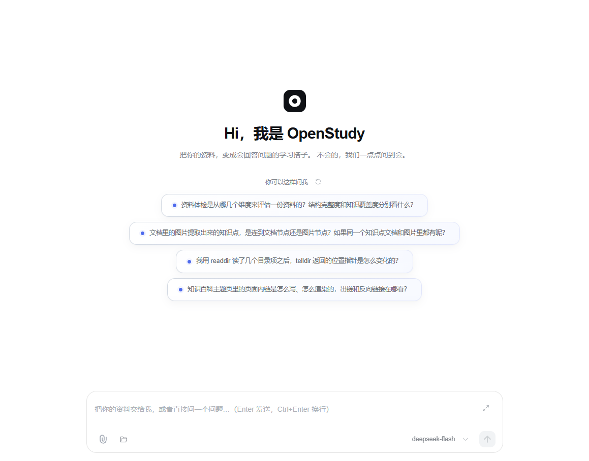
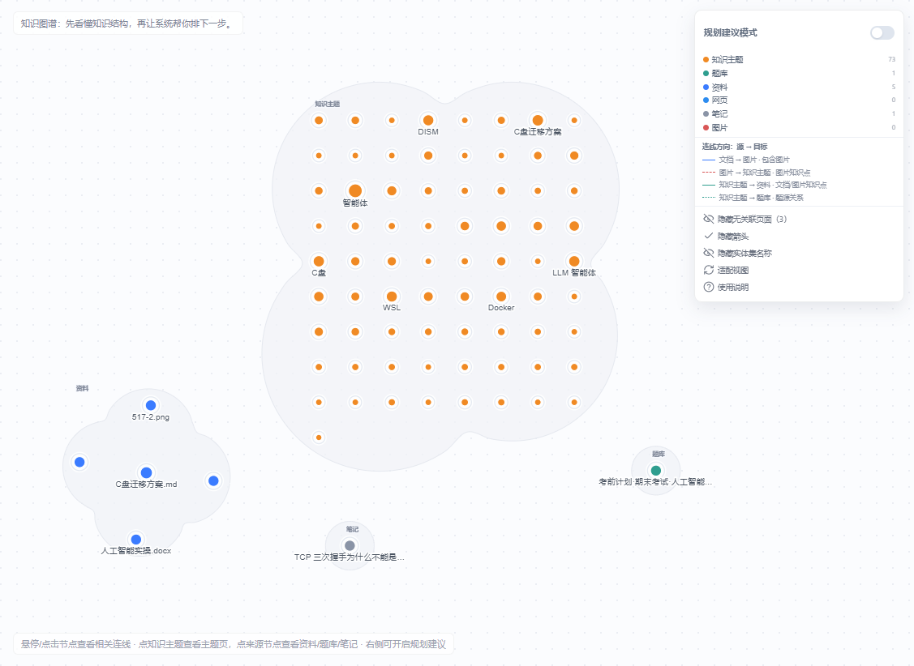

# OpenStudy Frontend

OpenStudy 的 Vue 3 + TypeScript 前端。

> 完整产品介绍、功能截图与部署说明见根目录 [README.md](../README.md)。

## 技术栈

- Vue 3.4
- TypeScript
- Vite 5
- Element Plus
- Pinia
- Vue Router

## 本地开发

```powershell
npm install
npm run dev
```

默认开发地址：`http://localhost:3167`

后端默认地址：`http://localhost:9101`

## 构建

```powershell
npm run build:prod
```

## 主要页面

| 路径 | 页面 |
|---|---|
| `/front/agent/chat` | 智能对话 / OpenStudy 助手 |
| `/front/workspace` | 我的资料、资料夹、画廊、知识百科与知识图谱 |
| `/front/questionPractice` | 题库练习 |
| `/front/studio` | 题库搭建 |
| `/front/myQuestion/myStats` | 学习统计 |
| `/front/notes` | 学习分享与笔记 |

## 目录结构

```text
src/
├── api/                       # 后端接口封装
├── components/                # 公共组件
├── views/front/               # 前台页面
├── views/front/workspace/     # 资料空间、知识百科、知识图谱
├── views/front/agent/         # 智能对话
├── router/                    # 路由
├── store/                     # Pinia
└── utils/                     # 请求、解析、导出等工具
```

## 截图





## License

[MIT](../LICENSE)
